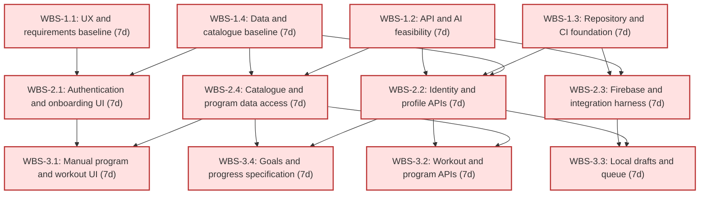
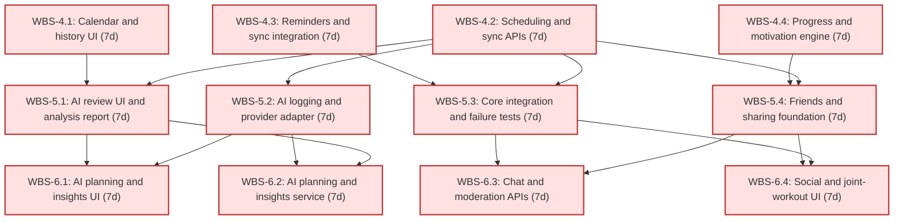
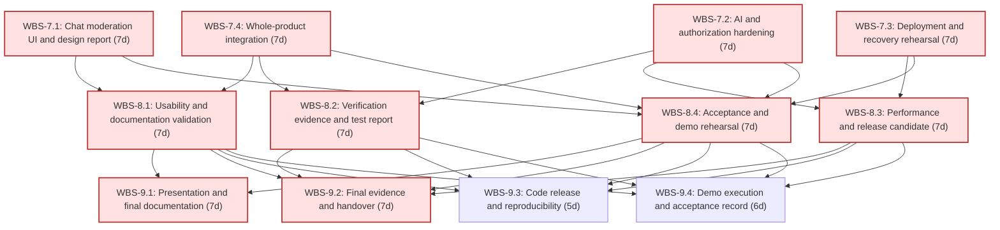
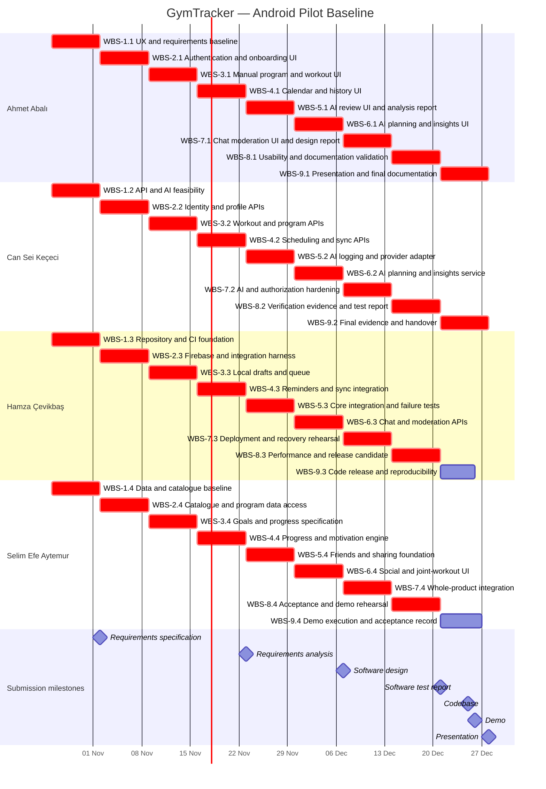

# Software Engineering — Project Plan
# GymTracker

## Cover Page

| Field | Details |
|---|---|
| Course | Software Engineering - BLG 411E |
| Report name | Project Plan |
| Project title | GymTracker: AI-assisted Fitness Planning and Tracking |
| Group name | CSHA |
| Group members | Ahmet Abalı, Can Sei Keçeci, Hamza Çevikbaş, Selim Efe Aytemur |
| Student IDs | 150240052, 150240007, 150240025, 150230070 |
| Instructor | Prof. Dr. Tolga Ovatman - Assoc. Prof. Dr. Ayşe Tosun |
| Customer | Res. Ass. Kemal Devrim Kafadar - kafadar19@itu.edu.tr |
| Product Owner | Selim Efe Aytemur - aytemur23@itu.edu.tr |
| Submission date | 26 October 2026 |
| Document version | 0.0 |
| Repository | https://github.com/kececi24/gymtracker |
## 1. Introduction

### 1.1 Scope

GymTracker is an Mobile/Android-first fitness planning and tracking application. It brings goal setting, workout planning, workout recording, progress review, and training-partner coordination into one workflow. Its intended users include beginners, fitness enthusiasts, athletes, and trainers. The broader intended audience spans ages 16 to 70 and above; this application pilot does not claim that its recommendations are clinically validated or suitable for every individual.

The central workflow is: authenticate, establish a profile and goals, select or create a program, schedule sessions, record completed exercise, review measured progress, and revise future plans. Users can record sessions manually or submit a natural-language description for conversion into a structured draft. AI-generated goals, plans, logs, and insights remain proposals. A user must inspect and explicitly confirm any proposal that changes persisted training data. Historical records and progress calculations come from stored, user-approved records rather than generated narrative.

The objective is a working application with repeatable end-to-end demonstrations, a documented architecture, traceable requirements, a reproducible deployment, and test evidence. Success measurements are meeting the release acceptance conditions in Sections 1.2 and 5.5; not proving improved physical performance in a clinical study.

**Mandatory Android pilot scope**

- Welcome screens, email and Google authentication, onboarding, editable profile, manual goals, and AI goal suggestions.
- An exercise catalogue organized by muscle group, predefined workout schemas, and manual and AI-assisted workout creation.
- Weekly and monthly calendar views, scheduling, rescheduling, cancellations, reminders, and notification preferences.
- Manual live workout logging, manual post-workout logging, natural-language post-workout logging, local draft storage, and queued synchronization.
- History, a progress dashboard, personal records, personalized insights, daily motivational quotes, and badges.
- Friend requests and connections, joint-workout invitations, explicit workout sharing, friend-group text chat, and moderation controls.
- Backend APIs, PostgreSQL persistence, Android packaging, Docker Compose deployment, a bounded Kubernetes/Helm deployment test, CI, security checks, test evidence, and documentation.

**Release boundaries and feature depth**

The pilot implements the complete feature set at demonstrable scale. The initial catalogue contains at least 20 reviewed resistance exercises covering the major muscle groups and at least three predefined programs. Chat supports persisted text messages and membership control; attachments, typing indicators, message search, and read receipts are outside this release. Joint workouts coordinate a common scheduled event while each participant keeps an independent private workout log. Badges use at least three deterministic rules, and motivational quotes come from a small curated collection. Moderation includes reporting, blocking, authorized report review, content hiding, and account restriction. These boundaries limit implementation depth without removing required features.

**Subsequent stages**

Stage 2 is a web client using the same backend; Stage 3 is an iOS client. Neither is planned for the December acceptance baseline, assigned implementation effort, or critical path. Reusable Flutter components and documented API contracts support those later stages. Dates and budgets for these stages require a separate plan after the Android pilot is accepted.

**Out of scope**

Medical diagnosis; injury assessment; rehabilitation; emergency monitoring; clinical claims; gym billing and membership administration; trainer payments; e-commerce; camera-based form analysis; automatic repetition counting; voice transcription; biometric identification; supplement, drug, or diet prescriptions; meal databases, barcode scanning, or macronutrient diaries; AI meal recognition; wearable, Bluetooth, Apple Health, Health Connect, and live heart-rate integration; autonomous AI writes; AI access to friends' private records; GPS or cardio-distance tracking; competition administration; advanced periodization automation; simultaneous editing of a shared workout log; custom model training; proprietary model-training datasets; and production-scale availability commitments.

**Planning assumptions and constraints**

As of 23 October 2026, the charter is the only completed project artifact reported by the team. No implementation or test results are assumed to exist. The implementation baseline starts on 26 October 2026. The charter deadline is 12 October and the plan deadline is 26 October; all subsequent academic deadlines remain unchanged.

Each of four members is expected to contribute 8–10 hours per week. The baseline uses eight hours, with seven allocated to planned work and one protected for contingency each week. The additional two hours are potential recovery capacity, not guaranteed capacity. Exams are distributed across the semester; individual unavailability is recorded weekly and tasks are reassigned before commitments are missed. There is no full-time team member.

The baseline includes 252 planned person-hours, 36 contingency hours, and up to 72 additional hours only if members actually confirm ten-hour availability. All human review, meetings, documentation, and validation must fit inside the assigned effort. Estimates are an initial planning model to be calibrated against measured throughput, not a guarantee that the full backlog can be implemented without adjustment.

The pilot assumes access to development laptops, an Android emulator and at least one physical Android device, GitHub, Firebase project credentials, and an authorized frontier-model API account. Hosting and monetary spending limits have not yet been allocated. The default deployment is a team-controlled Docker Compose environment; external hosting is not a release prerequisite. Paid resources require a recorded team spending limit before activation. No budget of zero and no unrestricted API credit are assumed.

### 1.2 Deliverables

Deliverables are product capabilities and supporting assets. Academic reports are submission milestones within D-10 rather than substitutes for functioning software. 

| ID | Deliverable | Contents | Acceptance criterion |
|---|---|---|---|
| D-01 | Android application and identity | Welcome, email/Google login, onboarding, profile, goals, navigation and preferences. | A new email user and a Google user can reach the dashboard; an unauthenticated request and another user’s private-record request are rejected; profile and goals persist after restart. |
| D-02 | Exercise and program management | Reviewed catalogue, templates, manual and AI-assisted program creation. | At least 20 exercises and three programs exist; a user can create, edit and reuse a program; an AI draft cannot be saved without confirmation. |
| D-03 | Calendar and notifications | Weekly/monthly views, planned sessions, invitation scheduling, reminder preferences and FCM integration. | Create, move and cancel a session; verify local-time display; a controlled-device reminder test succeeds and cancellation prevents a stale queued reminder from being dispatched. |
| D-04 | Workout records and synchronization | Live/manual post-workout entry, local drafts, durable queue, history and conflict handling. | A locally saved draft survives app restart; repeated upload of the same operation creates one logical record; an edit conflict preserves both versions until resolved. |
| D-05 | AI assistance service | Goal suggestions, program drafts, natural-language log conversion and personalized explanations. | All four workflows produce editable drafts or clear failures; malformed, ambiguous and unavailable-provider cases preserve manual workflows; AI has no direct persistence authority. |
| D-06 | Progress and motivation | Dashboard, deterministic personal records and badges, curated quotes and bounded insights. | Fixture-based calculations reproduce expected volume, session count and records; correcting/deleting a workout updates derived results; three badge rules and daily quote selection are demonstrable. |
| D-07 | Social coordination and moderation | Connections, joint invitations, sharing, group text chat, reporting, blocking and moderator actions. | Two users complete friend/invite/share/chat scenarios; a third user cannot read their restricted content; report review and moderator restrictions are auditable. |
| D-08 | Backend and data platform | ASP.NET Core APIs, PostgreSQL schema, migrations, background jobs, Firebase identity verification and OpenAPI. | A clean database migrates successfully; API contracts match implemented endpoints; ownership and membership tests pass against PostgreSQL; backup restoration is demonstrated. |
| D-09 | Delivery and verification system | CI, tests, vulnerability scans, Docker Compose, Kubernetes/Helm smoke test and Android build. | A clean checkout builds and tests using documented steps; Compose runs the pilot; Kubernetes/Helm installation and rollback smoke-test evidence exists; release has no unresolved release-blocking defect. |
| D-10 | Documentation and handover | Planning, requirements, analysis, design, test evidence, user/admin guides, AI-use record, demo and presentation materials. | All required sections and traceability links are present; another member follows setup and demo instructions; required reports and final artifacts are packaged by their milestones. |

### 1.3 Functional Requirements / Tasks

| Task ID | Task | Expected behavior / work | Deliverables |
|---|---|---|---|
| T-01 | Access and onboarding | Implement welcome, email and Google authentication, onboarding, profile editing, logout and owner-scoped account access. | D-01, D-08 |
| T-02 | Goals and preferences | Create/edit goals, capture experience and available equipment, provide AI suggestions and store notification/privacy preferences. | D-01, D-05 |
| T-03 | Exercise catalogue and templates | Browse/filter exercises by muscle group; inspect exercise definitions and select predefined programs. | D-02, D-08 |
| T-04 | Program creation | Create/edit manual programs and inspect, edit, approve or discard AI program drafts. Preserve the program version used by a workout. | D-02, D-05 |
| T-05 | Calendar and reminders | Create, reschedule, cancel and display sessions in weekly/monthly views; manage timezone-aware reminders and delivery attempts. | D-03 |
| T-06 | Manual workout logging | Start and save live sessions; record sets, repetitions and load; enter past sessions; edit/delete owned records with confirmation. | D-04 |
| T-07 | AI workout entry | Convert a text description into catalogue-mapped structured sets; flag unknown exercises, missing units and ambiguity; commit only confirmed content. | D-04, D-05 |
| T-08 | Offline persistence and synchronization | Persist manual drafts and queued writes locally; retry safely after reconnection; surface and resolve conflicting edits. | D-04, D-08 |
| T-09 | History and measured progress | Browse/filter history; show reproducible volume, completed-session frequency, exercise-specific records and muscle-group workload. | D-04, D-06 |
| T-10 | Motivation and insights | Show curated daily quotes, deterministic badges and personalized explanations grounded in the user’s approved records. | D-05, D-06 |
| T-11 | Friend connections | Send/accept/reject requests, remove friends and enforce connection/privacy rules on social APIs. | D-07 |
| T-12 | Joint workouts and sharing | Invite friends, accept/decline/cancel joint events, maintain independent logs, and explicitly share or revoke a workout summary. | D-03, D-07 |
| T-13 | Group chat | Create a friend group, manage membership and send/read persisted text messages with server-side authorization. | D-07 |
| T-14 | Moderation | Report social content, block users, review reports with moderator privileges, hide content and restrict accounts with audit evidence. | D-07, D-08 |
| T-15 | AI orchestration | Provide server-side provider adapters, response validation, bounded context, timeouts, usage controls and human-confirmation gates. | D-05, D-08 |
| T-16 | Platform and deployment | Build schema/migrations, APIs, jobs, CI, secrets configuration, Compose deployment, Helm/Kubernetes test and release artifacts. | D-08, D-09 |
| T-17 | Verification and acceptance | Execute automated and manual tests, inspect authorization/offline/AI failure paths, measure quality targets and resolve release blockers. | D-01–D-09 |
| T-18 | Project control and documentation | Maintain scope, traceability, risks, estimates, progress and reports; prepare the demonstration, presentation and handover. | D-10 |

### 1.4 Non-functional Issues

The following are acceptance targets, not claims about performance already achieved. The test report records actual results and deviations. The reference test environment is a documented development host running Compose, a physical Android test device, a controlled network, 100 seeded users, and 10,000 seeded workout-set rows. Device/host specifications and software versions are recorded before measurement.

| Quality attribute | Requirement | Assessment |
|---|---|---|
| Authorization | Every private endpoint derives identity from a verified Firebase token and checks resource ownership; chat, shared records and moderation additionally check membership/role. App Check supplements, never replaces, authorization. | Positive and negative API tests for unauthenticated, expired-token, non-owner, former-member and non-moderator access. |
| Confidentiality | Provider keys remain server-side; private logs are excluded from ordinary telemetry; networked deployments use TLS. Local caches are user-scoped and cleared on logout after warning about unsynchronized changes. | Repository/CI secret scan; inspect sanitized logs; test account switching, logout and queued-data handling. |
| AI integrity | Generated content is untrusted, schema-validated and user-reviewable. Provider output cannot call persistence operations directly. No private friend data is included in prompts. | Malformed JSON, prompt injection, foreign IDs, negative loads, invented exercises, missing units and rejected-draft cases. |
| Performance | For ordinary non-AI API requests, target p95 ≤1 second under 10 concurrent simulated users over five minutes after warm-up. Cached primary screens target ≤2 seconds on the reference device. | Record sample counts, endpoint mix, network conditions, errors and latency distribution; exclude AI and external sign-in latency explicitly. |
| AI responsiveness | Display progress immediately, allow cancellation, and terminate a provider attempt after 30 seconds. On failure expose manual entry and retain draft text. | Delayed/failed-provider tests and UI checks; timeout does not imply that provider-side execution or billing stopped. |
| Reliability | No loss of a draft acknowledged as locally saved; idempotent synchronization; explicit conflict handling; cancelled reminders are not newly dispatched. | Kill/restart app, disconnect/reconnect, duplicate requests, stale versions and cancellation/job-race tests. |
| Usability and accessibility | Readable contrast, text scaling to 200%, labelled controls and touch targets of at least 48 logical pixels on primary Android flows; visible save/sync/error states. | Widget/manual review plus five consenting adult evaluators: at least four complete a manual workout entry without facilitator intervention. |
| Calculation correctness | Metrics use documented units and eligible stored sets; corrections propagate; body-map output describes workload, not measured muscle growth or medical fitness. | Hand-computed fixtures including empty history, deleted sets, zero external load and mixed exercise categories. |
| Maintainability | Version-controlled migrations, lint/format checks, peer-reviewed changes, OpenAPI contracts and separate provider adapters. | CI evidence and review checklist; no merge with a failing mandatory check. |
| Portability | Reproducible Android/Compose pilot and a separate Kubernetes/Helm smoke test; web/iOS release support is not claimed. | Clean-checkout build, installation, migration, health check and rollback checks. |
| Recoverability | Back up PostgreSQL before release migration; restore a backup into an isolated database and verify record counts and sample records. | Restore rehearsal; target recovery within 60 minutes for the pilot dataset; report actual time. |
| Cost control | Limit AI requests and input/output sizes using configurable settings; log usage totals without raw private prompts; disable AI when the approved budget threshold is reached. | Simulated quota-exhaustion and provider-error cases; manual functions remain usable. |

### 1.5 Technical Baseline and Data Rules

The backend uses C#, .NET 10, ASP.NET Core, Entity Framework Core, REST APIs and OpenAPI. PostgreSQL is the canonical relational database and SQL dialect, including integration tests. The EF Core PostgreSQL provider is Npgsql; MySQL and Pomelo are not dependencies of this baseline. Exact framework/provider versions are pinned only after a compatibility smoke test demonstrates migration, insert, query and transaction rollback. Selecting PostgreSQL is a database-platform decision as well as a SQL-dialect decision.

The mobile client uses Flutter/Dart, Riverpod, Dio and Drift/SQLite. Firebase Authentication and Google Sign-In provide identity; Firebase Admin SDK verifies identity and manages FCM delivery. Firebase App Check is evaluated and configured for the Android pilot with an explicitly separated development configuration. The PostgreSQL database is the canonical store of synchronized records; SQLite holds local drafts and pending operations. Background jobs manage reminder dispatch and retries. Chat initially uses REST polling while the chat screen is active, with configurable intervals and pagination; no new real-time transport is necessary for acceptance.

Docker and Docker Compose provide the reproducible pilot environment. GitHub Actions runs backend xUnit tests, PostgreSQL integration tests, Flutter unit/widget tests, formatting, build checks and Trivy scans. Kubernetes and Helm are a deployment-testing workstream after the Compose pilot works. A local test cluster is sufficient; a managed production cluster is not required. Test credentials and provider stubs are kept separate from release configuration.

**AI selection and use.** The planned candidate portfolio follows the project’s frontier-model strategy: OpenAI ChatGPT 5.5 Sol/Luna/Tera and 6.0 Astra families, Anthropic Claude Opus/Sonnet 5.5 and Haiku, xAI Grok 4.6/4.7, and Google Gemini 2.5/3/3.1/3.8 Flash/4 families, with supported effort settings. These are candidate labels, not assertions that every named model has an accessible API or identical capabilities. The first technical gate records the actual provider model identifier, access entitlement, structured-output support, latency, cost and data-handling configuration. One verified primary provider and, if accessible within the same budget, one fallback provider are sufficient for the pilot; implementing every candidate is not required. A configured adapter isolates provider changes from domain logic. Cursor and frontier assistants may support development; BigQuery is not required for transactional storage or pilot acceptance.

Development assistants may draft boilerplate, tests, documentation and debugging proposals. Humans own architecture decisions, reviews, security checks and acceptance. Credentials and private user data are not pasted into development prompts. AI-generated code is reviewed and tested like other code. An AI-use log records the tool/model, purpose, affected artifact and human validation. AI is not a fifth accountable team member; estimates already assume assistance and include review/rework, so no further automatic productivity discount is applied.

**Data semantics.** Store timestamps in UTC and retain the user’s display timezone. Use stable exercise IDs and explicit units; normalize external load to kilograms. Volume is the sum of repetitions × external load for eligible resistance sets, not an estimate of physiological effort. Unweighted exercises are tracked by repetitions and are not assigned invented bodyweight load. Personal records are exercise-specific, with separate maximum load and repetition records. Program edits do not retroactively alter historical workout snapshots. Muscle-group indicators summarize recorded workload according to documented exercise tags; they do not claim to measure strength or muscle growth directly.

Client-generated operation IDs are used for queued writes, uniqueness constraints for idempotency, and a record version for optimistic concurrency. On a stale-version response, preserve the local draft, retrieve the server version and request an explicit keep/edit decision. AI prompts receive only the minimum current-user context required for the request. Unknown exercises and ambiguous units require correction before confirmation. Sharing is opt-in with server-enforced visibility; revocation removes future application access but cannot retract content already observed by a recipient.

## 2. Project Plan — Work Breakdown Structure

Each WBS row is a bounded work package with one accountable owner. Its completion condition includes implementation or document production, relevant tests, integration, and peer review. Requirements are elaborated into user stories in the requirements specification. The IDs below remain stable even if dates are later rebaselined.

The five-level size scale is T (up to 2 hours), S (over 2–4), M (over 4–8), L (over 8–16), and XL (over 16). L/XL items must be decomposed before commitment. The initial work packages are intentionally sized M at seven person-hours each; this is a uniform planning envelope, not evidence that every feature has identical complexity. A work package can address multiple explicitly listed parent tasks when it integrates one vertical slice.

| WBS ID | Parent task ID(s) | Activity | Completion condition | Size |
|---|---|---|---|---|
| WBS-1.1 | T-01, T-18 | UX and requirements baseline | Map welcome-to-history journey; sketch Android screens and validation/error states; finalize specification content and acceptance cases by 1 November. | M |
| WBS-1.2 | T-15, T-16 | API and AI feasibility | Define API boundaries; verify an accessible model identifier and structured draft; check .NET/EF/Npgsql compatibility and record decision. | M |
| WBS-1.3 | T-16 | Repository and CI foundation | Create backend/Flutter skeletons, Compose PostgreSQL, secrets example and CI build/test jobs; prove clean checkout starts. | M |
| WBS-1.4 | T-02, T-03, T-16 | Data and catalogue baseline | Define entities/ownership and units; create first migrations; curate 20 exercises and three program seeds; review goal fields. | M |
| WBS-2.1 | T-01, T-18 | Authentication and onboarding UI | Wire email/Google flows, onboarding and profile screens; submit the already prepared specification on 2 November, then cross-check implementation coverage. | M |
| WBS-2.2 | T-01, T-02, T-16 | Identity and profile APIs | Verify Firebase tokens; add owner-scoped profile and goal APIs; reject unauthenticated/foreign-user access. | M |
| WBS-2.3 | T-01, T-16, T-17 | Firebase and integration harness | Configure Android/Firebase and development App Check; run identity/migration tests against PostgreSQL; supply reusable API fixtures. | M |
| WBS-2.4 | T-03, T-04 | Catalogue and program data access | Deliver catalogue filtering and versioned program persistence; render template selection and validate seed completeness. | M |
| WBS-3.1 | T-04, T-06 | Manual program and workout UI | Create program editor and live/post-workout forms with units, set validation, confirmation and visible draft state. | M |
| WBS-3.2 | T-04, T-06 | Workout and program APIs | Implement owned program/workout create/read/edit/delete and historical snapshots; add unit/authorization tests. | M |
| WBS-3.3 | T-08, T-16 | Local drafts and queue | Persist manual drafts and queued operations in Drift; isolate accounts; prove local saves survive app termination. | M |
| WBS-3.4 | T-02, T-09 | Goals and progress specification | Wire manual goals; define and test metric fixtures, record eligibility and dashboard states; review volume/muscle-group semantics. | M |
| WBS-4.1 | T-05, T-09 | Calendar and history UI | Implement weekly/monthly navigation, schedule edit/cancel and history detail screens; finalize analysis-report content by 22 November. | M |
| WBS-4.2 | T-05, T-08 | Scheduling and sync APIs | Implement UTC scheduling, operation deduplication, version checks and sync conflict responses with PostgreSQL tests. | M |
| WBS-4.3 | T-05, T-08 | Reminders and sync integration | Integrate FCM/background jobs, retry policy and stale-reminder cancellation; exercise disconnect/reconnect and conflict UI. | M |
| WBS-4.4 | T-09, T-10 | Progress and motivation engine | Implement volume/session metrics, personal records, three badge rules and curated daily quotes; recompute after edits/deletions. | M |
| WBS-5.1 | T-07, T-18 | AI review UI and analysis report | Implement draft comparison/edit/approve/discard for text logs; submit the prepared analysis report on 23 November; maintain domain-flow and traceability updates. | M |
| WBS-5.2 | T-07, T-15 | AI logging and provider adapter | Implement bounded server context, structured parsing, catalogue mapping, timeout, quota controls and invalid-output rejection. | M |
| WBS-5.3 | T-08, T-17 | Core integration and failure tests | Run offline restart, duplicate replay, conflict, ownership and reminder-race tests; fix integration defects and preserve evidence. | M |
| WBS-5.4 | T-11, T-12 | Friends and sharing foundation | Deliver friend requests/acceptance/removal and explicit summary sharing/revocation with visibility constraints and fixtures. | M |
| WBS-6.1 | T-02, T-04, T-10 | AI planning and insights UI | Reuse review components for goal/program drafts; connect personalized insights with source metrics and manual fallback; assemble design-report content by 6 December. | M |
| WBS-6.2 | T-02, T-04, T-10, T-15 | AI planning and insights service | Generate goal/program drafts and bounded explanations; validate fields, forbid autonomous writes and test private-context isolation. | M |
| WBS-6.3 | T-13, T-14 | Chat and moderation APIs | Implement group membership, paginated text chat, report/block actions, moderator review/hide/restrict and audit events. | M |
| WBS-6.4 | T-11, T-12 | Social and joint-workout UI | Connect friends/sharing screens; implement joint invites with accept/decline/cancel and independent participant logs. | M |
| WBS-7.1 | T-13, T-14, T-18 | Chat moderation UI and design report | Connect group chat/report/block screens and moderator controls; submit the prepared design report on 7 December and maintain architecture/interface changes. | M |
| WBS-7.2 | T-15, T-17 | AI and authorization hardening | Run adversarial/ambiguous AI cases, role/ownership tests and quota/timeout paths; fix defects and freeze API contracts. | M |
| WBS-7.3 | T-16, T-17 | Deployment and recovery rehearsal | Rehearse Compose restore; create Helm configuration; install/health-check/rollback in a local Kubernetes cluster; capture evidence. | M |
| WBS-7.4 | T-09, T-12, T-17 | Whole-product integration | Test calendar/social/progress interactions, revocation and recalculation; resolve cross-screen bugs and freeze feature scope. | M |
| WBS-8.1 | T-17, T-18 | Usability and documentation validation | Run five-person adult usability sessions; verify accessibility and instructions; prepare test-report narrative and defect summary. | M |
| WBS-8.2 | T-17, T-18 | Verification evidence and test report | Execute final API/database/AI regression cases, record environment and traceability; consolidate test results for 21 December. | M |
| WBS-8.3 | T-16, T-17 | Performance and release candidate | Measure target workload, scan dependencies/images, exercise clean build/install and freeze a tested release candidate. | M |
| WBS-8.4 | T-17, T-18 | Acceptance and demo rehearsal | Execute full user/customer acceptance scenarios and data fixtures; rehearse demo, record outcomes and prepare presentation evidence. | M |
| WBS-9.1 | T-17, T-18 | Presentation and final documentation | Resolve presentation/UI/documentation defects, verify final traceability and deliver the presentation package for 28 December. | M |
| WBS-9.2 | T-17, T-18 | Final evidence and handover | Verify fixes and test addendum, finish API/user/admin notes and AI-use record, and perform final acceptance cross-check. | M |
| WBS-9.3 | T-16, T-17 | Code release and reproducibility | Tag release and package Android/code/configuration by 25 December; rebuild from tag and verify no secrets or release blockers. | M |
| WBS-9.4 | T-12, T-17, T-18 | Demo execution and acceptance record | Verify social/independent-log demo data; demonstrate on 26 December and record outcome, limitations and follow-up actions. | M |

**Decomposition and review rules.** Ahmet owns the main user journey and report assembly; Can owns backend/AI logic; Hamza owns integration/infrastructure; Selim owns data/progress/social coordination. This allocation follows the team’s roles while sharing integration work. Ahmet and Selim review one another’s client work; Can and Hamza review one another’s backend/infrastructure work. Cross-domain changes receive the affected owner’s review. Peer-review time is included in each member’s weekly envelope.

The first implementation week turns requirements into testable contracts while infrastructure and seed data progress in parallel. Detailed requirements are ready in WBS-1.1 by 1 November and submitted at the start of WBS-2.1 on 2 November; implementation continues thereafter. Analysis/design documents consolidate the evolving design before their deadlines rather than delaying all development until December. Each weekly integration gate requires the slice to build, pass its targeted tests, and expose a stable contract to dependent activities.

## 3. Estimates

### 3.1 Estimation Method

One person-week means **40 person-hours** throughout this plan; it does not mean one student’s eight-hour project week. Each M package has an initial estimate of seven hours, or 0.175 person-weeks. A typical envelope is 4.5 hours of focused implementation/authoring, 1.5 hours of testing/review/rework, and one hour of integration, coordination and documentation. The mix changes by package; the seven-hour total does not. Weekly coordination is a 20-minute team check-in, with remaining communication handled asynchronously inside that allowance.

These are bottom-up work-package budget estimates based on bounded pilot behavior, reuse of standard authentication/client libraries, generated scaffolding and a single primary model adapter. They are not historical velocity measurements or a three-point statistical PERT estimate. At the end of the first two weeks, actual hours and accepted results with the baseline are to be compared. If the remaining work no longer fits, record a revised forecast and escalate the scope/time decision rather than relabeling unfinished work as complete.

| WBS ID | Size | Effort (person-weeks) | Hours | Estimate basis |
|---|---|---|---|---|
| WBS-1.1 | M | 0.175 | 7 | UX and requirements baseline; bounded slice, tests/review and integration included. |
| WBS-1.2 | M | 0.175 | 7 | API and AI feasibility; bounded slice, tests/review and integration included. |
| WBS-1.3 | M | 0.175 | 7 | Repository and CI foundation; bounded slice, tests/review and integration included. |
| WBS-1.4 | M | 0.175 | 7 | Data and catalogue baseline; bounded slice, tests/review and integration included. |
| WBS-2.1 | M | 0.175 | 7 | Authentication and onboarding UI; bounded slice, tests/review and integration included. |
| WBS-2.2 | M | 0.175 | 7 | Identity and profile APIs; bounded slice, tests/review and integration included. |
| WBS-2.3 | M | 0.175 | 7 | Firebase and integration harness; bounded slice, tests/review and integration included. |
| WBS-2.4 | M | 0.175 | 7 | Catalogue and program data access; bounded slice, tests/review and integration included. |
| WBS-3.1 | M | 0.175 | 7 | Manual program and workout UI; bounded slice, tests/review and integration included. |
| WBS-3.2 | M | 0.175 | 7 | Workout and program APIs; bounded slice, tests/review and integration included. |
| WBS-3.3 | M | 0.175 | 7 | Local drafts and queue; bounded slice, tests/review and integration included. |
| WBS-3.4 | M | 0.175 | 7 | Goals and progress specification; bounded slice, tests/review and integration included. |
| WBS-4.1 | M | 0.175 | 7 | Calendar and history UI; bounded slice, tests/review and integration included. |
| WBS-4.2 | M | 0.175 | 7 | Scheduling and sync APIs; bounded slice, tests/review and integration included. |
| WBS-4.3 | M | 0.175 | 7 | Reminders and sync integration; bounded slice, tests/review and integration included. |
| WBS-4.4 | M | 0.175 | 7 | Progress and motivation engine; bounded slice, tests/review and integration included. |
| WBS-5.1 | M | 0.175 | 7 | AI review UI and analysis report; bounded slice, tests/review and integration included. |
| WBS-5.2 | M | 0.175 | 7 | AI logging and provider adapter; bounded slice, tests/review and integration included. |
| WBS-5.3 | M | 0.175 | 7 | Core integration and failure tests; bounded slice, tests/review and integration included. |
| WBS-5.4 | M | 0.175 | 7 | Friends and sharing foundation; bounded slice, tests/review and integration included. |
| WBS-6.1 | M | 0.175 | 7 | AI planning and insights UI; bounded slice, tests/review and integration included. |
| WBS-6.2 | M | 0.175 | 7 | AI planning and insights service; bounded slice, tests/review and integration included. |
| WBS-6.3 | M | 0.175 | 7 | Chat and moderation APIs; bounded slice, tests/review and integration included. |
| WBS-6.4 | M | 0.175 | 7 | Social and joint-workout UI; bounded slice, tests/review and integration included. |
| WBS-7.1 | M | 0.175 | 7 | Chat moderation UI and design report; bounded slice, tests/review and integration included. |
| WBS-7.2 | M | 0.175 | 7 | AI and authorization hardening; bounded slice, tests/review and integration included. |
| WBS-7.3 | M | 0.175 | 7 | Deployment and recovery rehearsal; bounded slice, tests/review and integration included. |
| WBS-7.4 | M | 0.175 | 7 | Whole-product integration; bounded slice, tests/review and integration included. |
| WBS-8.1 | M | 0.175 | 7 | Usability and documentation validation; bounded slice, tests/review and integration included. |
| WBS-8.2 | M | 0.175 | 7 | Verification evidence and test report; bounded slice, tests/review and integration included. |
| WBS-8.3 | M | 0.175 | 7 | Performance and release candidate; bounded slice, tests/review and integration included. |
| WBS-8.4 | M | 0.175 | 7 | Acceptance and demo rehearsal; bounded slice, tests/review and integration included. |
| WBS-9.1 | M | 0.175 | 7 | Presentation and final documentation; bounded slice, tests/review and integration included. |
| WBS-9.2 | M | 0.175 | 7 | Final evidence and handover; bounded slice, tests/review and integration included. |
| WBS-9.3 | M | 0.175 | 7 | Code release and reproducibility; bounded slice, tests/review and integration included. |
| WBS-9.4 | M | 0.175 | 7 | Demo execution and acceptance record; bounded slice, tests/review and integration included. |
| Total | — | 6.300 | 252 | 36 work packages × 7 hours |

### 3.2 Capacity, Reserve and Duration

| Measure | Per member | Four-member team |
|---|---:|---:|
| Planned effort per week | 7 h | 28 h |
| Protected contingency per week | 1 h | 4 h |
| Baseline available effort per week | 8 h | 32 h |
| Potential upper availability | 10 h | 40 h |
| Nine-week planned effort | 63 h / 1.575 person-weeks | 252 h / 6.300 person-weeks |
| Nine-week protected contingency | 9 h | 36 h / 0.900 person-weeks |
| Nine-week baseline capacity | 72 h | 288 h / 7.200 person-weeks |
| Potential additional capacity beyond baseline | 18 h | 72 h |

Reserve is 14.3% of planned effort, or 12.5% of baseline capacity. It covers measured rework, individual exam disruption and integration defects. It is not pre-assigned to optional web/iOS work. There is no separate nine-week reserve block; this is effort reserve within the existing calendar. 

At 0.175 FTE, a seven-hour package occupies one elapsed week: 0.175 person-weeks ÷ 0.175 FTE = 1 week. This includes coordination and waiting across a student workweek. Two members cannot automatically halve every task because serial work and reviews remain. The final code and demo packages distribute seven hours over five and six calendar days respectively; they do not require a full-time week.

## 4. Resources

### 4.1 Team Structure and Member Roles

| Member | Student ID | Role(s) | Responsibilities |
|---|---|---|---|
| Ahmet Abalı | 150240052 | Project Manager; Frontend Developer | Schedule/risk control, Android UX and forms, report assembly, usability and presentation; abali24@itu.edu.tr. |
| Can Sei Keçeci | 150240007 | Backend Developer; AI Engineer; Documenter | API/domain behavior, AI adapters/validation, backend tests, technical evidence and handover; kececi24@itu.edu.tr. |
| Hamza Çevikbaş | 150240025 | Full Stack Developer; DevOps Engineer | CI, Firebase integration, offline/sync, deployments, performance/security checks and reproducible release; cevikbash24@itu.edu.tr. |
| Selim Efe Aytemur | 150230070 | Product Owner; Frontend Developer; Database Engineer | Scope/acceptance decisions, PostgreSQL data semantics, catalogue/progress, social flows and demo; aytemur23@itu.edu.tr. |

The customer, Res. Ass. Kemal Devrim Kafadar, reviews the pilot against agreed requirements. The Product Owner maintains acceptance priorities; the Project Manager maintains the baseline. Customer attendance and response time are external dependencies, not booked development capacity. Internal acceptance tests proceed if feedback is delayed, and unresolved feedback is recorded without claiming customer approval.

### 4.2 Member-to-Activity Assignment

FTE is based on a 40-hour full-time week and average activity duration. Only one planned primary package is active per person in each weekly window. The owner is accountable for completion and arranges the peer review described in Section 2.

| WBS ID | Assigned member | Responsibility | Average activity FTE |
|---|---|---|---|
| WBS-1.1 | Ahmet Abalı | UX and requirements baseline | 0.175 |
| WBS-1.2 | Can Sei Keçeci | API and AI feasibility | 0.175 |
| WBS-1.3 | Hamza Çevikbaş | Repository and CI foundation | 0.175 |
| WBS-1.4 | Selim Efe Aytemur | Data and catalogue baseline | 0.175 |
| WBS-2.1 | Ahmet Abalı | Authentication and onboarding UI | 0.175 |
| WBS-2.2 | Can Sei Keçeci | Identity and profile APIs | 0.175 |
| WBS-2.3 | Hamza Çevikbaş | Firebase and integration harness | 0.175 |
| WBS-2.4 | Selim Efe Aytemur | Catalogue and program data access | 0.175 |
| WBS-3.1 | Ahmet Abalı | Manual program and workout UI | 0.175 |
| WBS-3.2 | Can Sei Keçeci | Workout and program APIs | 0.175 |
| WBS-3.3 | Hamza Çevikbaş | Local drafts and queue | 0.175 |
| WBS-3.4 | Selim Efe Aytemur | Goals and progress specification | 0.175 |
| WBS-4.1 | Ahmet Abalı | Calendar and history UI | 0.175 |
| WBS-4.2 | Can Sei Keçeci | Scheduling and sync APIs | 0.175 |
| WBS-4.3 | Hamza Çevikbaş | Reminders and sync integration | 0.175 |
| WBS-4.4 | Selim Efe Aytemur | Progress and motivation engine | 0.175 |
| WBS-5.1 | Ahmet Abalı | AI review UI and analysis report | 0.175 |
| WBS-5.2 | Can Sei Keçeci | AI logging and provider adapter | 0.175 |
| WBS-5.3 | Hamza Çevikbaş | Core integration and failure tests | 0.175 |
| WBS-5.4 | Selim Efe Aytemur | Friends and sharing foundation | 0.175 |
| WBS-6.1 | Ahmet Abalı | AI planning and insights UI | 0.175 |
| WBS-6.2 | Can Sei Keçeci | AI planning and insights service | 0.175 |
| WBS-6.3 | Hamza Çevikbaş | Chat and moderation APIs | 0.175 |
| WBS-6.4 | Selim Efe Aytemur | Social and joint-workout UI | 0.175 |
| WBS-7.1 | Ahmet Abalı | Chat moderation UI and design report | 0.175 |
| WBS-7.2 | Can Sei Keçeci | AI and authorization hardening | 0.175 |
| WBS-7.3 | Hamza Çevikbaş | Deployment and recovery rehearsal | 0.175 |
| WBS-7.4 | Selim Efe Aytemur | Whole-product integration | 0.175 |
| WBS-8.1 | Ahmet Abalı | Usability and documentation validation | 0.175 |
| WBS-8.2 | Can Sei Keçeci | Verification evidence and test report | 0.175 |
| WBS-8.3 | Hamza Çevikbaş | Performance and release candidate | 0.175 |
| WBS-8.4 | Selim Efe Aytemur | Acceptance and demo rehearsal | 0.175 |
| WBS-9.1 | Ahmet Abalı | Presentation and final documentation | 0.175 |
| WBS-9.2 | Can Sei Keçeci | Final evidence and handover | 0.175 |
| WBS-9.3 | Hamza Çevikbaş | Code release and reproducibility | 0.245 |
| WBS-9.4 | Selim Efe Aytemur | Demo execution and acceptance record | 0.204 |

### 4.3 Resource and Communication Controls

Maintain one shared backlog with task/WBS IDs, owner, estimate, actual hours, status, blockers and evidence links. Before each weekly window, members report exam commitments and confirm eight-hour availability; a reduction triggers reassignment or a new forecast. Do not assign work above confirmed availability. The Project Manager flags any task forecast above its remaining allowance or any blocked dependency lasting more than one day. Pairing transfers work ownership only when the receiving member’s capacity is checked.

Use pull requests and mandatory passing CI for integration. A weekly checkpoint reviews accepted functionality, actual/remaining hours, risk triggers, the next milestone and budget usage. Scope/date/resource changes are recorded with reason, affected requirements, revised estimates and Product Owner decision; changes affecting course obligations require customer/instructor agreement. Feature deletion is not an automatic response to delay.

Shared resources include the repository, development database, Firebase test project, configured model credentials, Android devices, a Compose host and a local Kubernetes test cluster. Record the actual host/device/provider configuration at the first technical gate. No paid cloud infrastructure or new hardware purchase is assumed without allocation. Synthetic training records are used in testing and demos.

## 5. Schedule

### 5.1 PERT Chart — Activity Sequence

The network uses deterministic activity-on-node durations with a forward/backward critical-path calculation. “PERT” identifies the dependency chart format; no probabilistic confidence level is claimed. Each standard activity lasts seven calendar days at part-time allocation. All links are finish-to-start. The same-owner links include resource-order constraints; additional links represent required cross-stream contracts or integrated results. A required input can be prototyped earlier, but dependent acceptance is not credited until the predecessor completes.

The complete predecessor table is authoritative. Diagrams split the same network into three readable segments. Nodes in one row are parallel work, not four full-time allocations.

| Activity | Predecessors | Duration (days) | ES | EF | LS | LF | Total float (days) |
|---|---|---|---|---|---|---|---|
| WBS-1.1 | Start | 7 | 0 | 7 | 0 | 7 | 0 |
| WBS-1.2 | Start | 7 | 0 | 7 | 0 | 7 | 0 |
| WBS-1.3 | Start | 7 | 0 | 7 | 0 | 7 | 0 |
| WBS-1.4 | Start | 7 | 0 | 7 | 0 | 7 | 0 |
| WBS-2.1 | WBS-1.1, WBS-1.4 | 7 | 7 | 14 | 7 | 14 | 0 |
| WBS-2.2 | WBS-1.2, WBS-1.3, WBS-1.4 | 7 | 7 | 14 | 7 | 14 | 0 |
| WBS-2.3 | WBS-1.3, WBS-1.2 | 7 | 7 | 14 | 7 | 14 | 0 |
| WBS-2.4 | WBS-1.4, WBS-1.2 | 7 | 7 | 14 | 7 | 14 | 0 |
| WBS-3.1 | WBS-2.1, WBS-2.4 | 7 | 14 | 21 | 14 | 21 | 0 |
| WBS-3.2 | WBS-2.2, WBS-2.4 | 7 | 14 | 21 | 14 | 21 | 0 |
| WBS-3.3 | WBS-2.3, WBS-2.2 | 7 | 14 | 21 | 14 | 21 | 0 |
| WBS-3.4 | WBS-2.4, WBS-2.2 | 7 | 14 | 21 | 14 | 21 | 0 |
| WBS-4.1 | WBS-3.1, WBS-3.2 | 7 | 21 | 28 | 21 | 28 | 0 |
| WBS-4.2 | WBS-3.2, WBS-3.3 | 7 | 21 | 28 | 21 | 28 | 0 |
| WBS-4.3 | WBS-3.3, WBS-3.2 | 7 | 21 | 28 | 21 | 28 | 0 |
| WBS-4.4 | WBS-3.4, WBS-3.2 | 7 | 21 | 28 | 21 | 28 | 0 |
| WBS-5.1 | WBS-4.1, WBS-4.2 | 7 | 28 | 35 | 28 | 35 | 0 |
| WBS-5.2 | WBS-4.2 | 7 | 28 | 35 | 28 | 35 | 0 |
| WBS-5.3 | WBS-4.3, WBS-4.2 | 7 | 28 | 35 | 28 | 35 | 0 |
| WBS-5.4 | WBS-4.4, WBS-4.2 | 7 | 28 | 35 | 28 | 35 | 0 |
| WBS-6.1 | WBS-5.1, WBS-5.2 | 7 | 35 | 42 | 35 | 42 | 0 |
| WBS-6.2 | WBS-5.2, WBS-5.1 | 7 | 35 | 42 | 35 | 42 | 0 |
| WBS-6.3 | WBS-5.3, WBS-5.4 | 7 | 35 | 42 | 35 | 42 | 0 |
| WBS-6.4 | WBS-5.4, WBS-5.3 | 7 | 35 | 42 | 35 | 42 | 0 |
| WBS-7.1 | WBS-6.1, WBS-6.3 | 7 | 42 | 49 | 42 | 49 | 0 |
| WBS-7.2 | WBS-6.2, WBS-6.3 | 7 | 42 | 49 | 42 | 49 | 0 |
| WBS-7.3 | WBS-6.3, WBS-6.2 | 7 | 42 | 49 | 42 | 49 | 0 |
| WBS-7.4 | WBS-6.4, WBS-6.1, WBS-6.3 | 7 | 42 | 49 | 42 | 49 | 0 |
| WBS-8.1 | WBS-7.1, WBS-7.4 | 7 | 49 | 56 | 49 | 56 | 0 |
| WBS-8.2 | WBS-7.2, WBS-7.4 | 7 | 49 | 56 | 49 | 56 | 0 |
| WBS-8.3 | WBS-7.3, WBS-7.2 | 7 | 49 | 56 | 49 | 56 | 0 |
| WBS-8.4 | WBS-7.4, WBS-7.1, WBS-7.2, WBS-7.3 | 7 | 49 | 56 | 49 | 56 | 0 |
| WBS-9.1 | WBS-8.1, WBS-8.4 | 7 | 56 | 63 | 56 | 63 | 0 |
| WBS-9.2 | WBS-8.2, WBS-8.1, WBS-8.3, WBS-8.4 | 7 | 56 | 63 | 56 | 63 | 0 |
| WBS-9.3 | WBS-8.3, WBS-8.1, WBS-8.2, WBS-8.4 | 5 | 56 | 61 | 58 | 63 | 2 |
| WBS-9.4 | WBS-8.4, WBS-8.1, WBS-8.2, WBS-8.3 | 6 | 56 | 62 | 57 | 63 | 1 |

**Network segment: weeks 1–3.** Cross-segment predecessor links are listed in the table above. Red nodes have zero total float.

**Network segment: weeks 4–6.** Cross-segment predecessor links are listed in the table above. Red nodes have zero total float.

**Network segment: weeks 7–9.** Cross-segment predecessor links are listed in the table above. Red nodes have zero total float.

### 5.2 Critical Path and Total Project Duration

Day 0 is 26 October 2026 at 00:00; day 63 is 28 December 2026 at 00:00. The baseline network occupies **63 calendar days, or nine elapsed weeks**. Final submission is due at 23:59 on 28 December. This final submission day is not counted as another development week.

One critical path is:

`WBS-1.1 → WBS-2.1 → WBS-3.1 → WBS-4.1 → WBS-5.1 → WBS-6.1 → WBS-7.1 → WBS-8.1 → WBS-9.1`

Every activity on this path lasts seven days; the sum is 63 days. There are multiple parallel critical paths because the initial weekly envelopes and resource chains are deliberately balanced. WBS-1.1 through WBS-8.4 and WBS-9.1/WBS-9.2 have zero total project float. This is a property of the planning model, not evidence that every underlying subtask will take precisely the same time. Actual durations must be updated when measured.

WBS-9.3 has two days of float relative to the project finish, and WBS-9.4 has one day. **Neither has usable float against its own submission milestone:** the code must still be ready on 25 December and the demo on 26 December. Their earlier deadlines override end-of-project float. Earlier report deadlines likewise constrain their associated work packages even when the wider network permits a later finish.

| Critical-path activity | Duration (weeks) | Reason |
|---|---|---|
| WBS-1.1 | 1 | Predecessor handoff and/or same-owner resource chain; zero total float. |
| WBS-2.1 | 1 | Predecessor handoff and/or same-owner resource chain; zero total float. |
| WBS-3.1 | 1 | Predecessor handoff and/or same-owner resource chain; zero total float. |
| WBS-4.1 | 1 | Predecessor handoff and/or same-owner resource chain; zero total float. |
| WBS-5.1 | 1 | Predecessor handoff and/or same-owner resource chain; zero total float. |
| WBS-6.1 | 1 | Predecessor handoff and/or same-owner resource chain; zero total float. |
| WBS-7.1 | 1 | Predecessor handoff and/or same-owner resource chain; zero total float. |
| WBS-8.1 | 1 | Predecessor handoff and/or same-owner resource chain; zero total float. |
| WBS-9.1 | 1 | Predecessor handoff and/or same-owner resource chain; zero total float. |

**Forward pass**: ES is the maximum predecessor EF; EF = ES + duration.
**Backward pass**: LF is the minimum successor LS, or day 63 for a terminal node; LS = LF − duration. Total float = LS − ES. 
The calculation includes the stated resource-order edges, not an unconstrained "unlimited staff" schedule. (ES: Early Start, EF: Early Finish, LS: Late Start, LF: Late Finish)

### 5.3 Gantt Chart — Project Timeline

Dates below are local calendar dates. Mermaid activity end dates are exclusive: an activity ending at 2026-11-02 completes by the end of 1 November. The specification content is completed in week 1 and submitted on the first day of week 2, before its 2 November 23:59 deadline. Final code/demo tasks finish by the end of their respective dates.

### 5.4 Submission Calendar and Control Gates

| Submission | Deadline (23:59) | Required content / dependency |
|---|---|---|
| Project Charter | 12 October 2026 | Project purpose, stakeholders, scope, technology strategy and milestones; completed artifact at planning baseline. |
| Project Plan | 26 October 2026 | Scope, product deliverables, tasks, WBS, estimates, assignments, schedule and risks. |
| Requirement Specification Report | 2 November 2026 | User stories/use cases, functional/non-functional requirements and acceptance conditions; first-week contracts and specification consolidation. |
| Requirement Analysis Report | 23 November 2026 |  Domain model, workflows, constraints and traceability; prepared in WBS-4.1, submitted at the start of WBS-5.1. |
| Software Design Report | 7 December 2026 | Architecture, schema, APIs, client state, security and deployment design; prepared in WBS-6.1, submitted at the start of WBS-7.1. |
| Software Test Report | 21 December 2026 | Executed tests, actual outcomes, coverage map, defects, environment and limitations; WBS-8.1–WBS-8.4. |
| Codebase | 25 December 2026 | Tagged source, migrations, tests, configuration examples, build/deploy instructions and Android build; WBS-9.3. |
| Demo | 26 December 2026 | Rehearsed live workflow and backup evidence; WBS-9.4. |
| Presentation | 28 December 2026 | Problem, requirements, design, demonstrated results, limitations and next stages; WBS-9.1. |

The two shifted dates apply only to the charter and plan. No later deadline has been moved. The specification, analysis and design reports are assembled in WBS-1.1, WBS-4.1 and WBS-6.1 respectively. Their submission occurs on the first day of WBS-2.1, WBS-5.1 and WBS-7.1 respectively. These submission actions do not wait for the week-long UI package to finish.

The first gate, by 1 November, verifies environment access, PostgreSQL compatibility, one provider call, the data model and a requirements inventory. The second gate, by 8 November, demonstrates login/profile/catalogue. By 22 November, manual recording, synchronization, calendar and deterministic progress must integrate. By 6 December, the design report must describe implemented components and clearly identify the remaining chat/moderation UI and integration work. The week ending 13 December completes all required feature slices, closes integration and freezes feature scope. The week ending 20 December produces the tested release candidate and test-report evidence. The final week is limited to fixes, regression, release packaging and delivery.

Changes after the 21 December test report receive a dated test addendum identifying the commit, affected cases and regression outcome. The report is not represented as evidence for later untested code. No feature is accepted solely because a screen exists or an AI demonstration succeeded once.

### 5.5 Verification, Release Acceptance and Demo

Use unit tests for calculation/validation rules, PostgreSQL integration tests for migrations/transactions/authorization, API tests for workflows and failure paths, Flutter unit/widget tests for state and primary screens, and manual end-to-end tests on Android. Provider stubs cover reproducible AI failures; a small recorded live-provider sample proves actual integration. Stub-only results must be labelled. Test data includes distinct owners, an outsider, a removed group member and a moderator.

The minimum end-to-end suite includes: email and Google entry; manual goal/program creation; live/manual post-workout recording; offline draft restart and replay; text-to-workout review and confirmation; AI goal/program suggestions; history and metric recalculation; weekly/monthly scheduling and reminders; quote/badge display; friend requests; joint invitations with independent logs; shared-summary revocation; group chat; reporting/blocking/moderation; and clean deployment/restore. Each task T-01–T-18 maps to at least one acceptance or artifact-review record.

Release requires all mandatory deliverables to meet their acceptance criteria, all primary end-to-end scenarios to pass, no unresolved severity-1 or severity-2 defect, and no unreviewed critical/high scan finding. Severity 1 means private-data exposure, data loss/corruption, or application-wide failure; severity 2 means a mandatory workflow is unusable without an acceptable workaround. Lower-severity defects require a recorded impact, owner and disposition. A scan finding can be classified as non-applicable only with documented evidence, not merely to make a pipeline green. Report any unmet performance/usability target openly and obtain a recorded acceptance decision; do not silently remove the target.

The demonstration starts from a known seed dataset and shows the full planning–logging–progress cycle, a natural-language draft approved by the user, and a two-user coordination/sharing/chat flow with privacy checks. The backup is a screen recording of the same tagged build plus saved test evidence. A provider/network outage may use clearly labelled prepared output or a stub to explain the flow. Release code and evidence remain reproducible independently of the presentation.

### 5.6 Schedule Consistency and Change Control

There are 36 uniquely identified WBS activities, each with mapped tasks, an owner, seven person-hours, dependencies, dates and a completion condition. Each member owns one package per weekly window, totaling 63 planned hours over nine weeks. Standard weekly planned allocation is 0.175 FTE per member, below the 0.200 baseline capacity. Final shortened packages concentrate the same seven hours inside their deadline windows without increasing the weekly total. No optional platform work is charged to this capacity.

Review and documentation are included in the planned envelopes; contingency is held separately. Required cross-stream dependencies are represented in the predecessor table and within each diagram segment. The Gantt uses the forward-pass dates. Milestone checks additionally impose the earlier report/code/demo deadlines. The start and end dates, 63-day critical paths and 252-hour effort total therefore describe different, consistent dimensions of the same baseline.

The first two weeks are a feasibility checkpoint. If actual throughput or technical findings indicate that a mandatory slice exceeds its envelope, the Project Manager is to update remaining estimates and identify which deadline is threatened. Use protected reserve, confirmed extra availability, reassignment and simpler implementation depth first. Any reduction of mandatory scope or alteration of an academic deadline requires an explicit approved change. Preserve the original baseline and record the revised version; do not retrospectively rewrite estimates to match spent time.

## 6. Risks

### 6.1 Risk Impact / Probability Chart

Probability is an ordinal planning judgment: 1 very low, 2 low, 3 medium, 4 high, 5 very high. Impact is 1 negligible/local correction, 2 minor rework without milestone threat, 3 significant rework or impaired noncritical behavior, 4 threat to a mandatory feature or milestone, and 5 privacy/data loss or inability to deliver the pilot. Scores are P × I; they prioritize attention but are not measured failure probabilities. The register is ordered by ascending probability and then impact.

| Risk ID | Risk | P | I | Score | Affected WBS |
|---|---|---|---|---|---|
| R-01 | Development device or local data loss | 2 | 3 | 6 | WBS-1.3, WBS-3.3, WBS-7.3 |
| R-02 | Push notifications delayed or device permission denied | 2 | 3 | 6 | WBS-4.1, WBS-4.3 |
| R-03 | Customer or evaluator unavailable | 2 | 3 | 6 | WBS-8.1, WBS-8.4, WBS-9.4 |
| R-04 | Kubernetes environment or Helm configuration fails | 2 | 4 | 8 | WBS-7.3, WBS-8.3 |
| R-05 | Database migration or synchronization loses/duplicates records | 2 | 5 | 10 | WBS-3.3, WBS-4.2, WBS-5.3, WBS-7.3 |
| R-06 | Unauthorized access to records or group content | 2 | 5 | 10 | WBS-2.2, WBS-5.4, WBS-6.3, WBS-7.2 |
| R-07 | Framework/provider version incompatibility | 3 | 4 | 12 | WBS-1.2, WBS-1.3, WBS-2.3 |
| R-08 | Model access, quota, billing or external API outage | 3 | 4 | 12 | WBS-1.2, WBS-5.2, WBS-6.2, WBS-8.2 |
| R-09 | Ambiguous or fabricated AI workout output | 3 | 4 | 12 | WBS-5.1, WBS-5.2, WBS-6.2, WBS-7.2 |
| R-10 | UI/API integration or requirement ambiguity causes rework | 3 | 4 | 12 | WBS-1.1, WBS-1.2, WBS-4.1, WBS-7.4 |
| R-11 | Exam workload reduces member availability | 4 | 4 | 16 | WBS-1.1–WBS-9.4 |
| R-12 | Mandatory scope exceeds the 252-hour implementation estimate | 4 | 5 | 20 | WBS-1.1–WBS-9.4 |

| Impact ↓ / Probability → | 1 — Very low | 2 — Low | 3 — Medium | 4 — High | 5 — Very high |
|---|---|---|---|---|---|
| 1 — Very low | — | — | — | — | — |
| 2 — Low | — | — | — | — | — |
| 3 — Medium | — | R-01; R-02; R-03 | — | — | — |
| 4 — High | — | R-04 | R-07; R-08; R-09; R-10 | R-11 | — |
| 5 — Very high | — | R-05; R-06 | — | R-12 | — |

### 6.2 Risk Mitigation / Aversion Plan

| Risk ID | Related WBS | Owner | Trigger | Preventive action | Contingency |
|---|---|---|---|---|---|
| R-01 | WBS-1.3, WBS-3.3, WBS-7.3 | Hamza Çevikbaş | Unpushed work or missing recoverable backup. | Push reviewed work frequently, document environment and back up database/configuration securely. | Restore on a second machine; use the documented Compose environment and seed data. |
| R-02 | WBS-4.1, WBS-4.3 | Hamza Çevikbaş | Controlled reminder does not arrive or permission is denied. | Test permission/token lifecycle and cancelled jobs; show scheduled sessions independently of push delivery. | Retry transient failures with bounds; record delivery limitation and use in-app calendar reminders during demonstration. |
| R-03 | WBS-8.1, WBS-8.4, WBS-9.4 | Selim Efe Aytemur | No response to scheduled review or fewer than five evaluators confirmed. | Arrange reviews and usability participants in advance; circulate specific acceptance scenarios. | Reschedule within the gate window; run internal tests and disclose uncompleted external acceptance. |
| R-04 | WBS-7.3, WBS-8.3 | Hamza Çevikbaş | Smoke install/health/rollback fails. | Keep Compose as pilot baseline; use a small local cluster and limited Helm configuration. | Diagnose within reserve; preserve Compose delivery and record any unmet Kubernetes test explicitly for decision. |
| R-05 | WBS-3.3, WBS-4.2, WBS-5.3, WBS-7.3 | Selim Efe Aytemur | Duplicate records, stale overwrite or failed restore observed. | Use transactions, idempotency keys, versions, replay tests and backup/restore rehearsal. | Stop affected writes, preserve queued drafts, restore verified data and rerun regression before release. |
| R-06 | WBS-2.2, WBS-5.4, WBS-6.3, WBS-7.2 | Can Sei Keçeci | Foreign-owner/member request succeeds. | Centralize ownership/membership/role checks; test revocation and removed users; minimize logs. | Disable affected endpoint, revoke compromised credentials if needed, repair authorization and block release until verified. |
| R-07 | WBS-1.2, WBS-1.3, WBS-2.3 | Can Sei Keçeci | Pinned .NET/EF/Npgsql combination fails smoke tests. | Run compatibility proof before feature work; pin a coherent package set and document reproducible restore. | Select a mutually supported package combination through an architecture decision; retain PostgreSQL and re-test migrations. |
| R-08 | WBS-1.2, WBS-5.2, WBS-6.2, WBS-8.2 | Can Sei Keçeci | No approved API access at first gate, quota threshold reached or repeated provider errors. | Verify exact model IDs early, approve spending limits, cap requests/context and isolate adapters. | Use a verified allowed fallback if available; keep manual flows and disclose temporary AI unavailability; escalate unmet live-AI acceptance. |
| R-09 | WBS-5.1, WBS-5.2, WBS-6.2, WBS-7.2 | Can Sei Keçeci | Invented exercise, unsupported unit or unchecked write reaches a test. | Validate structure and catalogue IDs; request clarification; require editable confirmation and adversarial tests. | Reject unsafe/invalid draft, retain original text, offer manual correction and patch validation before further acceptance. |
| R-10 | WBS-1.1, WBS-1.2, WBS-4.1, WBS-7.4 | Ahmet Abalı | Contract disagreement, repeated blocked integration or disputed metric definition. | Freeze reviewed contracts per slice, maintain fixtures and resolve semantics before dependent implementation. | Hold a focused decision review, update affected tests/contracts and reforecast the dependency chain. |
| R-11 | WBS-1.1–WBS-9.4 | Ahmet Abalı | Member forecasts fewer than eight hours or misses an integration commitment. | Collect weekly availability and cross-train reviewers; keep one hour per member as reserve. | Reassign within confirmed capacity; use agreed extra hours if available and escalate any milestone threat. |
| R-12 | WBS-1.1–WBS-9.4 | Ahmet Abalı | After week 2, forecast remaining effort exceeds remaining planned hours plus reserve. | Bound every feature, measure accepted throughput, reuse platform services and prevent optional platform expansion. | Use reserve and confirmed capacity; propose a documented scope/depth or schedule decision to Product Owner/customer; never silently drop a required feature. |

### 6.3 Risk Ownership and Escalation

The named owner checks the trigger at each weekly checkpoint and reports active issues immediately. A risk becomes an issue when its trigger occurs; record the observed impact, corrective action, due date, consumed reserve and next review. Privacy/data-integrity defects block release regardless of calendar pressure. The Product Owner decides product tradeoffs and the Project Manager updates the forecast; neither role can unilaterally move a course deadline.

Risks R-11 and R-12 receive continuous attention because limited availability and breadth of scope are the strongest threats to delivery. The 36-hour reserve is shared across risks rather than allocated repeatedly to each one. If forecast reserve consumption exceeds the remaining reserve, the next checkpoint must produce an explicit recovery or change decision.

## Appendix A. Requirements-to-Work-Package Traceability

This index supports coverage review. Detailed test-case IDs and evidence links are added to the requirements/test records as those artifacts are produced. Activities listed here does not assert that it has already been completed.

| Task | Deliverables | Implementing / verifying WBS activities |
|---|---|---|
| T-01 | D-01, D-08 | WBS-1.1, WBS-2.1, WBS-2.2, WBS-2.3 |
| T-02 | D-01, D-05 | WBS-1.4, WBS-2.2, WBS-3.4, WBS-6.1, WBS-6.2 |
| T-03 | D-02, D-08 | WBS-1.4, WBS-2.4 |
| T-04 | D-02, D-05 | WBS-2.4, WBS-3.1, WBS-3.2, WBS-6.1, WBS-6.2 |
| T-05 | D-03 | WBS-4.1, WBS-4.2, WBS-4.3 |
| T-06 | D-04 | WBS-3.1, WBS-3.2 |
| T-07 | D-04, D-05 | WBS-5.1, WBS-5.2 |
| T-08 | D-04, D-08 | WBS-3.3, WBS-4.2, WBS-4.3, WBS-5.3 |
| T-09 | D-04, D-06 | WBS-3.4, WBS-4.1, WBS-4.4, WBS-7.4 |
| T-10 | D-05, D-06 | WBS-4.4, WBS-6.1, WBS-6.2 |
| T-11 | D-07 | WBS-5.4, WBS-6.4 |
| T-12 | D-03, D-07 | WBS-5.4, WBS-6.4, WBS-7.4, WBS-9.4 |
| T-13 | D-07 | WBS-6.3, WBS-7.1 |
| T-14 | D-07, D-08 | WBS-6.3, WBS-7.1 |
| T-15 | D-05, D-08 | WBS-1.2, WBS-5.2, WBS-6.2, WBS-7.2 |
| T-16 | D-08, D-09 | WBS-1.2, WBS-1.3, WBS-1.4, WBS-2.2, WBS-2.3, WBS-3.3, WBS-7.3, WBS-8.3, WBS-9.3 |
| T-17 | D-01–D-09 | WBS-2.3, WBS-5.3, WBS-7.2, WBS-7.3, WBS-7.4, WBS-8.1, WBS-8.2, WBS-8.3, WBS-8.4, WBS-9.1, WBS-9.2, WBS-9.3, WBS-9.4 |
| T-18 | D-10 | WBS-1.1, WBS-2.1, WBS-5.1, WBS-7.1, WBS-8.1, WBS-8.2, WBS-8.4, WBS-9.1, WBS-9.2, WBS-9.4 |

## Appendix B. Definition of Done and Submission Checklist

A work package is done when its stated behavior or document content exists, its linked requirements have been checked, relevant positive/negative cases pass, review comments are resolved, changes are integrated, and evidence is attached to the backlog item. “Code written,” “AI generated,” and “works on one machine” are not independent completion conditions.

Before each academic submission, verify the correct title/version, member information, consistent IDs, readable diagrams/tables, complete required sections, no obsolete template instructions, and consistency with the actual implementation status. Before the final code submission, verify the release tag, build instructions, dependency/configuration examples, migrations/seeds, test commands, Android artifact, sanitized evidence, known limitations and restore procedure. Credentials must not appear in source, screenshots, reports or presentation materials.

The final handover distinguishes tested capabilities, known defects, optional future web/iOS stages and unresolved external dependencies. Acceptance claims are tied to recorded evidence. This plan is a controlled baseline: progress and actual test outcomes will be documented as work is executed, without presenting planned work as completed work.
