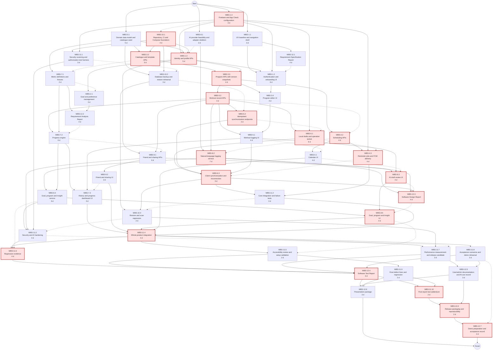
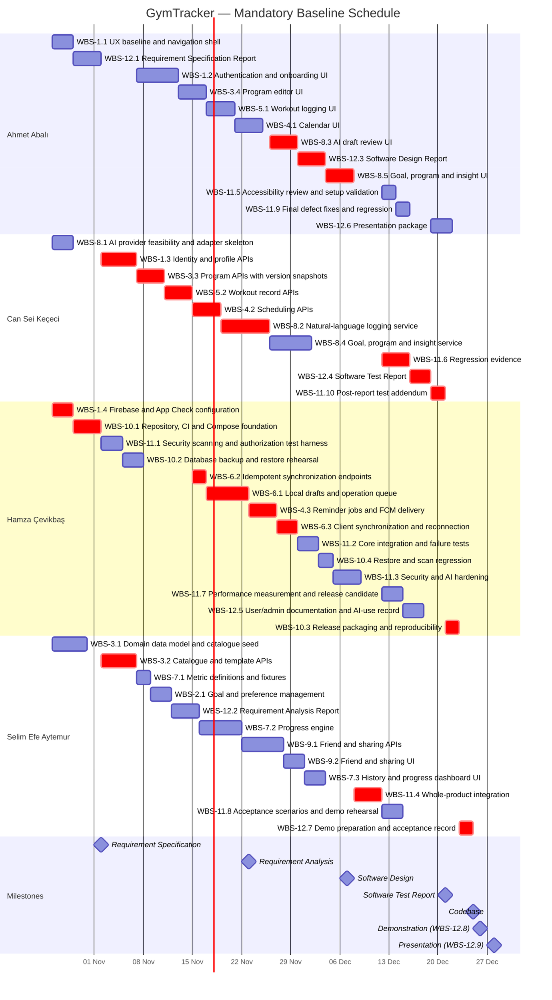

# Software Engineering — Project Plan

## Cover Page

| Field | Details |
|---|---|
| **Course** | BLG 411E — Software Engineering |
| **Report name** | Project Plan |
| **Project title** | GymTracker: AI-assisted Fitness Planning and Tracking |
| **Group name / number** | CSHA |
| **Group members** | Ahmet Abalı — 150240052, Can Sei Keçeci — 150240007, Hamza Çevikbaş — 150240025, Selim Efe Aytemur — 150230070 |
| **Instructor** | Prof. Dr. Tolga Ovatman, Assoc. Prof. Dr. Ayşe Tosun |
| **Repository** | https://github.com/kececi24/gymtracker |
| **Submission date** | 2026-10-26 |
| **Document version** | 1.0 |

---

## 1. Introduction

### 1.1 Scope

**Project overview:**  
Individuals who train regularly often distribute their planning, logging and progress review across several tools, which makes it difficult to relate what was planned to what was performed. GymTracker is an Android-first application that integrates these activities into a single workflow: the user authenticates, defines goals, selects or creates a program, schedules sessions, records completed workouts, reviews measured progress and revises future plans. Workouts may be entered manually or described in natural language and converted into a structured draft by a large language model. All AI output is treated as a proposal; persisted training data change only after the user has reviewed and confirmed the proposal. The intended users are beginners, recreational athletes and trainers aged 16 and above. The application does not provide medical or clinical advice.

The project goal is a working Android pilot accompanied by a documented architecture, traceable requirements, a reproducible deployment and recorded test evidence. Success is measured against the acceptance criteria in Section 1.2, not against changes in users' physical performance.

**In scope:**
- Welcome screens, email and Google authentication, onboarding, an editable profile, manual goals and AI goal suggestions.
- An exercise catalogue organized by muscle group (at least 20 reviewed exercises), at least three predefined programs, and manual and AI-assisted program creation.
- Weekly and monthly calendar views, scheduling, rescheduling, cancellation, reminders and notification preferences.
- Live and post-workout manual logging, natural-language post-workout logging, local drafts and queued synchronization. When a record edited offline is synchronized, it overwrites the server version (last-write-wins); no conflict-resolution interface is provided.
- Workout history, a progress dashboard, personal records and personalized insights.
- Friend requests and connections, and explicit sharing and revocation of completed-workout summaries.
- ASP.NET Core APIs, PostgreSQL persistence, an Android build, a Docker Compose deployment, CI with security scanning, test evidence and documentation.

**Optional scope:**

Optional items are excluded from the mandatory acceptance baseline and the critical path. They are selected only after the Product Owner confirms that mandatory work is on schedule and that the assigned member has spare capacity. The table lists them in the order in which they would be deferred if capacity becomes insufficient.

| Optional capability | Task | Acceptance if selected | Deferral order |
|---|---|---|---|
| Kubernetes/Helm deployment | T-17 | Install, migration job, health check and rollback succeed on a local cluster. | 1 (deferred first) |
| Global workout-plan sharing | T-16 | Publish/unpublish structured plans, browse public plans and import an independent copy; no private history or profile data is exposed. | 2 |
| Group chat | T-14 | Persisted text messages; only current members can read or post. | 3 |
| Joint workouts | T-15 | Invite, accept, decline and cancel a shared session; each participant keeps an independent log. | 4 |
| Badges and daily quotes | T-13 | At least three deterministic badge rules and curated quotes; awards recalculate after record edits. | 5 (deferred last) |

Because the pilot has no moderation function, global plan sharing is restricted to structured plan data (exercises, sets and a short title) and excludes free-text fields. Web and iOS clients are later stages that require a separate plan.

**Out of scope:**

Content moderation, reporting, moderator roles and account restriction; conflict-resolution interfaces for concurrent edits; usability studies with external participants; medical diagnosis, injury assessment or rehabilitation; nutrition tracking; payments and e-commerce; camera-based form analysis and automatic repetition counting; wearable and health-platform integrations; GPS and cardio tracking; custom model training; and production-scale availability commitments.

**Assumptions and constraints:**

- **Time.** The implementation baseline runs from 26 October to 28 December 2026. Report deadlines are fixed by the course and are listed in Section 5.4.
- **Team capacity.** Each of the four members contributes eight hours per week for nine weeks (72 hours per member, 288 hours in total). Seven hours per week are schedulable and one hour is reserved for contingency. Members may offer up to two additional hours per week, but this is not assumed in the baseline. Examination periods are recorded weekly and work is reassigned before commitments are missed.
- **Resources.** The team has development laptops, an Android emulator, at least one physical Android device, GitHub, a Firebase project and access to at least one commercial LLM API. Paid services require an agreed spending limit before activation.
- **AI assistance.** AI development assistants are used for scaffolding, routine code and first drafts of documents. Their assumed effect on effort is quantified in Section 3.3.
- **Status.** At the time of writing, the project charter is the only completed artifact; no implementation exists.

### 1.2 Deliverables

The deliverables below are product capabilities and supporting assets. Course reports are milestones within D-10.

| Deliverable ID | Deliverable name | Description / contents | Acceptance criterion |
|---|---|---|---|
| D-01 | Android application and identity | Welcome, email/Google login, onboarding, profile, goals, navigation and preferences. | A new email user and a Google user reach the dashboard; unauthenticated and non-owner requests are rejected; profile and goals persist after restart. |
| D-02 | Exercise and program management | Reviewed catalogue, templates, and manual and AI-assisted program creation. | At least 20 exercises and three programs exist; a user can create, edit and reuse a program; an AI draft cannot be saved without confirmation. |
| D-03 | Calendar and notifications | Weekly/monthly views, planned sessions, reminder preferences and FCM integration. | Sessions can be created, moved and cancelled and display in local time; a reminder arrives on a test device; a cancelled session sends no reminder. |
| D-04 | Workout records and synchronization | Live and post-workout entry, local drafts, a durable queue and history. | A locally saved draft survives restart; replaying the same operation creates one record; an offline edit replaces the server version after reconnection. |
| D-05 | AI assistance service | Goal suggestions, program drafts, natural-language log conversion and personalized insights. | All four workflows produce editable drafts or clear failure messages; malformed output and provider outages leave manual workflows usable; AI output is never persisted without confirmation. |
| D-06 | Progress and motivation | Dashboard, deterministic personal records and insights; optional badges and quotes. | Fixture-based calculations reproduce expected volume, session counts and records; editing or deleting a workout updates derived results. |
| D-07 | Social coordination | Friend connections and private workout-summary sharing; optional chat, joint workouts and global plan sharing. | Two users complete the friend and sharing scenarios; a third user cannot read their shared content; revocation removes access. |
| D-08 | Backend and data platform | ASP.NET Core APIs, PostgreSQL schema and migrations, background jobs, Firebase token verification and OpenAPI contracts. | A clean database migrates successfully; API contracts match implemented endpoints; ownership tests pass against PostgreSQL; a backup is restored successfully. |
| D-09 | Delivery and verification system | CI, automated tests, vulnerability scans, Docker Compose deployment and Android build; optional Kubernetes/Helm. | A clean checkout builds and passes tests by following the documented steps; Compose runs the pilot; no unresolved release-blocking defect remains. |
| D-10 | Documentation | Requirement, analysis, design and test reports; user/administrator guide; AI-use record; demonstration and presentation material. | All required sections and traceability links are present; another member reproduces the setup; each report is submitted by its deadline. |

### 1.3 Functional Requirements / Tasks

Every task maps to at least one deliverable. Tasks T-13 to T-17 are optional.

| Task ID | Functional requirement / task | Description | Related deliverable ID(s) |
|---|---|---|---|
| T-01 | Access and onboarding | Welcome screens, email and Google authentication, onboarding, profile editing, logout and owner-scoped account access. | D-01, D-08 |
| T-02 | Goals and preferences | Manual goals, experience level, available equipment and notification/privacy preferences. | D-01 |
| T-03 | Exercise catalogue and program management | Catalogue browsing by muscle group, predefined templates and manual program creation with version snapshots. | D-02, D-08 |
| T-04 | Calendar and reminders | Weekly and monthly views; creating, moving and cancelling sessions; timezone-aware FCM reminders. | D-03 |
| T-05 | Workout logging | Live and post-workout recording of sets, repetitions and load; editing and deleting owned records. | D-04 |
| T-06 | Offline drafts and synchronization | Local drafts and a queue of pending writes; idempotent replay after reconnection with last-write-wins semantics. | D-04, D-08 |
| T-07 | History and progress | History browsing and deterministic metrics: volume, session frequency, personal records and muscle-group workload. | D-06 |
| T-08 | AI assistance | Provider adapter, natural-language workout logging, goal and program suggestions and grounded insights; every proposal requires user confirmation. | D-05 |
| T-09 | Friend connections and private sharing | Friend requests, removal, and explicit sharing and revocation of completed-workout summaries. | D-07 |
| T-10 | Platform and deployment | Repository, CI, Docker Compose environment, backup/restore and release packaging. | D-08, D-09 |
| T-11 | Verification and acceptance | Security scanning, integration, regression, accessibility, performance and acceptance testing. | D-01 – D-09 |
| T-12 | Project control and documentation | Course reports, user/administrator documentation, AI-use record, demonstration and presentation. | D-10 |
| T-13 | Badges and daily quotes (optional) | Deterministic badge rules and curated motivational quotes. | D-06 |
| T-14 | Group chat (optional) | Friend groups with persisted text messages and membership enforcement. | D-07 |
| T-15 | Joint workouts (optional) | Shared session invitations with independent participant logs. | D-03, D-07 |
| T-16 | Global workout-plan sharing (optional) | Publishing structured plans for other users to browse and import. | D-02, D-07 |
| T-17 | Kubernetes/Helm deployment (optional) | Helm chart and smoke test on a local Kubernetes cluster. | D-09 |

### 1.4 Non-functional Issues

The values below are acceptance targets; actual measurements are reported in the Software Test Report. Measurements use a documented development host running Docker Compose, one physical Android device, 100 seeded users and 10,000 seeded workout sets.

| Quality attribute | Requirement / concern | How it will be assessed |
|---|---|---|
| Security — authorization | Every private endpoint derives the user's identity from a verified Firebase token and checks ownership; shared summaries additionally check friendship and share status. | Positive and negative API tests for unauthenticated, expired-token, non-owner and non-friend requests. |
| Security — confidentiality | Provider keys stay on the server; private workout data are excluded from logs; networked deployments use TLS; local caches are user-scoped and cleared on logout. | CI secret scanning, inspection of sanitized logs, and account-switch and logout tests. |
| Security — AI integrity | Generated content is schema-validated and cannot invoke persistence directly; prompts contain only the current user's data. | Tests with malformed JSON, prompt injection, foreign IDs, negative loads, invented exercises and missing units. |
| Performance | Non-AI API requests: 95th-percentile latency ≤ 1 s with 10 concurrent simulated users over five minutes. Cached primary screens load in ≤ 2 s on the test device. | Load test with recorded sample counts, endpoint mix and latency distribution; AI and sign-in latency excluded. |
| AI responsiveness | Progress is shown immediately; requests can be cancelled and time out after 30 s; on failure the draft text is kept and manual entry is offered. | Delayed- and failed-provider tests using stubs. |
| Reliability | A draft acknowledged as saved is never lost; synchronization is idempotent; the most recently synchronized write wins; cancelled reminders are not dispatched. | App-kill/restart, disconnect/reconnect, duplicate-request and reminder-cancellation tests. |
| Usability and accessibility | Primary flows support 200% text scaling, adequate contrast, labelled controls and touch targets of at least 48 dp, and show visible save, sync and error states. | Checklist review by a member who did not build the screens, plus Flutter widget tests. |
| Calculation correctness | Metrics use documented units and eligible stored sets; corrections propagate to derived values. | Comparison with hand-computed fixtures (empty history, deleted sets, zero load, mixed categories). |
| Maintainability | Version-controlled migrations, lint and format checks, peer-reviewed pull requests, OpenAPI contracts and isolated provider adapters. | CI results; no merge with a failing mandatory check. |
| Recoverability | PostgreSQL backups can be restored within 60 minutes for the pilot dataset. | Restore rehearsal with row-count and sample-record comparison; actual time is reported. |
| Cost control | AI request counts and input/output sizes are capped by configuration; AI features are disabled when the approved budget is reached. | Simulated quota-exhaustion test; manual functions remain available. |

### 1.5 Technical Baseline

The backend uses C#, .NET 10, ASP.NET Core and Entity Framework Core with the Npgsql provider, exposing REST endpoints documented with OpenAPI. PostgreSQL is the only database and is also used in integration tests. Exact package versions are pinned after the compatibility check in WBS-10.1. The mobile client uses Flutter/Dart with Riverpod, Dio and Drift (SQLite). Firebase Authentication and Google Sign-In provide identity; the Firebase Admin SDK verifies tokens on the server and sends FCM notifications; Firebase App Check supplements but does not replace server-side authorization. Docker Compose provides the reproducible pilot environment, and GitHub Actions runs backend and Flutter tests, format checks, builds and Trivy scans.

**Data rules.** Timestamps are stored in UTC together with the user's display timezone. External load is normalized to kilograms. Volume is defined as the sum of repetitions × external load over eligible resistance sets; bodyweight exercises are tracked by repetitions only. Personal records are exercise-specific and distinguish maximum load from maximum repetitions. Editing a program creates a new version and does not alter historical workouts. Each queued write carries a client-generated operation ID, so a replayed operation creates at most one record. When an edited record is synchronized, it replaces the server version without a conflict prompt; this behaviour is documented in the user guide.

**AI provider.** WBS-8.1 selects one primary provider from those to which the team has API access (for example Anthropic, OpenAI or Google) and records the exact model identifier, structured-output support, latency, cost and data-handling settings. A second provider is added only if it fits the same budget. All provider calls pass through an adapter, so the provider can be changed without modifying domain logic.

**AI in development.** Development assistants may draft boilerplate, tests and document text. Team members remain responsible for architecture decisions, code review, security checks and acceptance. Credentials and personal data are never included in prompts. An AI-use log records the tool, purpose, affected artifact and human validation.

---

## 2. Project Plan — Work Breakdown Structure (WBS)

Each task from Section 1.3 is decomposed into activities numbered WBS-*n*.*x*, where *n* is the number of the parent task; every activity therefore has exactly one parent. Each activity has a single accountable owner, and its completion condition includes implementation or authoring, the relevant tests and peer review.

Sizes are assigned from the scope of each activity before its effort is estimated, using the following scale. The hour ranges are reference values for checking the estimates in Section 3.

| Size | Scope characteristics | Reference effort |
|---|---|---|
| T (Tiny) | Configuration, a repeat of existing work, or a fixed time-box | ≤ 2 h |
| S (Small) | One component (a screen, an endpoint group or a document) following an established pattern | 2–4 h |
| M (Medium) | Several coordinated components, or one component with non-trivial logic or unfamiliar technology | 4–8 h |
| L (Large) | Work spanning client, server and data layers | 8–16 h |
| XL (Extra-large) | Work that cannot be completed within a single iteration | > 16 h |

L and XL activities must be decomposed before scheduling, so none appear in the baseline.

**Mandatory activities**

| WBS activity ID | Parent task ID | Activity / subtask | Description / completion condition | Size (T/S/M/L/XL) |
|---|---|---|---|---|
| WBS-1.1 | T-01 | UX baseline and navigation shell | Low-fidelity layouts for the primary screens, shared loading/error components and the navigation structure are reviewed by the Product Owner. | S |
| WBS-1.2 | T-01 | Authentication and onboarding UI | Email and Google sign-in, sign-up, onboarding and profile screens work against the API; loading, failure and logout paths have widget tests. | M |
| WBS-1.3 | T-01 | Identity and profile APIs | Firebase tokens are verified server-side; profile endpoints enforce ownership; unauthenticated, expired-token and non-owner requests are rejected in tests. | M |
| WBS-1.4 | T-01 | Firebase and App Check configuration | The Firebase project, Google Sign-In fingerprints and App Check debug/release providers are configured and documented. | S |
| WBS-2.1 | T-02 | Goal and preference management | Users create and edit manual goals, experience level, available equipment and notification preferences; values persist after restart. | S |
| WBS-3.1 | T-03 | Domain data model and catalogue seed | Ownership, units and program-version tables are migrated; 20 reviewed exercises and three templates are seeded. | M |
| WBS-3.2 | T-03 | Catalogue and template APIs | Exercises can be filtered by muscle group and templates retrieved; query tests pass against PostgreSQL. | M |
| WBS-3.3 | T-03 | Program APIs with version snapshots | Owner-scoped program CRUD stores an immutable version on each edit; workouts reference the version used. | S |
| WBS-3.4 | T-03 | Program editor UI | Users create, edit and reuse programs from templates or the catalogue; invalid sets are rejected in the form. | S |
| WBS-4.1 | T-04 | Calendar UI | Weekly and monthly views display sessions in local time; create, move and cancel dialogs work against the API. | S |
| WBS-4.2 | T-04 | Scheduling APIs | Sessions are stored in UTC with the user's display timezone; create, move and cancel endpoints pass timezone tests. | S |
| WBS-4.3 | T-04 | Reminder jobs and FCM delivery | A background job dispatches reminders through FCM, re-checks cancellation before sending and records delivery attempts; a controlled-device test succeeds. | S |
| WBS-5.1 | T-05 | Workout logging UI | Live and post-workout forms record sets, repetitions and load; edit and delete require confirmation. | S |
| WBS-5.2 | T-05 | Workout record APIs | Owner-scoped workout and set CRUD validates units and references program versions; transaction tests pass. | S |
| WBS-6.1 | T-06 | Local drafts and operation queue | Drafts and pending operations persist in user-scoped SQLite tables and survive app restart; logout clears them after a warning. | M |
| WBS-6.2 | T-06 | Idempotent synchronization endpoints | Client-generated operation IDs are unique; replaying an operation creates one record; the latest synchronized write replaces the server version. | T |
| WBS-6.3 | T-06 | Client synchronization and reconnection | Queued operations replay in order after reconnection with bounded retries; an offline edit overwrites the server copy. | S |
| WBS-7.1 | T-07 | Metric definitions and fixtures | Hand-computed fixtures cover empty history, deleted sets, zero external load, mixed categories and both record types. | T |
| WBS-7.2 | T-07 | Progress engine | Volume, session frequency, load and repetition records and muscle-group workload match the fixtures and recalculate after edits or deletions. | M |
| WBS-7.3 | T-07 | History and progress dashboard UI | History list/detail and a dashboard with two charts display server-computed metrics with empty and error states. | S |
| WBS-8.1 | T-08 | AI provider feasibility and adapter skeleton | One structured-output request succeeds against the selected provider; model identifier, latency, cost and data-handling settings are recorded; a stub adapter exists. | S |
| WBS-8.2 | T-08 | Natural-language logging service | Text is converted into catalogue-mapped sets; unknown exercises, missing units, malformed output, timeouts and quota exhaustion produce clear failures; nothing is saved without confirmation. | M |
| WBS-8.3 | T-08 | AI draft review UI | Users review, edit, approve or discard a generated workout draft; the original text is retained on failure. | S |
| WBS-8.4 | T-08 | Goal, program and insight service | Goal suggestions, program drafts and insights are returned as editable proposals; insight prompts contain only the user's own computed metrics. | M |
| WBS-8.5 | T-08 | Goal, program and insight UI | Three review screens allow approval or rejection with a manual fallback when the provider is unavailable. | S |
| WBS-9.1 | T-09 | Friend and sharing APIs | Requests can be sent, accepted, rejected and removed; workout summaries can be shared and revoked; a third user cannot read restricted content. | M |
| WBS-9.2 | T-09 | Friend and sharing UI | Friend list, request inbox and share/revoke dialogs work end to end between two test accounts. | S |
| WBS-10.1 | T-10 | Repository, CI and Compose foundation | Backend and Flutter skeletons build in CI; Compose starts PostgreSQL; the EF Core and Npgsql versions pass a migration and rollback check. | S |
| WBS-10.2 | T-10 | Database backup and restore rehearsal | The seeded database is backed up and restored into an isolated instance; row counts and sample records match. | S |
| WBS-10.3 | T-10 | Release packaging and reproducibility | The accepted tag is rebuilt from a clean checkout; the APK, source archive and configuration examples pass the release checklist. | T |
| WBS-10.4 | T-10 | Restore and scan regression | Restore and dependency/image scans are repeated on the feature-complete build with recorded results. | T |
| WBS-11.1 | T-11 | Security scanning and authorization test harness | Secret, dependency and image scans run in CI; reusable fixtures support negative authorization tests. | S |
| WBS-11.2 | T-11 | Core integration and failure tests | Duplicate replay, restart with pending operations, offline overwrite and cancelled-reminder cases pass. | S |
| WBS-11.3 | T-11 | Security and AI hardening | Adversarial AI inputs and ownership/friendship checks pass on all integrated endpoints. | S |
| WBS-11.4 | T-11 | Whole-product integration | Scheduling, logging, progress and sharing interact correctly across screens, including revocation and recalculation. | S |
| WBS-11.5 | T-11 | Accessibility review and setup validation | Primary flows meet the contrast, text-scaling, labelling and 48 dp target checklist; another member reproduces the setup instructions. | T |
| WBS-11.6 | T-11 | Regression evidence | The full API, database and AI regression is executed and recorded with commit, environment and outcomes. | S |
| WBS-11.7 | T-11 | Performance measurement and release candidate | Load results for the non-AI endpoints are recorded; final scans and a clean install succeed. | S |
| WBS-11.8 | T-11 | Acceptance scenarios and demo rehearsal | The end-to-end acceptance list passes and the two-user demonstration is rehearsed on seed data. | S |
| WBS-11.9 | T-11 | Final defect fixes and regression | Low-severity UI defects are resolved and affected cases re-run; no new features are added. | T |
| WBS-11.10 | T-11 | Post-report test addendum | Changes made after the test report are verified and documented in a dated addendum. | T |
| WBS-12.1 | T-12 | Requirement Specification Report | User stories, functional and non-functional requirements and acceptance conditions are reviewed by the Product Owner and submitted by 2 November. | S |
| WBS-12.2 | T-12 | Requirement Analysis Report | Domain model, workflows, metric and privacy constraints and traceability are reviewed and submitted by 23 November. | S |
| WBS-12.3 | T-12 | Software Design Report | Architecture, schema, API, client state, security and deployment design are consolidated and reviewed by 7 December. | S |
| WBS-12.4 | T-12 | Software Test Report | Executed tests, outcomes, defects, environment and limitations are consolidated and reviewed by 21 December. | S |
| WBS-12.5 | T-12 | User/admin documentation and AI-use record | Setup, user and administrator notes and the AI-use record are complete; another member verifies the instructions. | S |
| WBS-12.6 | T-12 | Presentation package | Slides present the problem, requirements, design, results, limitations and next stages; the team reviews them before 28 December. | S |
| WBS-12.7 | T-12 | Demo preparation and acceptance record | The demo fixture, backup recording and acceptance-record form are ready before 26 December. | T |
| WBS-12.8 | T-12 | Demonstration delivery | Fixed-date event on 2026-12-26; all four members attend and the outcome is recorded. | T |
| WBS-12.9 | T-12 | Presentation delivery | Fixed-date event on 2026-12-28; all four members attend and the outcome is recorded. | T |

**Optional activities** (unscheduled until selected)

| WBS activity ID | Parent task ID | Activity / subtask | Description / completion condition | Size (T/S/M/L/XL) |
|---|---|---|---|---|
| WBS-13.1 | T-13 | Badges and daily quotes | Three deterministic badge rules and a curated daily quote; awards recalculate after record edits. | S |
| WBS-14.1 | T-14 | Group chat APIs | Paginated text messages persist; only current members, managed by the group creator, can read or post. | S |
| WBS-14.2 | T-14 | Group chat UI and integration | Group, member and message screens; outsider and removed-member access is rejected. | S |
| WBS-15.1 | T-15 | Joint-workout APIs | Invite, accept, decline and cancel a shared session while each participant keeps an independent log. | S |
| WBS-15.2 | T-15 | Joint-workout UI and integration | Invitation and status flows; cancellation updates reminders for all participants. | S |
| WBS-16.1 | T-16 | Global plan-sharing APIs | Publish and unpublish structured plans (no free-text fields); browse public plans; import an independent copy. | S |
| WBS-16.2 | T-16 | Global plan-sharing UI and integration | Publish, browse and import flows; no workout history or profile data is exposed. | S |
| WBS-17.1 | T-17 | Helm chart and local Kubernetes smoke test | Install, migration job, health check and rollback succeed on a local cluster. | S |
| WBS-17.2 | T-17 | Kubernetes regression on release candidate | The smoke test is repeated on the release candidate. | T |

**WBS decomposition notes:**  
Work was decomposed along functional lines so that each activity produces a testable result. Client and server work for the same feature are separate activities with different owners, connected by an API contract that is agreed at the start of the server activity. Testing specific to an activity is part of that activity; cross-feature verification is collected under T-11, and report writing under T-12. Ahmet and Selim review each other's client work, and Can and Hamza review each other's backend and infrastructure work; review time is included in the reviewer's own estimates.

> **Course guideline note:** User stories for these subtasks will be written in the separate requirements document; this project plan defines and sizes the subtasks.

---

## 3. Estimates

### 3.1 Effort Estimates

One person-week (man-week) equals 40 person-hours. Estimates are bottom-up and include implementation or authoring, targeted tests, peer review and integration. Coordination is limited to a 20-minute weekly check-in; other coordination is asynchronous and included in the activities. The figures already include the assumed AI-assistance savings described in Section 3.3.

| WBS activity ID | Size | Estimated effort (man-weeks) | Hours | Basis / assumptions |
|---|---|---|---|---|
| WBS-1.1 | S | 0.075 | 3 | Approximately eight primary screens at low fidelity; shared state components are built once and reused by later UI packages. |
| WBS-1.2 | M | 0.150 | 6 | Five screens; Google Sign-In uses the standard Flutter plugin; three failure states require dedicated tests. |
| WBS-1.3 | M | 0.125 | 5 | Token-verification middleware plus four endpoints; the middleware is reused by every later API package. |
| WBS-1.4 | S | 0.075 | 3 | Configuration work following vendor documentation; no application logic. |
| WBS-2.1 | S | 0.075 | 3 | One form with three goal types; reuses the profile endpoints and ownership checks from WBS-1.3. |
| WBS-3.1 | M | 0.125 | 5 | Approximately eight tables; the seed data is authored once as migration data and reviewed against exercise references. |
| WBS-3.2 | M | 0.125 | 5 | Read-only endpoints over seeded data; filtering is the only non-trivial logic. |
| WBS-3.3 | S | 0.100 | 4 | Standard CRUD following the WBS-1.3 pattern; the snapshot rule is the only new logic. |
| WBS-3.4 | S | 0.100 | 4 | One editor screen with an exercise picker and set table built from WBS-1.1 components. |
| WBS-4.1 | S | 0.100 | 4 | Views come from an existing Flutter calendar package; effort lies in the three dialogs and empty/error states. |
| WBS-4.2 | S | 0.100 | 4 | Three endpoints following the established pattern plus timezone conversion tests. |
| WBS-4.3 | S | 0.100 | 4 | One background job and token registration; tested on a single physical device. |
| WBS-5.1 | S | 0.100 | 4 | Both forms share one set-entry component, which is also reused by WBS-8.3. |
| WBS-5.2 | S | 0.100 | 4 | Follows the endpoint and validation pattern established in WBS-3.3. |
| WBS-6.1 | M | 0.150 | 6 | Two Drift tables and queue logic; estimated at the upper end of M because the team has not built an offline queue before. |
| WBS-6.2 | T | 0.050 | 2 | A uniqueness constraint and replay handling on existing write endpoints; last-write-wins requires no version comparison. |
| WBS-6.3 | S | 0.075 | 3 | A connectivity listener and ordered replay; no conflict screens are needed. |
| WBS-7.1 | T | 0.050 | 2 | Five fixture scenarios calculated manually; no implementation. |
| WBS-7.2 | M | 0.150 | 6 | Four metric families computed server-side; correctness is checked directly against WBS-7.1 fixtures. |
| WBS-7.3 | S | 0.075 | 3 | Uses an existing charting package; data are already computed by WBS-7.2. |
| WBS-8.1 | S | 0.075 | 3 | A single proof-of-concept request and an interface with one real and one stub implementation. |
| WBS-8.2 | M | 0.175 | 7 | Prompt, schema and validation design plus five failure paths; validation is the principal cost. |
| WBS-8.3 | S | 0.100 | 4 | Reuses the WBS-5.1 set-entry component in an editable review mode. |
| WBS-8.4 | M | 0.150 | 6 | Three prompt types reuse the WBS-8.2 adapter and validation layer. |
| WBS-8.5 | S | 0.100 | 4 | Follows the review pattern established in WBS-8.3. |
| WBS-9.1 | M | 0.150 | 6 | Two small state machines (friendship, share) with three-user visibility tests. |
| WBS-9.2 | S | 0.075 | 3 | Three screens reusing existing list and dialog components. |
| WBS-10.1 | S | 0.100 | 4 | Standard project templates; the compatibility check is a short scripted test. |
| WBS-10.2 | S | 0.075 | 3 | One dump/restore script and a comparison query, executed once. |
| WBS-10.3 | T | 0.050 | 2 | Repeats existing build steps against the final tag. |
| WBS-10.4 | T | 0.050 | 2 | Re-executes scripts written in WBS-10.2 and WBS-11.1. |
| WBS-11.1 | S | 0.075 | 3 | CI configuration for existing scanning tools plus one fixture library. |
| WBS-11.2 | S | 0.075 | 3 | Four scripted scenarios; defects found are fixed by the owning package. |
| WBS-11.3 | S | 0.100 | 4 | Approximately 20 negative cases reusing the WBS-11.1 harness. |
| WBS-11.4 | S | 0.100 | 4 | Cross-feature scenarios executed manually on the Android device. |
| WBS-11.5 | T | 0.050 | 2 | Checklist review of five primary flows; no external participants. |
| WBS-11.6 | S | 0.100 | 4 | Execution and recording of existing automated suites. |
| WBS-11.7 | S | 0.075 | 3 | One five-minute load run with ten simulated users plus repeated scans. |
| WBS-11.8 | S | 0.075 | 3 | Execution of a predefined scenario list. |
| WBS-11.9 | T | 0.050 | 2 | Fixed time-box for minor corrections. |
| WBS-11.10 | T | 0.050 | 2 | Fixed time-box; limited to changes from WBS-11.9. |
| WBS-12.1 | S | 0.100 | 4 | Approximately 12 tasks expanded into user stories; structure and first draft are AI-assisted. |
| WBS-12.2 | S | 0.100 | 4 | Builds on the specification and the metric definitions already fixed in WBS-7.1. |
| WBS-12.3 | S | 0.100 | 4 | Consolidates design decisions already documented in pull requests and API contracts. |
| WBS-12.4 | S | 0.075 | 3 | Consolidates evidence produced by WBS-11.x; no new testing. |
| WBS-12.5 | S | 0.075 | 3 | Short guides derived from the setup steps validated in WBS-11.5. |
| WBS-12.6 | S | 0.075 | 3 | About 15 slides drawn from existing reports. |
| WBS-12.7 | T | 0.050 | 2 | Reuses the rehearsal from WBS-11.8. |
| **Preparation subtotal** | — | **4.425** | **177** | Sum of the 48 mandatory preparation activities. |
| WBS-12.8 | T | 0.100 | 4 | Four members × 1 h at the demonstration on 26 December. |
| WBS-12.9 | T | 0.100 | 4 | Four members × 1 h at the presentation on 28 December. |
| **Total (mandatory)** | — | **4.625** | **185** | — |

Optional activities are estimated separately and excluded from the mandatory total (33 h, 0.825 man-weeks):

| WBS activity ID | Size | Estimated effort (man-weeks) | Hours | Basis / assumptions |
|---|---|---|---|---|
| WBS-13.1 | S | 0.100 | 4 | Three rule functions over existing progress data and a static quote list. |
| WBS-14.1 | S | 0.100 | 4 | Two tables and four endpoints; membership checks follow the friendship pattern from WBS-9.1. |
| WBS-14.2 | S | 0.100 | 4 | Three screens with polling while the chat screen is open. |
| WBS-15.1 | S | 0.100 | 4 | One invitation state machine reusing scheduling endpoints from WBS-4.2. |
| WBS-15.2 | S | 0.100 | 4 | Invitation list and status indicators on existing calendar screens. |
| WBS-16.1 | S | 0.100 | 4 | Publish flag and copy operation on existing program versions. |
| WBS-16.2 | S | 0.100 | 4 | Browse list and import action reusing the program editor. |
| WBS-17.1 | S | 0.100 | 4 | One Helm chart for the existing images; the team has not used Helm before. |
| WBS-17.2 | T | 0.025 | 1 | Re-execution of the WBS-17.1 script. |
| **Optional total** | — | **0.825** | **33** | — |

**Estimation method:**  
Each activity was first sized using the scale in Section 2. The owner then estimated the hours by counting the concrete elements involved (screens, endpoints, tables, test scenarios or report sections) and comparing them with similar work the team has done in earlier courses. The estimate was then checked against the reference range for the size, and any reuse of earlier components is stated in the basis column. Because no velocity data exist for this team, actual hours will be compared with the estimates at the end of week 2 and the remaining work will be re-forecast; the original baseline is retained for comparison.

**Effort versus duration:** Durations are derived from effort under the allocation convention in Section 3.2: every activity is worked at an average of one person-hour per calendar day (0.175 FTE). An activity of *h* hours therefore has a duration of *h* days. This convention reflects part-time student work; members may batch the hours, provided that hand-offs to dependent activities occur on the scheduled dates.

### 3.2 Capacity and Reserve

| Member | Preparation hours | Demo (26 Dec) | Protected reserve | Uncommitted | Capacity (weeks 1–9) | Presentation (28 Dec) | Optional if all selected |
|---|---|---|---|---|---|---|---|
| Ahmet Abalı | 44 | 1 | 9 | 18 | 72 | 1 | 8 |
| Can Sei Keçeci | 42 | 1 | 9 | 20 | 72 | 1 | 8 |
| Hamza Çevikbaş | 45 | 1 | 9 | 17 | 72 | 1 | 9 |
| Selim Efe Aytemur | 46 | 1 | 9 | 16 | 72 | 1 | 8 |
| **Total** | **177** | **4** | **36** | **71** | **288** | **4** | **33** |

Mandatory effort is 185 hours (177 preparation and 8 delivery hours). Together with the 36-hour protected reserve, this leaves 71 uncommitted hours within the 288-hour capacity of weeks 1–9. The presentation on 28 December falls in week 10; its one hour per member is recorded as a separate commitment. Uncommitted hours belong to specific members and dates, so they cannot automatically absorb delays elsewhere; the per-member loads must be recalculated before an optional item is selected.

### 3.3 AI-assistance Scenarios

The estimates in Section 3.1 assume that development assistants reduce effort on scaffolding, routine CRUD code, form construction and first drafts of documents. The saving assumed for each activity is net of prompting and correction time. Verification, integration, coordination and fixed time-boxes are assumed to receive no saving. The reduced-benefit scenario assumes that only half of the expected saving is realized.

| WBS activity ID | Without assistance (h) | Assumed saving (h) | Baseline (h) | Reduced benefit (h) |
|---|---|---|---|---|
| WBS-1.1 | 4 | 1 | 3 | 3.5 |
| WBS-1.2 | 8 | 2 | 6 | 7 |
| WBS-1.3 | 7 | 2 | 5 | 6 |
| WBS-1.4 | 4 | 1 | 3 | 3.5 |
| WBS-3.1 | 7 | 2 | 5 | 6 |
| WBS-3.2 | 7 | 2 | 5 | 6 |
| WBS-3.3 | 5 | 1 | 4 | 4.5 |
| WBS-3.4 | 5 | 1 | 4 | 4.5 |
| WBS-4.1 | 5 | 1 | 4 | 4.5 |
| WBS-4.2 | 5 | 1 | 4 | 4.5 |
| WBS-4.3 | 5 | 1 | 4 | 4.5 |
| WBS-5.1 | 5 | 1 | 4 | 4.5 |
| WBS-5.2 | 5 | 1 | 4 | 4.5 |
| WBS-6.1 | 8 | 2 | 6 | 7 |
| WBS-6.3 | 4 | 1 | 3 | 3.5 |
| WBS-7.2 | 8 | 2 | 6 | 7 |
| WBS-7.3 | 4 | 1 | 3 | 3.5 |
| WBS-8.1 | 4 | 1 | 3 | 3.5 |
| WBS-8.2 | 9 | 2 | 7 | 8 |
| WBS-8.3 | 5 | 1 | 4 | 4.5 |
| WBS-8.4 | 8 | 2 | 6 | 7 |
| WBS-8.5 | 6 | 2 | 4 | 5 |
| WBS-9.1 | 8 | 2 | 6 | 7 |
| WBS-9.2 | 5 | 2 | 3 | 4 |
| WBS-10.1 | 6 | 2 | 4 | 5 |
| WBS-11.1 | 4 | 1 | 3 | 3.5 |
| WBS-12.1 | 6 | 2 | 4 | 5 |
| WBS-12.2 | 5 | 1 | 4 | 4.5 |
| WBS-12.3 | 5 | 1 | 4 | 4.5 |
| WBS-12.4 | 4 | 1 | 3 | 3.5 |
| WBS-12.5 | 4 | 1 | 3 | 3.5 |
| WBS-12.6 | 4 | 1 | 3 | 3.5 |
| Activities with no assumed saving | 43 | 0 | 43 | 43 |
| **Preparation total** | **222** | **45** | **177** | **199.5** |

Without any AI benefit, preparation effort rises to 222 hours; in the reduced-benefit scenario it rises to 199.5 hours. Both values remain within the combined uncommitted and reserve capacity (107 hours) in aggregate. However, a shortfall on a critical activity still delays the readiness date, so the effect on the schedule must be recomputed if the savings do not materialize.

---

## 4. Resources

### 4.1 Team Structure and Member Roles

| Member | Student ID | Role(s) | Main responsibilities |
|---|---|---|---|
| Ahmet Abalı | 150240052 | Project Manager; Frontend Developer | Schedule and risk control; authentication, program, logging, calendar and AI review screens; requirement specification, design report and presentation. |
| Can Sei Keçeci | 150240007 | Backend Developer; AI Engineer | Identity, program, workout and scheduling APIs; AI adapter and services; regression evidence and test report. |
| Hamza Çevikbaş | 150240025 | Full-stack Developer; DevOps Engineer | Repository, CI and Compose; Firebase; offline queue and synchronization; reminders; security scanning and hardening; release packaging and user documentation. |
| Selim Efe Aytemur | 150230070 | Product Owner; Frontend Developer; Database Engineer | Scope and acceptance decisions; data model and catalogue; goals; progress engine and dashboard; friends and sharing; requirement analysis and demonstration. |

The customer reviews the pilot against the agreed requirements. The customer's availability is an external dependency: internal acceptance testing proceeds if feedback is delayed, and any outstanding feedback is recorded.

### 4.2 Member-to-Activity Assignment

FTE is relative to a 40-hour week. Each member works on one mandatory activity at a time at 0.175 FTE; the order of each member's activities appears as resource predecessors in Section 5.1.

| WBS activity ID | Assigned member | Responsibility | Allocation to activity (FTE) |
|---|---|---|---|
| WBS-1.1 | Ahmet Abalı | UX baseline and navigation shell | 0.175 |
| WBS-1.2 | Ahmet Abalı | Authentication and onboarding UI | 0.175 |
| WBS-1.3 | Can Sei Keçeci | Identity and profile APIs | 0.175 |
| WBS-1.4 | Hamza Çevikbaş | Firebase and App Check configuration | 0.175 |
| WBS-2.1 | Selim Efe Aytemur | Goal and preference management | 0.175 |
| WBS-3.1 | Selim Efe Aytemur | Domain data model and catalogue seed | 0.175 |
| WBS-3.2 | Selim Efe Aytemur | Catalogue and template APIs | 0.175 |
| WBS-3.3 | Can Sei Keçeci | Program APIs with version snapshots | 0.175 |
| WBS-3.4 | Ahmet Abalı | Program editor UI | 0.175 |
| WBS-4.1 | Ahmet Abalı | Calendar UI | 0.175 |
| WBS-4.2 | Can Sei Keçeci | Scheduling APIs | 0.175 |
| WBS-4.3 | Hamza Çevikbaş | Reminder jobs and FCM delivery | 0.175 |
| WBS-5.1 | Ahmet Abalı | Workout logging UI | 0.175 |
| WBS-5.2 | Can Sei Keçeci | Workout record APIs | 0.175 |
| WBS-6.1 | Hamza Çevikbaş | Local drafts and operation queue | 0.175 |
| WBS-6.2 | Hamza Çevikbaş | Idempotent synchronization endpoints | 0.175 |
| WBS-6.3 | Hamza Çevikbaş | Client synchronization and reconnection | 0.175 |
| WBS-7.1 | Selim Efe Aytemur | Metric definitions and fixtures | 0.175 |
| WBS-7.2 | Selim Efe Aytemur | Progress engine | 0.175 |
| WBS-7.3 | Selim Efe Aytemur | History and progress dashboard UI | 0.175 |
| WBS-8.1 | Can Sei Keçeci | AI provider feasibility and adapter skeleton | 0.175 |
| WBS-8.2 | Can Sei Keçeci | Natural-language logging service | 0.175 |
| WBS-8.3 | Ahmet Abalı | AI draft review UI | 0.175 |
| WBS-8.4 | Can Sei Keçeci | Goal, program and insight service | 0.175 |
| WBS-8.5 | Ahmet Abalı | Goal, program and insight UI | 0.175 |
| WBS-9.1 | Selim Efe Aytemur | Friend and sharing APIs | 0.175 |
| WBS-9.2 | Selim Efe Aytemur | Friend and sharing UI | 0.175 |
| WBS-10.1 | Hamza Çevikbaş | Repository, CI and Compose foundation | 0.175 |
| WBS-10.2 | Hamza Çevikbaş | Database backup and restore rehearsal | 0.175 |
| WBS-10.3 | Hamza Çevikbaş | Release packaging and reproducibility | 0.175 |
| WBS-10.4 | Hamza Çevikbaş | Restore and scan regression | 0.175 |
| WBS-11.1 | Hamza Çevikbaş | Security scanning and authorization test harness | 0.175 |
| WBS-11.2 | Hamza Çevikbaş | Core integration and failure tests | 0.175 |
| WBS-11.3 | Hamza Çevikbaş | Security and AI hardening | 0.175 |
| WBS-11.4 | Selim Efe Aytemur | Whole-product integration | 0.175 |
| WBS-11.5 | Ahmet Abalı | Accessibility review and setup validation | 0.175 |
| WBS-11.6 | Can Sei Keçeci | Regression evidence | 0.175 |
| WBS-11.7 | Hamza Çevikbaş | Performance measurement and release candidate | 0.175 |
| WBS-11.8 | Selim Efe Aytemur | Acceptance scenarios and demo rehearsal | 0.175 |
| WBS-11.9 | Ahmet Abalı | Final defect fixes and regression | 0.175 |
| WBS-11.10 | Can Sei Keçeci | Post-report test addendum | 0.175 |
| WBS-12.1 | Ahmet Abalı | Requirement Specification Report | 0.175 |
| WBS-12.2 | Selim Efe Aytemur | Requirement Analysis Report | 0.175 |
| WBS-12.3 | Ahmet Abalı | Software Design Report | 0.175 |
| WBS-12.4 | Can Sei Keçeci | Software Test Report | 0.175 |
| WBS-12.5 | Hamza Çevikbaş | User/admin documentation and AI-use record | 0.175 |
| WBS-12.6 | Ahmet Abalı | Presentation package | 0.175 |
| WBS-12.7 | Selim Efe Aytemur | Demo preparation and acceptance record | 0.175 |
| WBS-12.8 | All four members | Demonstration delivery | 1 h each (fixed date) |
| WBS-12.9 | All four members | Presentation delivery | 1 h each (fixed date) |
| WBS-13.1 | Selim Efe Aytemur | Badges and daily quotes (optional) | Assigned when selected |
| WBS-14.1 | Hamza Çevikbaş | Group chat APIs (optional) | Assigned when selected |
| WBS-14.2 | Ahmet Abalı | Group chat UI and integration (optional) | Assigned when selected |
| WBS-15.1 | Can Sei Keçeci | Joint-workout APIs (optional) | Assigned when selected |
| WBS-15.2 | Selim Efe Aytemur | Joint-workout UI and integration (optional) | Assigned when selected |
| WBS-16.1 | Can Sei Keçeci | Global plan-sharing APIs (optional) | Assigned when selected |
| WBS-16.2 | Ahmet Abalı | Global plan-sharing UI and integration (optional) | Assigned when selected |
| WBS-17.1 | Hamza Çevikbaş | Helm chart and local Kubernetes smoke test (optional) | Assigned when selected |
| WBS-17.2 | Hamza Çevikbaş | Kubernetes regression on release candidate (optional) | Assigned when selected |

**Availability or allocation constraints:**  
No member is full-time. Before each week, members report examination commitments and confirm their availability; any reduction triggers reassignment or a revised forecast. The protected hour per member per week is not scheduled. Work is integrated through pull requests that require passing CI and a review by the paired member. Scope, date or resource changes are recorded together with their rationale and the Product Owner's decision; changes affecting course obligations also require the agreement of the instructors.

---

## 5. Schedule

### 5.1 PERT Chart — Activity Sequence

The network uses activity-on-node notation with deterministic durations and finish-to-start dependencies. Two kinds of predecessor are distinguished: *technical* predecessors, where an activity needs another activity's output, and *resource* predecessors, where the same member must finish one activity before starting the next. Day 0 is Monday, 26 October 2026; ES, EF, LS and LF are elapsed calendar days, and EF is exclusive (an activity with EF = 7 finishes at the end of day 6). Float is calculated relative to the readiness finish on day 60.

| Activity | Owner | Technical predecessors | Resource predecessor | Duration (days) | ES | EF | LS | LF | Total float |
|---|---|---|---|---|---|---|---|---|---|
| WBS-1.1 | Ahmet | Start | — | 3 | 0 | 3 | 6 | 9 | 6 |
| **WBS-1.4** | Hamza | Start | — | 3 | 0 | 3 | 0 | 3 | **0** |
| WBS-3.1 | Selim | Start | — | 5 | 0 | 5 | 2 | 7 | 2 |
| WBS-8.1 | Can | Start | — | 3 | 0 | 3 | 4 | 7 | 4 |
| **WBS-10.1** | Hamza | Start | WBS-1.4 | 4 | 3 | 7 | 3 | 7 | **0** |
| WBS-12.1 | Ahmet | WBS-1.1 | WBS-1.1 | 4 | 3 | 7 | 9 | 13 | 6 |
| **WBS-1.3** | Can | WBS-1.4, WBS-3.1, WBS-10.1 | WBS-8.1 | 5 | 7 | 12 | 7 | 12 | **0** |
| **WBS-3.2** | Selim | WBS-3.1, WBS-10.1 | WBS-3.1 | 5 | 7 | 12 | 7 | 12 | **0** |
| WBS-11.1 | Hamza | WBS-10.1, WBS-1.4 | WBS-10.1 | 3 | 7 | 10 | 14 | 17 | 7 |
| WBS-10.2 | Hamza | WBS-3.1, WBS-10.1 | WBS-11.1 | 3 | 10 | 13 | 17 | 20 | 7 |
| WBS-1.2 | Ahmet | WBS-1.1, WBS-1.3, WBS-1.4 | WBS-12.1 | 6 | 12 | 18 | 13 | 19 | 1 |
| **WBS-3.3** | Can | WBS-3.2, WBS-1.3 | WBS-1.3 | 4 | 12 | 16 | 12 | 16 | **0** |
| WBS-7.1 | Selim | WBS-3.1 | WBS-3.2 | 2 | 12 | 14 | 14 | 16 | 2 |
| WBS-2.1 | Selim | WBS-1.3 | WBS-7.1 | 3 | 14 | 17 | 16 | 19 | 2 |
| **WBS-5.2** | Can | WBS-3.3 | WBS-3.3 | 4 | 16 | 20 | 16 | 20 | **0** |
| WBS-12.2 | Selim | WBS-7.1, WBS-2.1 | WBS-2.1 | 4 | 17 | 21 | 19 | 23 | 2 |
| WBS-3.4 | Ahmet | WBS-3.3, WBS-1.2 | WBS-1.2 | 4 | 18 | 22 | 19 | 23 | 1 |
| **WBS-4.2** | Can | WBS-3.3 | WBS-5.2 | 4 | 20 | 24 | 20 | 24 | **0** |
| **WBS-6.2** | Hamza | WBS-5.2 | WBS-10.2 | 2 | 20 | 22 | 20 | 22 | **0** |
| WBS-7.2 | Selim | WBS-5.2, WBS-7.1 | WBS-12.2 | 6 | 21 | 27 | 23 | 29 | 2 |
| WBS-5.1 | Ahmet | WBS-5.2, WBS-3.4 | WBS-3.4 | 4 | 22 | 26 | 23 | 27 | 1 |
| **WBS-6.1** | Hamza | WBS-5.2, WBS-1.4 | WBS-6.2 | 6 | 22 | 28 | 22 | 28 | **0** |
| **WBS-8.2** | Can | WBS-8.1, WBS-5.2 | WBS-4.2 | 7 | 24 | 31 | 24 | 31 | **0** |
| WBS-4.1 | Ahmet | WBS-4.2 | WBS-5.1 | 4 | 26 | 30 | 27 | 31 | 1 |
| WBS-9.1 | Selim | WBS-1.3, WBS-5.2 | WBS-7.2 | 6 | 27 | 33 | 29 | 35 | 2 |
| **WBS-4.3** | Hamza | WBS-4.2, WBS-1.4 | WBS-6.1 | 4 | 28 | 32 | 28 | 32 | **0** |
| **WBS-8.3** | Ahmet | WBS-8.2, WBS-5.1 | WBS-4.1 | 4 | 31 | 35 | 31 | 35 | **0** |
| WBS-8.4 | Can | WBS-8.2, WBS-7.2 | WBS-8.2 | 6 | 31 | 37 | 33 | 39 | 2 |
| **WBS-6.3** | Hamza | WBS-6.1, WBS-6.2, WBS-5.1 | WBS-4.3 | 3 | 32 | 35 | 32 | 35 | **0** |
| WBS-9.2 | Selim | WBS-9.1 | WBS-9.1 | 3 | 33 | 36 | 37 | 40 | 4 |
| WBS-11.2 | Hamza | WBS-6.3, WBS-4.3 | WBS-6.3 | 3 | 35 | 38 | 38 | 41 | 3 |
| **WBS-12.3** | Ahmet | WBS-8.2, WBS-9.1, WBS-6.3 | WBS-8.3 | 4 | 35 | 39 | 35 | 39 | **0** |
| WBS-7.3 | Selim | WBS-7.2, WBS-5.1 | WBS-9.2 | 3 | 36 | 39 | 40 | 43 | 4 |
| WBS-10.4 | Hamza | WBS-10.2, WBS-6.3 | WBS-11.2 | 2 | 38 | 40 | 41 | 43 | 3 |
| **WBS-8.5** | Ahmet | WBS-8.4, WBS-8.3 | WBS-12.3 | 4 | 39 | 43 | 39 | 43 | **0** |
| WBS-11.3 | Hamza | WBS-8.4, WBS-9.1, WBS-11.1 | WBS-10.4 | 4 | 40 | 44 | 43 | 47 | 3 |
| **WBS-11.4** | Selim | WBS-7.3, WBS-9.2, WBS-8.5, WBS-4.1, WBS-11.2 | WBS-7.3 | 4 | 43 | 47 | 43 | 47 | **0** |
| WBS-11.5 | Ahmet | WBS-11.4 | WBS-8.5 | 2 | 47 | 49 | 49 | 51 | 2 |
| **WBS-11.6** | Can | WBS-11.4, WBS-11.3 | WBS-8.4 | 4 | 47 | 51 | 47 | 51 | **0** |
| WBS-11.7 | Hamza | WBS-11.4, WBS-10.4 | WBS-11.3 | 3 | 47 | 50 | 48 | 51 | 1 |
| WBS-11.8 | Selim | WBS-11.4 | WBS-11.4 | 3 | 47 | 50 | 48 | 51 | 1 |
| WBS-11.9 | Ahmet | WBS-11.5 | WBS-11.5 | 2 | 49 | 51 | 52 | 54 | 3 |
| WBS-12.5 | Hamza | WBS-11.7, WBS-11.8 | WBS-11.7 | 3 | 50 | 53 | 53 | 56 | 3 |
| **WBS-12.4** | Can | WBS-11.5, WBS-11.6, WBS-11.7, WBS-11.8 | WBS-11.6 | 3 | 51 | 54 | 51 | 54 | **0** |
| **WBS-11.10** | Can | WBS-12.4, WBS-11.9 | WBS-12.4 | 2 | 54 | 56 | 54 | 56 | **0** |
| WBS-12.6 | Ahmet | WBS-12.4, WBS-12.5, WBS-11.9 | WBS-11.9 | 3 | 54 | 57 | 57 | 60 | 3 |
| **WBS-10.3** | Hamza | WBS-11.10, WBS-12.5 | WBS-12.5 | 2 | 56 | 58 | 56 | 58 | **0** |
| **WBS-12.7** | Selim | WBS-10.3 | WBS-11.8 | 2 | 58 | 60 | 58 | 60 | **0** |

In the chart below, solid arrows are technical dependencies and dashed arrows are resource-only dependencies. Critical activities (zero total float) are shaded red.

**PERT notes (activity durations and dependencies):**  
Four activities start on day 0: the UX baseline, Firebase configuration, the data model and the AI feasibility check. Thereafter the network follows the dependency order of the product: identity, catalogue and program APIs precede workout records, which in turn precede synchronization, scheduling, AI logging, progress and sharing. Client activities follow the APIs they consume. Verification (T-11) begins once whole-product integration is complete, and report activities depend on the work they describe. Each duration equals the activity's estimated hours (Section 3.1). The Requirement Analysis Report (WBS-12.2) depends on the metric definitions in WBS-7.1, so the metric semantics are agreed before the progress engine is implemented. The Software Design Report (WBS-12.3) consolidates design decisions recorded during implementation; development does not wait for the report.

### 5.2 Critical Path and Total Project Duration

The forward and backward passes yield a readiness finish of day 60. The zero-float activities do not form a single chain: the network has a shared start, two parallel critical branches in the middle of the project, and a shared final segment. The critical path is therefore presented in three segments.

**Segment 1 — Foundation (shared):** `WBS-1.4 → WBS-10.1 → WBS-1.3 ∥ WBS-3.2 → WBS-3.3 → WBS-5.2`  
WBS-1.3 and WBS-3.2 run in parallel (owners Can and Selim), are both five days long and both feed WBS-3.3, so either one delays the project if it slips.

**Segment 2a — AI branch:** `WBS-4.2 → WBS-8.2 → WBS-8.3`  
Days 20–35; owners Can and Ahmet.

**Segment 2b — Offline synchronization branch:** `WBS-6.2 → WBS-6.1 → WBS-4.3 → WBS-6.3`  
Days 20–35; owner Hamza. Both branches are 15 days long and both feed WBS-12.3, so the two branches are equally critical.

**Segment 3 — Integration, verification and release (shared):** `WBS-12.3 → WBS-8.5 → WBS-11.4 → WBS-11.6 → WBS-12.4 → WBS-11.10 → WBS-10.3 → WBS-12.7`  
Days 35–60.

| Critical-path activity ID | Segment | Duration (days) | Duration (weeks) | Reason it is critical |
|---|---|---|---|---|
| WBS-1.4 | 1 | 3 | 0.43 | Firebase configuration is required for token verification (WBS-1.3) and precedes Hamza's repository setup. |
| WBS-10.1 | 1 | 4 | 0.57 | The repository, CI and database environment are required by all backend work. |
| WBS-1.3 | 1 | 5 | 0.71 | Token verification and ownership middleware are required by every subsequent API. |
| WBS-3.2 | 1 | 5 | 0.71 | The catalogue APIs are required by the program APIs. |
| WBS-3.3 | 1 | 4 | 0.57 | Program versions are referenced by workout records. |
| WBS-5.2 | 1 | 4 | 0.57 | Workout records are required by synchronization, scheduling, AI logging, progress and sharing. |
| WBS-4.2 | 2a | 4 | 0.57 | Can must complete scheduling before AI logging (resource order); reminders also depend on it. |
| WBS-6.2 | 2b | 2 | 0.29 | Idempotent endpoints are required by client synchronization. |
| WBS-6.1 | 2b | 6 | 0.86 | The local queue is required by client synchronization. |
| WBS-8.2 | 2a | 7 | 1.00 | The AI logging service is required by the review UI and by the goal/program/insight service. |
| WBS-4.3 | 2b | 4 | 0.57 | Hamza must deliver reminders before the client synchronization work (resource order). |
| WBS-8.3 | 2a | 4 | 0.57 | Ahmet must finish the review UI before the design report (resource order). |
| WBS-6.3 | 2b | 3 | 0.43 | Synchronization behaviour must be settled before the design report and integration testing. |
| WBS-12.3 | 3 | 4 | 0.57 | The design report must be submitted by 7 December and precedes Ahmet's AI planning UI. |
| WBS-8.5 | 3 | 4 | 0.57 | The AI planning UI is the last feature before whole-product integration. |
| WBS-11.4 | 3 | 4 | 0.57 | Integration gates all final verification activities. |
| WBS-11.6 | 3 | 4 | 0.57 | Regression evidence is a required input to the test report. |
| WBS-12.4 | 3 | 3 | 0.43 | The test report is due on 21 December and precedes the addendum. |
| WBS-11.10 | 3 | 2 | 0.29 | The addendum verifies the final fixes that are included in the release tag. |
| WBS-10.3 | 3 | 2 | 0.29 | The tagged release must exist before demo preparation. |
| WBS-12.7 | 3 | 2 | 0.29 | Demonstration preparation is the last readiness activity. |
| **Critical path length** | — | **60** | **8.57** | — |

**Total project schedule:** **9 weeks**, from **2026-10-26** to **2026-12-28**. Preparation work is complete at the end of 2026-12-24 (day 60); the remaining days contain the fixed demonstration (26 December) and presentation (28 December).

**Critical-path explanation:**  
The critical path was identified by a forward pass (ES = latest EF of all predecessors; EF = ES + duration) and a backward pass (LF = earliest LS of all successors, or the readiness finish for terminal activities; LS = LF − duration) over both technical and resource dependencies. Resource dependencies are included because a member cannot carry out two activities simultaneously at the planned allocation. Activities with zero total float form the critical path, and its length of 60 days determines the readiness date. Because the AI and offline-synchronization branches are equally long, both must be monitored; shortening only one of them would not move the readiness date.

Course deadlines are verified separately from overall float. The margin is the number of days between the forecast completion date and the deadline.

| Package | Forecast completion (end of day) | Deadline (23:59) | Margin (days) |
|---|---|---|---|
| WBS-12.1 Requirement Specification Report | 2026-11-01 | 2026-11-02 | 1 |
| WBS-12.2 Requirement Analysis Report | 2026-11-15 | 2026-11-23 | 8 |
| WBS-12.3 Software Design Report | 2026-12-03 | 2026-12-07 | 4 |
| WBS-12.4 Software Test Report | 2026-12-18 | 2026-12-21 | 3 |
| WBS-10.3 Release packaging and reproducibility | 2026-12-22 | 2026-12-25 | 3 |
| WBS-12.7 Demo preparation and acceptance record | 2026-12-24 | 2026-12-26 | 2 |
| WBS-12.6 Presentation package | 2026-12-21 | 2026-12-28 | 7 |

### 5.3 Gantt Chart — Project Timeline

Bar end dates are exclusive. Critical activities carry the `crit` marker; submissions and events are milestones.

**Weekly workload check.** The table gives scheduled preparation hours per member for each seven-day window starting on 26 October. No value exceeds seven hours, so the protected eighth hour is never used by scheduled work. Week 9 additionally contains one demonstration hour per member.

| Member | W1 | W2 | W3 | W4 | W5 | W6 | W7 | W8 | W9 | Total |
|---|---|---|---|---|---|---|---|---|---|---|
| Ahmet Abalı | 7 | 2 | 7 | 7 | 6 | 7 | 3 | 4 | 1 | 44 |
| Can Sei Keçeci | 3 | 7 | 7 | 7 | 7 | 2 | 2 | 7 | 0 | 42 |
| Hamza Çevikbaş | 7 | 6 | 1 | 7 | 7 | 7 | 4 | 4 | 2 | 45 |
| Selim Efe Aytemur | 5 | 7 | 7 | 7 | 7 | 4 | 6 | 1 | 2 | 46 |

**Schedule consistency check:**  
All 48 mandatory preparation activities appear with identical IDs, durations and owners in the WBS (Section 2), the estimates (Section 3.1), the assignments (Section 4.2), the network table and chart (Section 5.1) and the Gantt chart. Each duration in days equals the estimated hours. The Gantt start dates equal the calculated early starts. The weekly totals per member equal the per-member preparation hours in Section 3.2 (Ahmet 44 h, Can 42 h, Hamza 45 h, Selim 46 h). All seven submission and delivery milestones are met with a non-negative margin. Optional activities have no dates and are excluded from the network.

### 5.4 Submission Calendar

| Submission | Deadline (23:59) | Prepared in |
|---|---|---|
| Project Charter | 2026-10-12 | Completed |
| Project Plan | 2026-10-26 | This document |
| Requirement Specification Report | 2026-11-02 | WBS-12.1 |
| Requirement Analysis Report | 2026-11-23 | WBS-12.2 |
| Software Design Report | 2026-12-07 | WBS-12.3 |
| Software Test Report | 2026-12-21 | WBS-12.4 (with WBS-11.5–WBS-11.8 evidence) |
| Codebase | 2026-12-25 | WBS-10.3 |
| Demonstration | 2026-12-26 | WBS-12.7 (preparation), WBS-12.8 (delivery) |
| Presentation | 2026-12-28 | WBS-12.6 (preparation), WBS-12.9 (delivery) |

Changes made after the test report are documented in a dated addendum (WBS-11.10) that identifies the commit, the affected test cases and the regression outcome.

### 5.5 Verification and Release Acceptance

Calculation and validation rules are covered by unit tests; migrations, transactions and authorization by PostgreSQL integration tests; workflows and failure paths by API tests; client state and primary screens by Flutter widget tests; and complete flows by manual end-to-end tests on Android. AI failures are reproduced with provider stubs, while a small recorded sample of live calls demonstrates the real integration; results obtained only with stubs are labelled as such.

The minimum end-to-end suite covers: email and Google sign-in; manual goal and program creation; live and post-workout logging; offline drafts across restart and their replay, including overwrite of an edited record; natural-language logging with review and confirmation; AI goal and program suggestions; history and metric recalculation; scheduling and reminders; friend requests; and sharing and revocation of workout summaries. Optional capabilities receive additional acceptance tests only if they are selected.

A release requires every mandatory deliverable to meet its acceptance criterion, all primary end-to-end scenarios to pass, no open severity-1 defect (private-data exposure, data loss or application-wide failure) or severity-2 defect (a mandatory workflow unusable without a workaround), and no unreviewed critical or high scan finding. Unmet performance or accessibility targets are reported together with a recorded acceptance decision.

The demonstration starts from a known seed dataset and shows the planning–logging–progress cycle, a confirmed natural-language draft and a two-user sharing scenario. A screen recording of the same tagged build serves as a fallback in case of a provider or network outage.

---

## 6. Risks

### 6.1 Risk Impact / Probability Chart

Probability and impact are scored from 1 (lowest) to 5 (highest). For impact, 1 denotes a local correction, 2 minor rework, 3 significant rework on non-critical work, 4 a threat to a mandatory feature or milestone, and 5 privacy or data loss, or inability to deliver the pilot. Risks are listed in ascending order of probability and then impact.

**Risk register:**

| Risk ID | Risk description | Probability (1–5) | Impact (1–5) | Risk score (P × I) | Affected WBS activity ID(s) |
|---|---|---|---|---|---|
| R-01 | Kubernetes/Helm configuration fails (optional scope) | 2 | 2 | 4 | WBS-17.1, WBS-17.2 |
| R-02 | Development device or local data loss | 2 | 3 | 6 | WBS-10.1, WBS-6.1, WBS-10.2, WBS-10.4 |
| R-03 | Push notifications delayed or permission denied | 2 | 3 | 6 | WBS-4.1, WBS-4.3 |
| R-04 | Customer unavailable for review | 2 | 3 | 6 | WBS-11.8, WBS-12.7 |
| R-05 | Migration or synchronization duplicates records or overwrites newer data unexpectedly | 2 | 5 | 10 | WBS-6.1, WBS-6.2, WBS-6.3, WBS-11.2, WBS-10.2 |
| R-06 | Unauthorized access to records or shared summaries | 2 | 5 | 10 | WBS-1.3, WBS-9.1, WBS-11.1, WBS-11.3 |
| R-07 | Framework or provider version incompatibility | 3 | 4 | 12 | WBS-10.1, WBS-1.3, WBS-1.4 |
| R-08 | AI model access, quota, billing or outage problems | 3 | 4 | 12 | WBS-8.1, WBS-8.2, WBS-8.4, WBS-11.6 |
| R-09 | Ambiguous or fabricated AI workout output | 3 | 4 | 12 | WBS-8.2, WBS-8.3, WBS-8.4, WBS-11.3 |
| R-10 | API contract or requirement ambiguity causes rework | 3 | 4 | 12 | WBS-1.1, WBS-8.1, WBS-4.1, WBS-11.4 |
| R-11 | Mandatory scope exceeds the estimated effort | 3 | 5 | 15 | All mandatory activities |
| R-12 | Examination workload reduces member availability | 4 | 4 | 16 | All mandatory activities |

| Impact ↓ / Probability → | 1 (Very low) | 2 (Low) | 3 (Medium) | 4 (High) | 5 (Very high) |
|---|---|---|---|---|---|
| **1 — Very low** | — | — | — | — | — |
| **2 — Low** | — | R-01 | — | — | — |
| **3 — Medium** | — | R-02, R-03, R-04 | — | — | — |
| **4 — High** | — | — | R-07, R-08, R-09, R-10 | R-12 | — |
| **5 — Very high** | — | R-05, R-06 | R-11 | — | — |

### 6.2 Risk Mitigation / Aversion Plan

| Risk ID | Related WBS activity ID(s) | Trigger | Mitigation / avoidance strategy | Responsible member | Contingency if risk occurs |
|---|---|---|---|---|---|
| R-01 | WBS-17.1, WBS-17.2 | Smoke install, health check or rollback fails. | Test early on a small local cluster; keep Docker Compose as the pilot baseline. | Hamza Çevikbaş | Leave T-17 unselected and report the outcome. |
| R-02 | WBS-10.1, WBS-6.1, WBS-10.2, WBS-10.4 | Unpushed work or a missing backup is detected. | Push reviewed work frequently and document the environment. | Hamza Çevikbaş | Restore on another machine from the repository and the Compose seed data. |
| R-03 | WBS-4.1, WBS-4.3 | A controlled reminder does not arrive. | Test the permission and token lifecycle; show scheduled sessions independently of push delivery. | Hamza Çevikbaş | Retry transient failures with a bound; demonstrate in-app reminders and record the limitation. |
| R-04 | WBS-11.8, WBS-12.7 | No response to a scheduled review. | Agree review dates early and circulate acceptance scenarios in advance. | Selim Efe Aytemur | Proceed with internal acceptance and record that external review is outstanding. |
| R-05 | WBS-6.1, WBS-6.2, WBS-6.3, WBS-11.2, WBS-10.2 | Duplicate records or an unexpected overwrite in tests. | Use operation IDs, transactions and replay tests; document last-write-wins behaviour for users. | Hamza Çevikbaş | Stop affected writes, preserve queued drafts, restore verified data and rerun regression. |
| R-06 | WBS-1.3, WBS-9.1, WBS-11.1, WBS-11.3 | A non-owner or non-friend request succeeds. | Build the authorization test harness early and extend it with each endpoint. | Can Sei Keçeci | Disable the affected endpoint, fix it and block the release until it is verified. |
| R-07 | WBS-10.1, WBS-1.3, WBS-1.4 | The pinned .NET/EF Core/Npgsql set fails the compatibility check. | Run the compatibility check before feature work and pin a coherent package set. | Hamza Çevikbaş | Select a compatible version set and re-test the migrations. |
| R-08 | WBS-8.1, WBS-8.2, WBS-8.4, WBS-11.6 | No API access at the first gate, or a quota threshold is reached. | Verify the exact model early, approve a spending limit and cap requests. | Can Sei Keçeci | Switch to a fallback provider if available; keep manual flows and disclose the limitation. |
| R-09 | WBS-8.2, WBS-8.3, WBS-8.4, WBS-11.3 | An invented exercise or unsupported unit reaches a test. | Validate structure and catalogue IDs; require confirmation; run adversarial tests. | Can Sei Keçeci | Reject the draft, keep the original text and offer manual correction. |
| R-10 | WBS-1.1, WBS-8.1, WBS-4.1, WBS-11.4 | A contract dispute or a repeatedly blocked integration. | Agree contracts at the start of each server activity and maintain shared fixtures. | Ahmet Abalı | Hold a focused decision review and re-forecast the affected chain. |
| R-11 | All mandatory activities | The week-2 comparison of actual and estimated hours forecasts an overrun. | Measure actual effort and AI savings from week 1; select optional items only when capacity is available. | Ahmet Abalı | Use uncommitted hours, then reserve, then confirmed extra hours; escalate any remaining shortfall to the Product Owner and customer. |
| R-12 | All mandatory activities | A member forecasts fewer than eight hours in a week. | Collect weekly availability and cross-train reviewers. | Ahmet Abalı | Reassign work within confirmed capacity and escalate any milestone threat. |

Each owner checks the trigger at the weekly check-in. When a trigger occurs, the risk is recorded as an issue together with its impact, corrective action and the reserve consumed. The 36-hour reserve is shared across all risks. Privacy and data-integrity defects block the release regardless of schedule pressure.

---

## Appendix A. Requirements-to-Work-Package Traceability

| Task | Deliverables | WBS activities |
|---|---|---|
| T-01 | D-01, D-08 | WBS-1.1, WBS-1.2, WBS-1.3, WBS-1.4 |
| T-02 | D-01 | WBS-2.1 |
| T-03 | D-02, D-08 | WBS-3.1, WBS-3.2, WBS-3.3, WBS-3.4 |
| T-04 | D-03 | WBS-4.1, WBS-4.2, WBS-4.3 |
| T-05 | D-04 | WBS-5.1, WBS-5.2 |
| T-06 | D-04, D-08 | WBS-6.1, WBS-6.2, WBS-6.3 |
| T-07 | D-06 | WBS-7.1, WBS-7.2, WBS-7.3 |
| T-08 | D-05 | WBS-8.1, WBS-8.2, WBS-8.3, WBS-8.4, WBS-8.5 |
| T-09 | D-07 | WBS-9.1, WBS-9.2 |
| T-10 | D-08, D-09 | WBS-10.1, WBS-10.2, WBS-10.3, WBS-10.4 |
| T-11 | D-01 – D-09 | WBS-11.1, WBS-11.2, WBS-11.3, WBS-11.4, WBS-11.5, WBS-11.6, WBS-11.7, WBS-11.8, WBS-11.9, WBS-11.10 |
| T-12 | D-10 | WBS-12.1, WBS-12.2, WBS-12.3, WBS-12.4, WBS-12.5, WBS-12.6, WBS-12.7, WBS-12.8, WBS-12.9 |
| T-13 | D-06 | WBS-13.1 |
| T-14 | D-07 | WBS-14.1, WBS-14.2 |
| T-15 | D-03, D-07 | WBS-15.1, WBS-15.2 |
| T-16 | D-02, D-07 | WBS-16.1, WBS-16.2 |
| T-17 | D-09 | WBS-17.1, WBS-17.2 |

## Appendix B. Definition of Done

An activity is complete when its stated behaviour or document content exists, its linked requirements have been checked, the relevant positive and negative tests pass, review comments are resolved, the change is merged and the evidence is linked from the backlog item. Before each submission, the team verifies titles, versions, member information, ID consistency, readable diagrams and the absence of template instructions or credentials.
