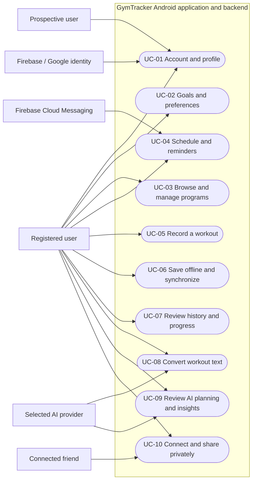
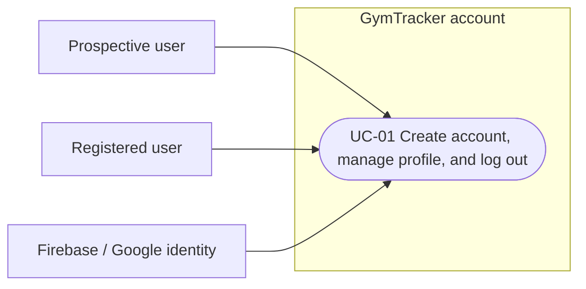
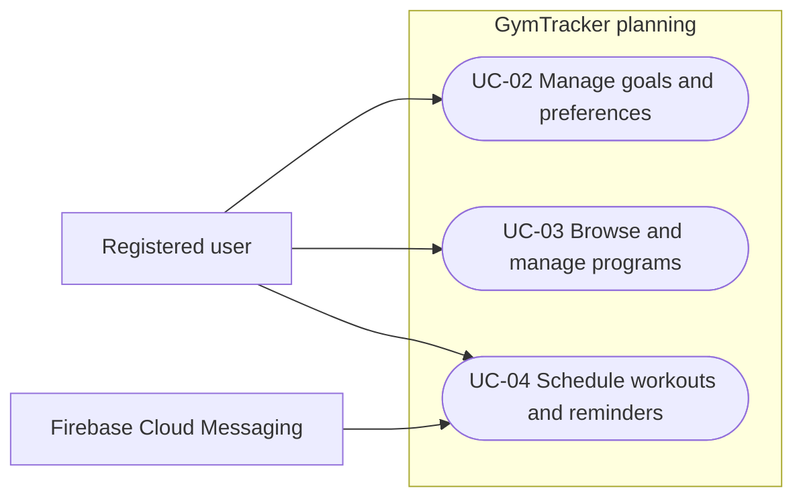
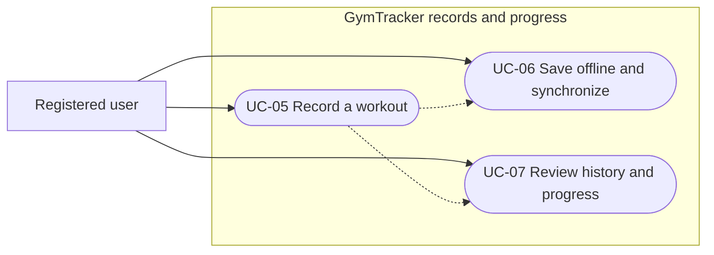
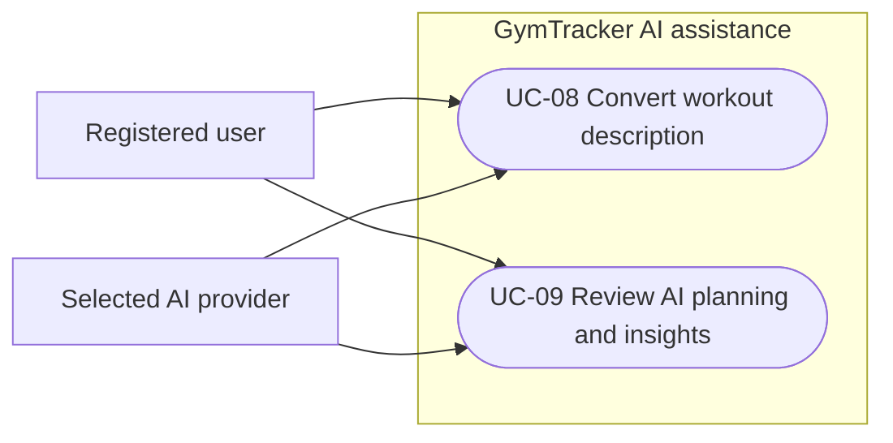
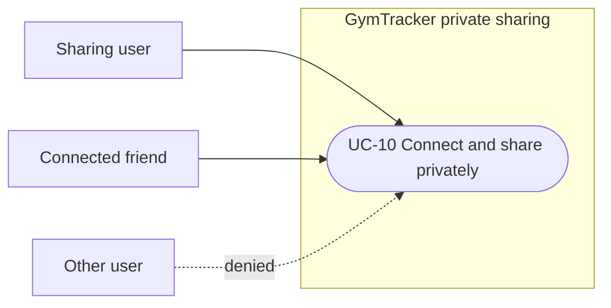
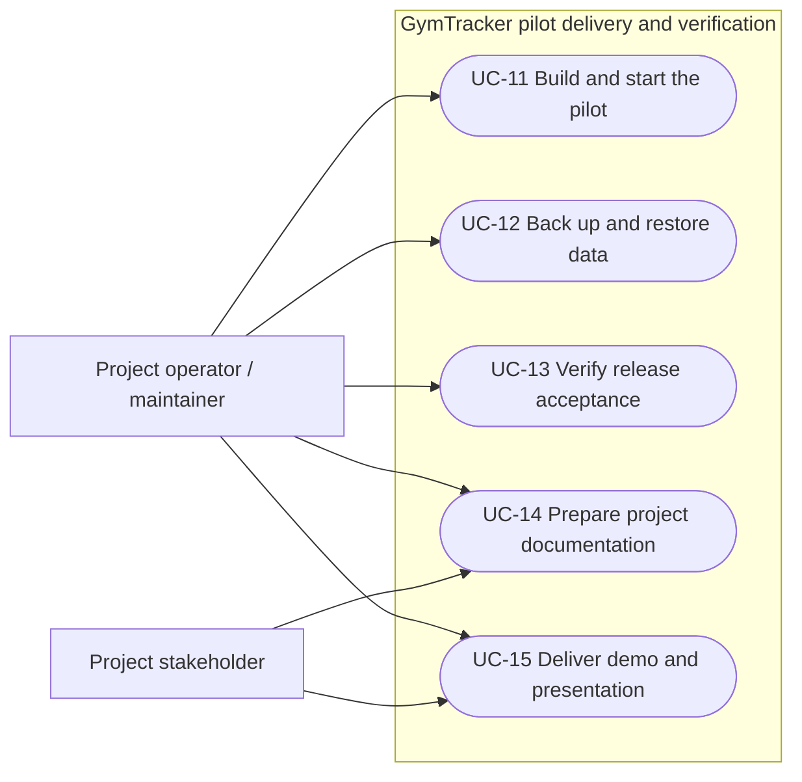

# Software Engineering — Requirements Specification

## Cover Page

| Field | Details |
|---|---|
| **Course** | BLG 411E Software Engineering |
| **Report name** | Requirements Specification |
| **Project title** | GymTracker: AI-assisted Fitness Planning and Tracking |
| **Group name / number** | CSHA |
| **Group members** | Ahmet Abalı — 150240052; Can Sei Keçeci — 150240007; Hamza Çevikbaş — 150240025; Selim Efe Aytemur — 150230070 |
| **Instructor** | Prof. Dr. Tolga Ovatman; Assoc. Prof. Dr. Ayşe Tosun |
| **Submission date** | 2026-11-08 |
| **Document version** | 1.0 |

## 1. Introduction

GymTracker is an Android-first application for beginners, recreational athletes, and trainers aged 16 and above. It supports training plans, workout records, progress review, and private sharing between connected users. Users can enter records directly or ask the AI assistant to prepare editable suggestions. AI output remains a proposal and is not saved until the user confirms it. GymTracker does not provide medical or clinical advice. The pilot also includes offline workout drafts, calendar reminders, a PostgreSQL-backed API, deployment assets, and verification evidence.

This specification defines the mandatory requirements and their acceptance conditions. Requirements link to Project Plan task (T-##), deliverable (D-##), and work-breakdown (WBS-#.#) identifiers. Tasks T-01 through T-12 form the baseline. Optional tasks T-13 through T-17 are deferred, as are web and iOS clients, nutrition diaries, GPS cardio tracking, and wearable imports.

The remaining sections define functional and quality requirements, user roles, representative scenarios, user stories, diagrams, and detailed use cases. Each requirement includes an observable acceptance condition; each planned feature links to a use case. Supporting verification and delivery work is linked to operational requirements and use cases.

## 2. System Requirements

### 2.1 Functional Requirements

All requirements in this table are mandatory for the pilot.

| Requirement ID | Related task(s) | Related deliverable(s) | Functional requirement | Priority | Verification / acceptance condition |
|---|---|---|---|---|---|
| FR-01 | T-01 | D-01, D-08 | The system shall allow a person to create an account and sign in using email or Google identity. The backend shall validate the Firebase identity token for protected requests. | Must | A new email user and a Google user reach the dashboard; unauthenticated and expired-token requests to protected endpoints are rejected. |
| FR-02 | T-01 | D-01 | The system shall provide onboarding and allow an authenticated user to view and edit their own profile. | Must | Profile and onboarding values persist after restart; a request for another user's profile is rejected. |
| FR-03 | T-01, T-06 | D-01, D-04 | When a user chooses logout, the system shall explain that unsynchronized local drafts and queued writes will be deleted. On confirmation, it shall clear that user's local drafts and queue before ending the local session. | Must | Confirming logout removes the current user's local drafts and queued writes; cancelling the warning leaves the session and data intact. |
| FR-04 | T-02 | D-01 | The system shall let an authenticated user create and edit manual fitness goals, experience level, available equipment, notification preferences, and privacy preferences. | Must | Values persist after restart and remain scoped to the owning account. |
| FR-05 | T-03 | D-02, D-08 | The system shall let users browse the reviewed exercise catalogue by primary muscle group and retrieve the predefined program templates. | Must | The catalogue contains at least 20 reviewed exercises and three templates; catalogue filtering and template retrieval return the seeded records through the application and API. |
| FR-06 | T-03 | D-02, D-08 | The system shall let a user create, edit, and reuse a program from catalogue exercises or a predefined template. Each edit shall create a new immutable program version; completed workouts shall retain the version used when logged. | Must | A user can create, edit, and reuse a program; invalid set values are rejected; a prior workout remains associated with its original program version after a later edit. |
| FR-07 | T-04 | D-03 | The system shall display planned sessions in weekly and monthly calendar views and let the owner create, move, and cancel a session. The calendar shall present sessions in the user's display timezone. | Must | A session can be created, moved, and cancelled; stored UTC time and displayed local time pass the Project Plan timezone cases. |
| FR-08 | T-04 | D-03 | The system shall let a user set a reminder lead time for a scheduled workout and shall default that lead time to 30 minutes. It shall dispatch reminders through FCM and re-check cancellation before sending. | Must | The reminder job dispatches at the configured lead time and a controlled-device test records the delivery outcome; a cancelled session does not dispatch a reminder. |
| FR-09 | T-05 | D-04 | The system shall let a user record a workout during or after a session, including exercises, sets, repetitions, and external load, and edit or delete their own records. | Must | Owned workout and set records can be created, edited, and deleted; invalid units and references are rejected; another user's record cannot be changed. |
| FR-10 | T-06 | D-04, D-08 | The system shall save workout drafts and pending operations locally while offline, scoped to the current user, and retain them across application restart. | Must | A locally saved draft and queue survive app termination and restart; account data remain isolated. |
| FR-11 | T-06 | D-04, D-08 | When connectivity returns, the system shall replay queued operations in order, retry transient failures with bounded retries, and use a client-generated operation ID so replaying an operation creates at most one server record. For edits, the most recently synchronized write shall replace the server version. | Must | Duplicate replay creates one record; queued operations replay in order; an offline edit replaces the server copy after reconnection. |
| FR-12 | T-07 | D-06 | The system shall let an authenticated user browse their workout history and inspect the details of a selected record. | Must | History list and detail show the user's saved records, including an empty state and an error state. |
| FR-13 | T-07 | D-06 | The system shall calculate training volume as the sum of repetitions multiplied by external load over eligible resistance sets; count bodyweight exercises by repetitions only; calculate session frequency as completed sessions in the selected period; report exercise-specific maximum-load and maximum-repetition records; and count completed sets by each exercise's primary muscle. | Must | Documented fixture calculations match; the dashboard displays two charts of server-computed metrics; deleting or editing eligible sets recalculates derived values; muscle-group set counts use the exercise's primary muscle. |
| FR-14 | T-08 | D-05 | The system shall accept a user's natural-language workout description and produce an editable draft mapped to known catalogue exercises and structured sets. The original text shall remain available for correction. | Must | Valid sample descriptions produce editable drafts; unknown exercises, missing units, malformed provider output, timeout, or quota failure produce a clear error and preserve the original text. |
| FR-15 | T-08 | D-05 | The system shall provide an editable AI goal suggestion based on the user's stated goals and preferences. | Must | A suggestion can be reviewed, edited, accepted, or rejected; accepting it requires an explicit user action. |
| FR-16 | T-08 | D-02, D-05 | The system shall provide an editable AI program proposal based on the user's goals, experience, and available equipment. | Must | A proposal can be reviewed, edited, accepted, or rejected; no proposal is saved without explicit confirmation. |
| FR-17 | T-08 | D-05, D-06 | The system shall provide AI explanations of progress patterns using only the current user's computed metrics as insight evidence. | Must | The insight request contains only the user's computed metrics; the returned explanation is reviewable and is not treated as a historical record. |
| FR-18 | T-08 | D-05 | The AI integration shall use a provider adapter and structured responses. AI requests shall be cancellable, show progress, and time out after 30 seconds; a failed request shall leave manual workflows usable. | Must | Provider selection and model identifier are recorded; stubbed malformed, delayed, cancelled, and unavailable responses show a recoverable error and offer manual entry. |
| FR-19 | T-09 | D-07 | The system shall let users send, accept, reject, and remove friend connections. | Must | Friend request and removal flows complete between two test accounts; an unrelated third user cannot access private friend data. |
| FR-20 | T-09 | D-07 | The system shall let a user explicitly share a completed-workout summary with a selected friend and revoke that access. | Must | The selected friend can read the shared summary; a third user cannot; revocation removes access. |
| FR-21 | T-10 | D-08 | The backend shall expose documented REST API contracts through OpenAPI and use PostgreSQL as its sole persistent database, with version-controlled schema migrations. | Must | A clean PostgreSQL database migrates successfully; API contracts match implemented endpoints; ownership and migration checks run against PostgreSQL. |
| FR-22 | T-10 | D-08, D-09 | The project shall provide a Docker Compose pilot environment, CI workflows, and a reproducible Android release package built from a clean checkout. | Must | Compose starts the backend and PostgreSQL; CI builds backend and Flutter code and runs configured checks; the accepted tag produces the documented APK and source archive. |
| FR-23 | T-10 | D-08 | The project shall provide a PostgreSQL backup and restore procedure for the pilot dataset. | Must | An isolated restore completes within 60 minutes and row counts and sample records match the backup. |
| FR-24 | T-11 | D-01–D-09 | The project shall provide security, migration, API, client, and end-to-end verification evidence for the mandatory workflows, including negative authorization and failure-path cases. | Must | The recorded test evidence names the commit, environment, cases, outcomes, and limitations; unresolved release-blocking defects are identified. |
| FR-25 | T-11 | D-01–D-09 | The project shall measure the stated performance and accessibility targets and record release-scan and acceptance results. | Must | Measurements use the documented development host, one physical Android device, 100 seeded users, and 10,000 seeded workout sets; the release gate in Section 2.2 is met or any unmet target is accompanied by a recorded acceptance decision. |
| FR-26 | T-12 | D-10 | The project team shall produce the required requirements, analysis, design, and test reports, user and administrator documentation, and an AI-use record. | Must | Required sections and traceability links are present; another team member reproduces the setup from the documentation. |
| FR-27 | T-12 | D-10 | The project team shall prepare and deliver the demonstration using a known seed dataset, an acceptance record, and a recording fallback. | Must | The rehearsal and demonstration show the planning–logging–progress cycle, a confirmed natural-language draft, and a two-user sharing and revocation scenario. |
| FR-28 | T-12 | D-10 | The project team shall prepare and deliver a presentation that reports the problem, requirements, design, results, limitations, and next stages. | Must | The presentation package is reviewed by the team and delivery outcome is recorded. |

**Functional rules and assumptions**

- The backend derives account identity from verified Firebase tokens. App Check supplements this control but does not replace server-side authorization.
- Timestamps are stored in UTC alongside the user's display timezone. External load is normalized to kilograms. Volume is the sum of repetitions multiplied by external load for eligible resistance sets; bodyweight exercises contribute repetitions only.
- Personal records are exercise-specific and distinguish maximum load from maximum repetitions. Editing a program creates a new version; it does not change historical workouts.
- A queued write includes a client-generated operation ID. Replaying the same operation creates at most one record. For a changed record, the latest synchronized write replaces the server version, without a conflict prompt.
- Every AI-generated goal, program, workout, or explanation is an untrusted proposal until reviewed. AI output cannot call persistence directly. The user explicitly approves a workout or program before it is saved.
- A friend is a separate user account, not a privileged role. Trainers and ordinary users have the same permissions. The product has no administrator account role.
- The completed set count for a muscle group uses the primary muscle assigned to the exercise in the catalogue.

### 2.2 Non-functional Requirements

Measurement results belong in the Software Test Report. For performance measurements, use the documented development host running Docker Compose, one physical Android device, 100 seeded users, and 10,000 seeded workout sets.

| Requirement ID | Quality attribute | Non-functional requirement | Applies to | Verification / measurement |
|---|---|---|---|---|
| NFR-01 | Authorization | Every private endpoint shall derive identity from a verified Firebase token and enforce record ownership. Shared summaries shall additionally require an active friendship and share permission. | FR-01–FR-04, FR-06–FR-20 | Positive and negative API tests for unauthenticated, expired-token, non-owner, non-friend, and revoked-share requests. |
| NFR-02 | Confidentiality | Provider credentials shall remain on the server; private workout information shall be excluded from logs; networked deployments shall use TLS; local caches shall be user-scoped and cleared on confirmed logout. | Whole system | CI secret scan, sanitized-log inspection, account-switch, logout, and authorization tests. |
| NFR-03 | AI integrity | Structured AI output shall be validated against the expected schema and catalogue references. Prompts shall contain only the current user's data, and generated output shall not persist without user confirmation. | FR-14–FR-18 | Stubbed malformed JSON, prompt-injection, foreign-ID, negative-load, invented-exercise, missing-unit, and no-confirmation tests. |
| NFR-04 | Performance | Non-AI API requests shall achieve a 95th-percentile latency of at most 1 second with 10 concurrent simulated users over five minutes. Cached primary screens shall load in at most 2 seconds on the test device. | FR-01–FR-13, FR-19–FR-23 | Record endpoint mix, sample counts, and latency distribution under the stated measurement setup. Exclude AI and sign-in latency. |
| NFR-05 | AI responsiveness | The application shall show progress immediately, allow cancellation, and time out AI requests after 30 seconds. A failure shall preserve the user's original draft and offer manual entry. | FR-14–FR-18 | Delayed, cancelled, and failed-provider tests using stubs. |
| NFR-06 | Usability and accessibility | Primary flows shall support 200% text scaling, adequate contrast, labelled controls, touch targets of at least 48 dp, and visible save, synchronization, and error states. | Android primary flows | Checklist review by a member who did not build the screens and Flutter widget checks. |
| NFR-07 | Reliability and synchronization | A draft acknowledged as saved shall survive app restart. Synchronization shall be idempotent and the most recently synchronized write shall win. A cancelled session shall not dispatch a reminder. | FR-07–FR-11 | App-kill/restart, disconnect/reconnect, duplicate-operation, overwrite, and reminder-cancellation scenarios. |
| NFR-08 | Calculation correctness | Derived metrics shall use documented units and eligible stored sets; edits and deletions shall propagate to derived values. | FR-12–FR-13 | Compare against hand-computed fixtures for empty history, deleted sets, zero external load, mixed exercise categories, and both personal-record types. |
| NFR-09 | Recoverability | PostgreSQL backups for the pilot dataset shall be restorable within 60 minutes. | FR-21–FR-23 | Restore rehearsal in an isolated instance with row-count and sample-record comparison; record elapsed time. |
| NFR-10 | Maintainability | The project shall use version-controlled migrations, lint and format checks, peer-reviewed changes, OpenAPI contracts, and an isolated AI provider adapter. | D-08, D-09 | CI results and review evidence; mandatory checks pass before release. |
| NFR-11 | Cost control | AI request counts and input/output sizes shall be bounded by configuration. AI features shall be disabled when the approved budget is reached while manual functions remain available. | FR-14–FR-18 | Simulated quota-exhaustion check and inspection of configured limits. |
| NFR-12 | Release integrity | Release requires mandatory deliverables to meet their acceptance criteria, primary end-to-end scenarios to pass, no open severity-1 defect (private-data exposure, data loss, or application-wide failure), no open severity-2 defect (mandatory workflow unusable without a workaround), and no unreviewed critical or high scan finding. | D-01–D-10 | Release checklist and recorded scan and acceptance results. Any unmet performance or accessibility target must include a recorded acceptance decision. |

## 3. Use Cases

### 3.1 User Types

| User type ID | User type / actor | Description and responsibilities | Goals / typical actions | Related requirement IDs |
|---|---|---|---|---|
| UT-01 | Registered user | A person who uses GymTracker to plan training, keep records, and review progress. Fitness trainers use the same user role and permissions. | Manage their own account, goals, plans, schedule, records, metrics, and shares. | FR-01–FR-20 |
| UT-02 | Prospective user | A person who has not yet completed account setup. | Register or sign in with email or Google and complete onboarding. | FR-01–FR-02 |
| UT-03 | Connected friend | A separate registered user who has an accepted connection and may receive a selected workout summary. | Accept a connection request and view summaries explicitly shared with them. | FR-19–FR-20 |
| UT-04 | Project operator / maintainer | A team member who prepares, runs, verifies, backs up, and documents the pilot. This is an operational project role, not an in-app administrator account. | Build and deploy the pilot, restore data, review scans and test evidence, and prepare project deliverables. | FR-21–FR-28 |
| UT-05 | Firebase Authentication / Google Sign-In | External identity services used for registration and authentication. | Authenticate a person and provide identity tokens for backend verification. | FR-01 |
| UT-06 | AI provider | The single selected external provider behind the adapter. | Return structured proposals or explanations to the backend. | FR-14–FR-18 |
| UT-07 | Firebase Cloud Messaging | External notification service. | Deliver workout reminders to the user's device. | FR-08 |

**Access distinctions.** Users can read and modify only their own private data. An accepted friend can read only the workout summaries that the owner explicitly shares and has not revoked. The app has no privileged trainer or administrator role. Operational access to deployment and database tooling is governed by the project environment and is not a separate mobile-app permission level.

### 3.2 User Scenarios

**SC-01 — Set up an account and profile**  
**Persona:** P-01 — New trainee  
**Related requirements:** FR-01, FR-02

A new trainee installs the Android application and chooses email or Google sign-in. After identity is established, the application guides the trainee through onboarding and opens the dashboard. The trainee can later edit their own profile; the saved values remain available after restart.

**SC-02 — Plan a week of training**  
**Persona:** P-01 — New trainee  
**Related requirements:** FR-04–FR-08

The trainee records a goal and available equipment, browses exercises by primary muscle, and chooses a template or creates a program. They schedule a session in the calendar and adjust the reminder lead time if needed. The calendar shows the session in local time and the system schedules a reminder using the configured lead time.

**SC-03 — Record a session without connectivity**  
**Persona:** P-02 — Returning trainee  
**Related requirements:** FR-09–FR-13

A returning trainee records sets and repetitions while offline. The application confirms that the draft is saved locally. After the phone reconnects, queued writes replay and the history and derived metrics update. If an offline edit and an earlier server copy conflict, the latest synchronized write replaces the server copy as documented.

**SC-04 — Use AI assistance for a workout or training plan**  
**Persona:** P-02 — Returning trainee  
**Related requirements:** FR-14–FR-18

After training, the trainee can type a natural-language description and review the structured workout draft before confirming it. When planning instead, the trainee can ask for a goal or program suggestion, or an explanation of computed progress. In each case the result remains reviewable; a goal or program is saved only after explicit approval. If the provider fails, the original workout text remains and manual entry is available.

**SC-05 — Share a completed workout privately**  
**Persona:** P-03 — Social trainee  
**Related requirements:** FR-19–FR-20

A trainee sends a friend request and waits for it to be accepted. They then choose a completed-workout summary and share it with that friend. A third account cannot view it. The owner can revoke the share, after which the former recipient no longer has access.

**SC-06 — Prepare and verify the pilot delivery**  
**Persona:** P-05 — Project maintainer  
**Related requirements:** FR-21–FR-28, NFR-09–NFR-12

A maintainer starts the PostgreSQL-backed Compose environment from a clean checkout, follows the setup guide, applies migrations, and checks the API and Android build. The team executes the agreed security, performance, accessibility, backup, and end-to-end checks, records their results, prepares the reports and guides, and rehearses the demonstration on seed data.

**SC-07 — Review AI planning and progress suggestions**  
**Persona:** P-04 — Goal-oriented trainee  
**Related requirements:** FR-15–FR-18

The trainee asks GymTracker for a goal or program suggestion based on their saved goals, experience, and available equipment, or asks for an explanation of progress metrics. The system presents an editable proposal or explanation based on the trainee's own data. The trainee can accept, edit, or reject a proposal, while manual planning remains available if the provider cannot respond.

#### User Stories Linked to the Project Plan

Each mandatory WBS activity appears below with a unique user-story ID. User-facing work is written as a user story; internal, technical, verification, or project-delivery work is explicitly labelled and linked to the requirement it supports. Optional WBS-13.1 through WBS-17.2 are deferred.

| User story ID | Scenario | Project Plan WBS activity | User story or internal activity explanation | Related requirements |
|---|---|---|---|---|
| US-01 | SC-02 | WBS-1.1 | As a trainee, I want a clear screen layout and navigation so that I can find the main training tasks. | FR-02–FR-09 |
| US-02 | SC-01 | WBS-1.2 | As a prospective user, I want sign-in, onboarding, and profile screens so that I can set up and use my account. | FR-01–FR-02 |
| US-03 | SC-01 | WBS-1.3 | Internal: implement token verification and owner-scoped profile APIs so user data stays private. | FR-01–FR-03, NFR-01 |
| US-04 | SC-01 | WBS-1.4 | Internal: configure Firebase, Google Sign-In fingerprints, and App Check for the documented Android environments. | FR-01, NFR-01 |
| US-05 | SC-02 | WBS-2.1 | As a trainee, I want to maintain my goals, experience, equipment, and preferences so that plans reflect my situation. | FR-04 |
| US-06 | SC-02 | WBS-3.1 | Internal: define ownership, units, and program-version storage and seed at least 20 reviewed exercises and three templates. | FR-05–FR-06, FR-21 |
| US-07 | SC-02 | WBS-3.2 | As a trainee, I want to filter exercises and retrieve templates so that I can choose suitable program content. | FR-05 |
| US-08 | SC-02 | WBS-3.3 | Internal: provide owner-scoped program APIs with immutable version snapshots. | FR-06, FR-21 |
| US-09 | SC-02 | WBS-3.4 | As a trainee, I want to create, edit, and reuse a program so that I can organize a repeatable routine. | FR-06 |
| US-10 | SC-02 | WBS-4.1 | As a trainee, I want weekly and monthly calendar views so that I can plan sessions and change them when needed. | FR-07–FR-08 |
| US-11 | SC-02 | WBS-4.2 | Internal: store scheduled times in UTC with the user's display timezone and validate create, move, and cancel operations. | FR-07 |
| US-12 | SC-02 | WBS-4.3 | Internal: send reminders through FCM at the configured lead time and suppress reminders for cancelled sessions. | FR-08 |
| US-13 | SC-03 | WBS-5.1 | As a trainee, I want to enter, edit, and delete workout sets so that my record reflects the completed session. | FR-09 |
| US-14 | SC-03 | WBS-5.2 | Internal: provide transactional, owner-scoped APIs that validate workout units and program-version references. | FR-09, FR-21, NFR-01 |
| US-15 | SC-01, SC-03 | WBS-6.1 | As a trainee, I want local drafts to persist while offline and a clear warning before confirmed logout deletes pending work so that I understand what happens to unsynchronized records. | FR-03, FR-10 |
| US-16 | SC-03 | WBS-6.2 | Internal: make synchronization endpoints idempotent using client-generated operation IDs. | FR-11 |
| US-17 | SC-03 | WBS-6.3 | As a trainee, I want queued changes to synchronize after reconnection so that my saved records reach the server. | FR-11 |
| US-18 | SC-03 | WBS-7.1 | Internal: define metric rules and hand-computed fixtures for empty history, deleted sets, zero load, mixed categories, and record types. | FR-13, NFR-08 |
| US-19 | SC-03 | WBS-7.2 | Internal: calculate volume as the sum of repetitions multiplied by load over eligible resistance sets, count sessions in the selected period, calculate records, and count completed sets by primary muscle. | FR-13 |
| US-20 | SC-03 | WBS-7.3 | As a trainee, I want a history and dashboard with two charts so that I can review my records and progress. | FR-12–FR-13 |
| US-21 | SC-04 | WBS-8.1 | Internal: select one provider and record the model, latency, cost, data handling, and structured-output support behind an adapter. | FR-18, NFR-03, NFR-05, NFR-11 |
| US-22 | SC-04 | WBS-8.2 | As a trainee, I want my workout description converted into a structured draft so that I can avoid entering every set manually. | FR-14, FR-18 |
| US-23 | SC-04 | WBS-8.3 | As a trainee, I want to review, correct, approve, or discard an AI draft so that no generated workout is saved without my decision. | FR-14, FR-18 |
| US-24 | SC-07 | WBS-8.4 | As a trainee, I want editable goal and program suggestions and explanations of my computed progress so that I can consider options while retaining control. | FR-15–FR-18 |
| US-25 | SC-07 | WBS-8.5 | As a trainee, I want review screens and manual alternatives so that provider outages do not block planning. | FR-15–FR-18 |
| US-26 | SC-05 | WBS-9.1 | Internal: enforce request, friendship, share, and revocation rules in the API. | FR-19–FR-20, NFR-01 |
| US-27 | SC-05 | WBS-9.2 | As a trainee, I want friend and share controls so that I can choose who sees a workout summary and later revoke access. | FR-19–FR-20 |
| US-28 | SC-06 | WBS-10.1 | Internal: create repository, CI, and Compose foundations and verify PostgreSQL migrations and rollback. | FR-21–FR-22, NFR-10 |
| US-29 | SC-06 | WBS-10.2 | As a maintainer, I want to rehearse an isolated database restore so that the pilot data can be recovered. | FR-23, NFR-09 |
| US-30 | SC-06 | WBS-10.3 | As a maintainer, I want to rebuild the accepted tag from a clean checkout so that the release package is reproducible. | FR-22 |
| US-31 | SC-06 | WBS-10.4 | Internal: repeat backup/restore and dependency/image scans on the feature-complete build. | FR-23–FR-25, NFR-09, NFR-12 |
| US-32 | SC-06 | WBS-11.1 | Internal: provide CI security scans and reusable authorization test fixtures. | FR-24–FR-25, NFR-01–NFR-03, NFR-12 |
| US-33 | SC-06 | WBS-11.2 | Internal: exercise duplicate replay, restart with queued work, offline overwrite, and reminder cancellation. | FR-08, FR-10–FR-11, FR-24 |
| US-34 | SC-06 | WBS-11.3 | Internal: verify adversarial AI inputs and ownership/friendship checks on integrated endpoints. | FR-14–FR-20, FR-24, NFR-01, NFR-03 |
| US-35 | SC-06 | WBS-11.4 | Internal: verify scheduling, logging, progress, sharing, revocation, and recalculation together. | FR-07–FR-13, FR-19–FR-20, FR-24 |
| US-36 | SC-06 | WBS-11.5 | Internal: review accessibility targets and reproduce installation instructions on another team member's environment. | FR-22, FR-25–FR-26, NFR-06 |
| US-37 | SC-06 | WBS-11.6 | Internal: execute and record API, database, and AI regression results with commit and environment details. | FR-24–FR-25 |
| US-38 | SC-06 | WBS-11.7 | Internal: measure non-AI endpoint performance and prepare the release candidate after scans and clean install. | FR-22, FR-25, NFR-04, NFR-12 |
| US-39 | SC-06 | WBS-11.8 | Internal: rehearse end-to-end acceptance scenarios and the two-user demonstration using seed data. | FR-24–FR-27 |
| US-40 | SC-06 | WBS-11.9 | Internal: fix low-severity UI defects and rerun affected checks without adding features. | FR-24–FR-25 |
| US-41 | SC-06 | WBS-11.10 | Internal: document post-test-report changes with the commit, affected cases, and regression outcome. | FR-24, FR-26 |
| US-42 | SC-06 | WBS-12.1 | As a project stakeholder, I want a reviewed requirements report so that the mandatory scope and acceptance conditions are agreed. | FR-26 |
| US-43 | SC-06 | WBS-12.2 | As a project stakeholder, I want a reviewed analysis report so that domain rules, workflows, metrics, and privacy constraints are documented. | FR-26 |
| US-44 | SC-06 | WBS-12.3 | As a project stakeholder, I want a reviewed design report so that architecture, schema, API, state, security, and deployment decisions are recorded. | FR-26 |
| US-45 | SC-06 | WBS-12.4 | As a project stakeholder, I want a reviewed test report so that executed tests, outcomes, defects, environment, and limitations are visible. | FR-26 |
| US-46 | SC-06 | WBS-12.5 | As a user or maintainer, I want setup, user, and administrator guidance and an AI-use record so that I can use or reproduce the pilot. | FR-26 |
| US-47 | SC-06 | WBS-12.6 | As a project stakeholder, I want a presentation covering results and limitations so that the project can be assessed. | FR-28 |
| US-48 | SC-06 | WBS-12.7 | As a project stakeholder, I want a prepared demo fixture, recording fallback, and acceptance form so that the demonstration can be completed if a provider or network fails. | FR-27 |
| US-49 | SC-06 | WBS-12.8 | As a project stakeholder, I want the team to deliver the demonstration and record its outcome so that the pilot is reviewable. | FR-27 |
| US-50 | SC-06 | WBS-12.9 | As a project stakeholder, I want the team to deliver the presentation and record its outcome so that the project results are communicated. | FR-28 |

### 3.3 Use Case Diagrams

The diagrams use Mermaid flowchart notation to show actors outside the named boundary and use cases inside it. They are views of the documented use cases, not separate requirements. Project-delivery activities use a separate delivery boundary because report preparation and demonstration are project deliverables rather than in-app capabilities.

#### 3.3.1 Whole-System Diagram — GymTracker application

**Diagram notes:** Registration and sign-in are available to prospective users; protected account actions require authentication and are owner-scoped. A connected friend can access only a summary shared with that account. Identity, AI, and notification services are external actors. No public sharing, group chat, or joint-workout behavior is included.

#### 3.3.2 Account and profile

**Functionality covered:** T-01 / FR-01–FR-03 / UC-01

#### 3.3.3 Planning and scheduling

**Functionality covered:** T-02, T-03, T-04 / FR-04–FR-08 / UC-02–UC-04

#### 3.3.4 Workout logging and progress

**Functionality covered:** T-05, T-06, T-07 / FR-09–FR-13 / UC-05–UC-07

#### 3.3.5 AI assistance

**Functionality covered:** T-08 / FR-14–FR-18 / UC-08–UC-09

#### 3.3.6 Friends and private sharing

**Functionality covered:** T-09 / FR-19–FR-20 / UC-10

#### 3.3.7 Platform, verification, and project delivery

**Functionality covered:** T-10–T-12 / FR-21–FR-28 / UC-11–UC-15

### 3.4 Use Cases

#### 3.4.1 Use Case Coverage Matrix

| Project Plan task | Functional requirement IDs | Use case IDs | Scenario IDs |
|---|---|---|---|
| T-01 | FR-01–FR-03 | UC-01 | SC-01 |
| T-02 | FR-04 | UC-02 | SC-02 |
| T-03 | FR-05–FR-06 | UC-03 | SC-02 |
| T-04 | FR-07–FR-08 | UC-04 | SC-02 |
| T-05 | FR-09 | UC-05 | SC-03 |
| T-06 | FR-03, FR-10–FR-11 | UC-01, UC-06 | SC-01, SC-03 |
| T-07 | FR-12–FR-13 | UC-07 | SC-03 |
| T-08 | FR-14–FR-18 | UC-08, UC-09 | SC-04, SC-07 |
| T-09 | FR-19–FR-20 | UC-10 | SC-05 |
| T-10 | FR-21–FR-23 | UC-11, UC-12 | SC-06 |
| T-11 | FR-24–FR-25 | UC-13 | SC-06 |
| T-12 | FR-26–FR-28 | UC-14, UC-15 | SC-06 |

All optional tasks T-13–T-17 are excluded from the baseline and therefore from this use-case matrix.

#### 3.4.2 UC-01 — Create account, manage profile, and log out

| Field | Description |
|---|---|
| **Use case ID** | UC-01 |
| **Goal** | Establish and manage a private user account. |
| **Primary actor(s)** | UT-02 prospective user; UT-01 registered user |
| **Supporting actors** | UT-05 Firebase Authentication / Google Sign-In |
| **Related tasks** | T-01 |
| **Related requirements** | FR-01–FR-03 |

**Preconditions:** The application is installed. For profile editing or logout, the user is signed in.

**Main success flow:**

1. The prospective user chooses email or Google sign-in.
2. The identity service authenticates the user and returns a token.
3. The backend validates the token and returns the account-scoped profile.
4. The user completes onboarding or edits their profile.
5. The system saves the values for that account and displays the dashboard.
6. When the user later chooses logout, the system explains that unsynchronized drafts and queued writes will be deleted.
7. The user confirms; the application clears that user's local drafts and queue, then ends the local session.

**Alternative flows:**

- **A1 — User cancels logout (branches from step 6):** The user declines the warning. The system keeps the session and local data and returns to the current screen.
- **A2 — User signs in with the other supported method (branches from step 1):** The user selects the other available identity method. The system continues at step 2.

**Exception flows:**

- **E1 — Authentication or token validation fails (steps 2–3):** The system reports that sign-in failed and offers another attempt. It does not open protected account data.
- **E2 — Logout cleanup fails (step 7):** The system reports the failure and does not claim logout completed until local user-scoped data has been cleared.

**Postconditions:** On successful sign-in, a session is established for the authenticated account. On confirmed logout, no local draft or queued write from that account remains.

#### 3.4.3 UC-02 — Manage goals and preferences

| Field | Description |
|---|---|
| **Use case ID** | UC-02 |
| **Goal** | Save the user's goals, experience, equipment, and preferences. |
| **Primary actor** | UT-01 registered user |
| **Related tasks** | T-02 |
| **Related requirements** | FR-04 |

**Preconditions:** The user is authenticated.

**Main success flow:**

1. The user opens goals and preferences.
2. The system displays the current saved values.
3. The user adds or edits goals, experience level, available equipment, notification preferences, or privacy preferences.
4. The user saves the changes.
5. The system validates and stores the values for that account and confirms the update.

**Alternative flows:**

- **A1 — User leaves without changes (branches from step 3):** The user returns to the prior screen; the system retains saved values.
- **A2 — User edits one category only (branches from step 3):** The system updates only the selected values and retains the rest.

**Exception flows:**

- **E1 — Invalid values (step 4):** The system identifies the invalid fields and does not replace the last saved values.
- **E2 — Save unavailable (step 4):** The system reports that the change was not saved and lets the user retry.

**Postconditions:** Successfully saved values persist for the user's account and are available to applicable planning flows.

#### 3.4.4 UC-03 — Browse exercises and manage a program

| Field | Description |
|---|---|
| **Use case ID** | UC-03 |
| **Goal** | Select exercises and create or update a reusable training program. |
| **Primary actor** | UT-01 registered user |
| **Related tasks** | T-03 |
| **Related requirements** | FR-05–FR-06 |

**Preconditions:** The user is authenticated; catalogue and template data are available.

**Main success flow:**

1. The user browses exercises by primary muscle or opens a predefined template.
2. The system presents matching catalogue entries or the selected template.
3. The user selects exercises and defines the program's sets and other supported structure.
4. The system validates the entries and saves the program.
5. The system confirms the saved program and its version.

**Alternative flows:**

- **A1 — User creates a program from scratch (branches from step 1):** The user skips templates and selects catalogue items directly, then continues at step 3.
- **A2 — User edits an existing program (branches from step 1):** The system saves the edit as a new immutable version; prior workout references remain unchanged.

**Exception flows:**

- **E1 — Invalid set data (step 4):** The system identifies invalid values and keeps the user in the editor without saving that version.
- **E2 — Catalogue or API unavailable (steps 1–2):** The system reports the problem and permits retry; it does not present unavailable content as saved.

**Postconditions:** The program is available to its owner as a saved version and can be reused in a later plan or workout.

#### 3.4.5 UC-04 — Schedule a workout and configure its reminder

| Field | Description |
|---|---|
| **Use case ID** | UC-04 |
| **Goal** | Schedule, move, or cancel a training session and select its reminder lead time. |
| **Primary actor** | UT-01 registered user |
| **Supporting actor** | UT-07 Firebase Cloud Messaging |
| **Related tasks** | T-04 |
| **Related requirements** | FR-07–FR-08 |

**Preconditions:** The user is authenticated and the calendar is available.

**Main success flow:**

1. The user opens a weekly or monthly calendar view.
2. The system displays scheduled sessions in the user's display timezone.
3. The user creates a session and chooses a date/time and reminder lead time, or accepts the 30-minute default.
4. The system stores the session time in UTC with the display timezone and schedules a reminder.
5. The system shows the new session in the calendar.
6. At the configured lead time, the reminder job dispatches the notification through FCM. A controlled-device test records the delivery outcome.

**Alternative flows:**

- **A1 — User moves a session (branches from step 2):** The user changes its date or time. The system updates the stored time and reminder schedule.
- **A2 — User cancels a session (branches from step 2):** The system marks it cancelled and removes or suppresses its reminder.
- **A3 — User selects another reminder lead time (branches from step 3):** The system uses the selected value for the session.

**Exception flows:**

- **E1 — Invalid date/time or timezone conversion (step 4):** The system explains the error and does not save an ambiguous session.
- **E2 — Notification permission or delivery failure (step 6):** The session remains visible in the calendar; the application reports the limitation where possible and does not change the session's saved state.

**Postconditions:** The session has an unambiguous saved time and reminder configuration, or is cancelled with no reminder sent.

#### 3.4.6 UC-05 — Record a workout

| Field | Description |
|---|---|
| **Use case ID** | UC-05 |
| **Goal** | Save a completed workout with its exercises and set details. |
| **Primary actor** | UT-01 registered user |
| **Related tasks** | T-05 |
| **Related requirements** | FR-09 |

**Preconditions:** The user is authenticated. The user has opened a live or post-workout entry form.

**Main success flow:**

1. The user starts a workout record or selects a planned program version.
2. The system displays the entry form.
3. The user enters exercises, sets, repetitions, and external load.
4. The system validates supported units and referenced exercises/program version.
5. The user saves the workout.
6. The system stores the record under the user's account and confirms the result.

**Alternative flows:**

- **A1 — User logs after training (branches from step 1):** The user opens post-workout entry instead of live entry and continues at step 2.
- **A2 — User edits or deletes a saved workout (branches from step 2):** The system requests confirmation, applies the change only to the owner's record, and recalculates affected metrics.

**Exception flows:**

- **E1 — Invalid units or references (step 4):** The system identifies the invalid entry and keeps the form available for correction.
- **E2 — API unavailable (step 5):** The system offers to save the workout as a local draft and queue it for synchronization.

**Postconditions:** The workout is saved on the server or retained as a user-scoped local draft pending synchronization.

#### 3.4.7 UC-06 — Save a workout offline and synchronize it

| Field | Description |
|---|---|
| **Use case ID** | UC-06 |
| **Goal** | Preserve workout changes without connectivity and apply them after reconnection. |
| **Primary actor** | UT-01 registered user |
| **Related tasks** | T-06 |
| **Related requirements** | FR-10–FR-11 |

**Preconditions:** The user is authenticated and has begun a workout entry. The network may be unavailable.

**Main success flow:**

1. The user saves or edits a workout while offline.
2. The application writes the draft and pending operation to the current user's local store.
3. The application confirms local save status.
4. On reconnection, the client replays queued operations in order, with each operation's unique ID.
5. The server applies each operation at most once and replaces a record with the latest synchronized write.
6. The client marks successful operations complete and refreshes the server-backed record.

**Alternative flows:**

- **A1 — Application restarts before reconnection (branches from step 4):** The client loads the user's local queue after restart and continues replay when connectivity returns.
- **A2 — Duplicate operation is replayed (branches from step 5):** The server recognizes the operation ID and does not create a second record.

**Exception flows:**

- **E1 — Transient sync failure (step 4):** The client keeps the operation pending and retries within its configured bound.
- **E2 — User logs out with pending work (step 1 or 2):** The application warns that unsynchronized data will be deleted. On confirmation, it clears the local drafts and queue as specified by UC-01; on cancellation, the session and data remain.

**Postconditions:** Each successfully synchronized operation is reflected once on the server. Remaining operations stay queued until success or bounded retry handling completes.

#### 3.4.8 UC-07 — Review workout history and progress

| Field | Description |
|---|---|
| **Use case ID** | UC-07 |
| **Goal** | Review saved workout records and deterministic progress metrics. |
| **Primary actor** | UT-01 registered user |
| **Related tasks** | T-07 |
| **Related requirements** | FR-12–FR-13 |

**Preconditions:** The user is authenticated.

**Main success flow:**

1. The user opens history or the progress dashboard.
2. The system retrieves the user's own workout records and computed metrics.
3. The system displays history details, training volume, completed-session frequency for the selected period, personal records, and completed-set counts grouped by each exercise's primary muscle. The dashboard includes two charts of server-computed metrics.
4. The user selects a record or chart for further detail.
5. The system displays the selected record or metric details.

**Alternative flows:**

- **A1 — No workout records exist (branches from step 2):** The system shows an empty state and explains how to add a workout.
- **A2 — A record is edited or deleted (branches from step 3):** The system recalculates affected derived results and refreshes the history/dashboard.

**Exception flows:**

- **E1 — Data retrieval fails (step 2):** The system shows an error state and permits retry without presenting stale calculations as current.
- **E2 — A non-owner requests a record (step 2):** The backend rejects access and does not return the private record.

**Postconditions:** The user sees only their records and metric values derived from the documented calculation rules.

#### 3.4.9 UC-08 — Convert a workout description into a draft

| Field | Description |
|---|---|
| **Use case ID** | UC-08 |
| **Goal** | Reduce manual entry by converting natural language into a reviewable workout draft. |
| **Primary actor** | UT-01 registered user |
| **Supporting actor** | UT-06 AI provider |
| **Related tasks** | T-08 |
| **Related requirements** | FR-14, FR-18 |

**Preconditions:** The user is authenticated and the AI service is configured.

**Main success flow:**

1. The user enters a workout description.
2. The system submits it through the provider adapter for structured conversion.
3. The provider returns exercise and set data.
4. The system validates the response against the schema, catalogue, units, and allowed values.
5. The system presents the result as an editable draft alongside the original text.
6. The user reviews and edits the draft.
7. The user explicitly confirms the draft.
8. The system saves the confirmed workout and displays the result.

**Alternative flows:**

- **A1 — User rejects or discards the draft (branches from step 5):** The system does not save it and retains the original description for manual entry.
- **A2 — User corrects a draft field (branches from step 6):** The system validates the correction and returns to step 6 until the user confirms.

**Exception flows:**

- **E1 — Unknown exercise, missing unit, or invalid structured response (steps 3–4):** The system rejects unsupported fields, retains the original text, and offers manual correction.
- **E2 — Provider timeout, quota exhaustion, or cancellation (step 2):** The system stops the request, preserves the original text, reports failure, and offers manual entry.

**Postconditions:** Only a user-confirmed draft is saved. Failed or rejected AI output does not alter workout history.

#### 3.4.10 UC-09 — Review AI planning suggestions and progress explanations

| Field | Description |
|---|---|
| **Use case ID** | UC-09 |
| **Goal** | Review AI proposals for goals and programs and an explanation of computed progress. |
| **Primary actor** | UT-01 registered user |
| **Supporting actor** | UT-06 AI provider |
| **Related tasks** | T-08 |
| **Related requirements** | FR-15–FR-18 |

**Preconditions:** The user is authenticated. Relevant saved goals, preferences, or computed metrics exist for the selected request.

**Main success flow:**

1. The user selects goal suggestions, program suggestions, or a progress explanation.
2. The system gathers the relevant user-owned goals, preferences, or computed metrics.
3. The system sends the request through the configured provider adapter.
4. The system validates the structured response and displays it as a proposal or explanation.
5. The user reviews the result and may edit or reject it.
6. For a goal or program proposal, the user explicitly approves it before the system saves it. For an insight, the system presents it for review without changing history.

**Alternative flows:**

- **A1 — User requests a manual path (branches from step 1):** The system opens manual goal or program entry without calling the provider.
- **A2 — User rejects a proposal (branches from step 5):** The system discards the proposal and leaves saved goals/programs unchanged.

**Exception flows:**

- **E1 — Provider unavailable or invalid response (steps 3–4):** The system explains that no proposal is available, retains existing data, and offers manual planning.
- **E2 — Response references unsupported or foreign data (step 4):** The system rejects it and does not expose another user's data.

**Postconditions:** Approved goals or programs are saved only after user confirmation; generated insights remain explanatory and do not modify historical records.

#### 3.4.11 UC-10 — Connect with a friend and share a workout summary

| Field | Description |
|---|---|
| **Use case ID** | UC-10 |
| **Goal** | Share a selected completed-workout summary with a connected friend under owner control. |
| **Primary actors** | UT-01 registered user; UT-03 connected friend |
| **Related tasks** | T-09 |
| **Related requirements** | FR-19–FR-20 |

**Preconditions:** Both people have registered accounts.

**Main success flow:**

1. The user sends a friend request to another account.
2. The recipient accepts the request.
3. The system records the connection for both accounts.
4. The owner selects a completed-workout summary and chooses that friend as the recipient.
5. The system stores the explicit share and confirms it to the owner.
6. The friend opens the shared summary and the system checks current friendship and share status.
7. The system displays only that summary to the selected friend.

**Alternative flows:**

- **A1 — Recipient rejects the request (branches from step 2):** The system records the rejection; no connection or sharing permission is created.
- **A2 — Owner removes the connection (branches from step 3):** The system removes the friendship and denies any access that depends on that connection.
- **A3 — Owner revokes the share (branches from step 5):** The system marks the share revoked; subsequent reads are denied.

**Exception flows:**

- **E1 — Third user requests the summary (step 6):** The system rejects the request without revealing the private summary.
- **E2 — Request or share operation fails (steps 1 or 5):** The system reports failure and leaves the last confirmed relationship/share state unchanged.

**Postconditions:** Only the selected friend can access an active shared summary; removal or revocation prevents later access.

#### 3.4.12 UC-11 — Build and start the pilot environment

| Field | Description |
|---|---|
| **Use case ID** | UC-11 |
| **Goal** | Start a reproducible pilot build with documented API contracts and PostgreSQL storage. |
| **Primary actor** | UT-04 project operator / maintainer |
| **Related tasks** | T-10 |
| **Related requirements** | FR-21–FR-22 |

**Preconditions:** The maintainer has the repository, required toolchain, and documented configuration examples.

**Main success flow:**

1. The maintainer checks out the accepted source revision and supplies local configuration.
2. The maintainer starts the Docker Compose environment.
3. The backend applies version-controlled migrations to PostgreSQL.
4. The maintainer checks the health endpoint and OpenAPI contract.
5. The CI workflow builds the backend and Flutter application and runs configured checks.
6. The maintainer builds the documented Android package from the accepted tag.

**Alternative flows:**

- **A1 — Maintainer starts a clean database (branches from step 2):** Compose starts an empty PostgreSQL instance; migrations establish the schema.
- **A2 — Build is run in CI (branches from step 1):** CI checks out the source and performs the build and configured checks without a local user session.

**Exception flows:**

- **E1 — Migration, build, or health check fails (steps 3–5):** The maintainer records the failure and does not mark the pilot environment as ready.
- **E2 — Optional Kubernetes/Helm deployment requested:** This is outside the confirmed baseline; no Kubernetes acceptance is implied.

**Postconditions:** A successful run yields a reproducible Compose pilot, PostgreSQL schema, API contract, and Android package.

#### 3.4.13 UC-12 — Back up and restore pilot data

| Field | Description |
|---|---|
| **Use case ID** | UC-12 |
| **Goal** | Recover pilot data from a verified PostgreSQL backup. |
| **Primary actor** | UT-04 project operator / maintainer |
| **Related tasks** | T-10 |
| **Related requirements** | FR-23, NFR-09 |

**Preconditions:** A PostgreSQL pilot dataset and a backup procedure are available.

**Main success flow:**

1. The maintainer creates a database backup.
2. The maintainer restores the backup to an isolated PostgreSQL instance.
3. The maintainer compares row counts and sample records.
4. The maintainer records elapsed time and restore outcome.
5. The maintainer confirms that restore completed within 60 minutes and data comparisons match.

**Alternative flows:**

- **A1 — Restore is a rehearsal (branches from step 1):** The production-like pilot remains unchanged while the isolated instance is checked.
- **A2 — Restore is needed for recovery (branches from step 2):** The maintainer uses the verified restore procedure and records the affected environment.

**Exception flows:**

- **E1 — Restore or comparison fails (steps 2–4):** The maintainer marks the backup procedure as unverified, preserves the source backup, and investigates before relying on the restored instance.

**Postconditions:** The restore result, elapsed time, row comparison, and sample-record comparison are documented.

#### 3.4.14 UC-13 — Verify and accept a release candidate

| Field | Description |
|---|---|
| **Use case ID** | UC-13 |
| **Goal** | Produce evidence that the mandatory pilot workflows and release gates have been checked. |
| **Primary actor** | UT-04 project operator / maintainer |
| **Related tasks** | T-11 |
| **Related requirements** | FR-24–FR-25, NFR-01–NFR-08, NFR-12 |

**Preconditions:** An integrated release candidate and acceptance scenarios are available.

**Main success flow:**

1. The maintainer records the source commit and test environment.
2. The team runs unit, PostgreSQL integration, API, Flutter widget, security-scan, performance, accessibility, and end-to-end checks applicable to the candidate.
3. The team records case results, defects, scan findings, and measurement conditions.
4. The team checks the required planning, logging, offline sync, AI review, history, reminders, friendship, sharing, and revocation flows.
5. The team checks severity-1 and severity-2 defect status and critical/high scan findings.
6. The team records the release acceptance decision and any unmet performance or accessibility targets with an acceptance decision.

**Alternative flows:**

- **A1 — A check fails (branches from step 3):** The team records the failure and limitation, resolves the defect where feasible, and reruns the affected cases.
- **A2 — A check relies on a provider stub (branches from step 2):** The evidence labels it as stub-based and separately records any live-provider sample.

**Exception flows:**

- **E1 — Open release-blocking defect or unreviewed critical/high finding (step 5):** The candidate does not meet the release gate until resolved or reviewed as required.
- **E2 — Target is unmet (step 6):** The report records the measurement and acceptance decision; the requirement is not reported as passed.

**Postconditions:** A traceable verification record exists for the candidate, including its environment, outcomes, and limitations.

#### 3.4.15 UC-14 — Prepare project reports and user documentation

| Field | Description |
|---|---|
| **Use case ID** | UC-14 |
| **Goal** | Produce project documentation that explains requirements, design, verification, setup, and use. |
| **Primary actor** | UT-04 project operator / maintainer |
| **Supporting actor** | Project stakeholder / reviewer |
| **Related tasks** | T-12 |
| **Related requirements** | FR-26 |

**Preconditions:** Project scope, implementation decisions, and available verification evidence are documented.

**Main success flow:**

1. The team prepares requirements, analysis, design, and test reports using the required course structure.
2. The team links report content to project tasks, deliverables, and requirements.
3. The team prepares setup, user, and administrator instructions and an AI-use record.
4. A second team member follows the setup instructions.
5. The team resolves review comments and submits each deliverable by its planned deadline.

**Alternative flows:**

- **A1 — Evidence is incomplete (branches from step 3):** The report labels the limitation and identifies the missing evidence rather than claiming an unexecuted result.
- **A2 — Instructions cannot be reproduced (branches from step 4):** The maintainer corrects the setup guide and repeats the reproduction check.

**Exception flows:**

- **E1 — Required project detail is unavailable (step 2):** The team records the unresolved decision and does not invent stakeholder approval or acceptance.

**Postconditions:** The required reports and guides are available with traceability, review status, and known limitations.

#### 3.4.16 UC-15 — Deliver the demonstration and presentation

| Field | Description |
|---|---|
| **Use case ID** | UC-15 |
| **Goal** | Present the working pilot, its evidence, and its limitations to project stakeholders. |
| **Primary actor** | UT-04 project operator / maintainer |
| **Supporting actor** | Project stakeholder / reviewer |
| **Related tasks** | T-12 |
| **Related requirements** | FR-27–FR-28 |

**Preconditions:** The accepted build, seed data, acceptance record, slides, and demonstration fallback are prepared.

**Main success flow:**

1. The team loads the known seed dataset and starts the accepted build.
2. The team demonstrates the planning–logging–progress cycle.
3. The team demonstrates a user-confirmed natural-language workout draft.
4. Two accounts demonstrate private sharing and revocation.
5. If provider or network service is unavailable, the team uses the recording of the same tagged build.
6. The team presents the problem, requirements, design, results, limitations, and next stages.
7. The team records the demonstration and presentation outcomes.

**Alternative flows:**

- **A1 — Live provider or network outage (branches from step 2):** The team uses the prepared recording fallback and labels the affected portion as recorded.
- **A2 — Seed data cannot be loaded (branches from step 1):** The team restores the prepared fixture and documents the setup issue before continuing.

**Exception flows:**

- **E1 — The tagged build cannot be started (step 1):** The team presents the recording fallback, records the failure, and does not claim a successful live run.

**Postconditions:** Stakeholders receive the project presentation and a record of the demonstration outcome and any limitations.

