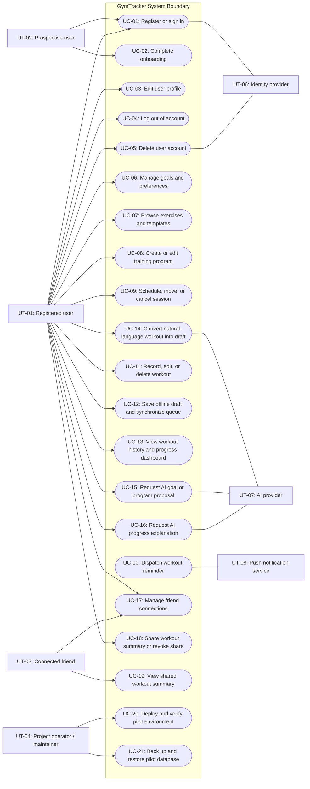
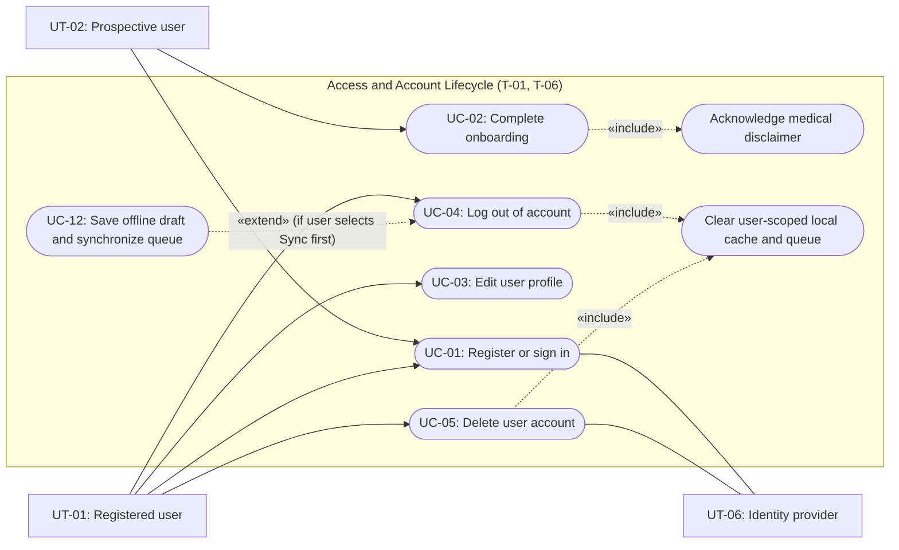
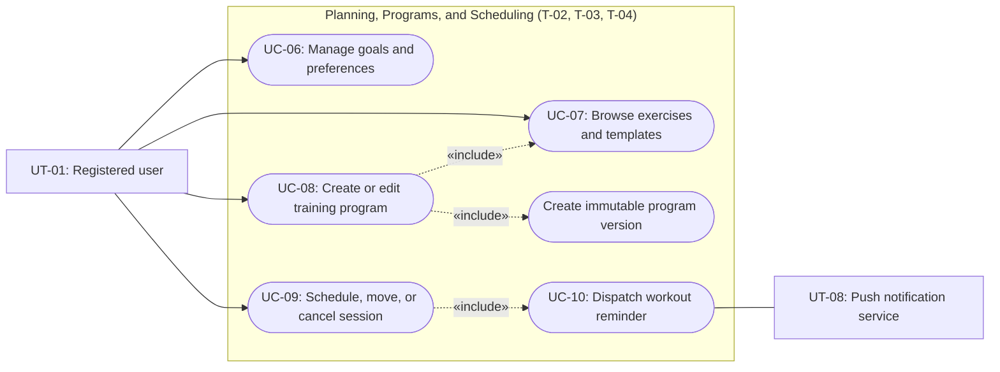
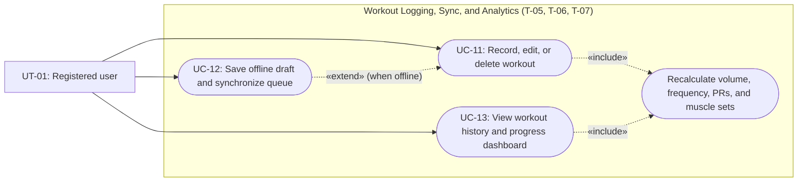
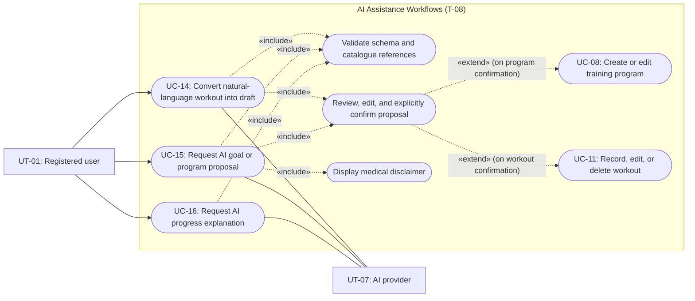
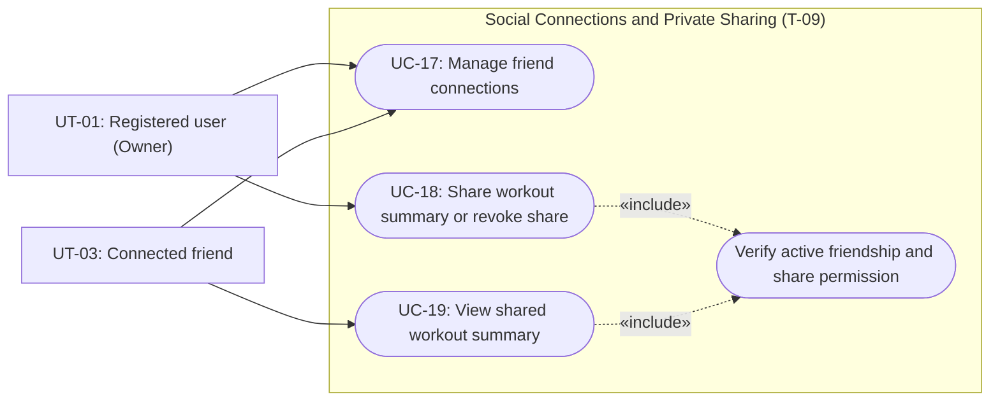
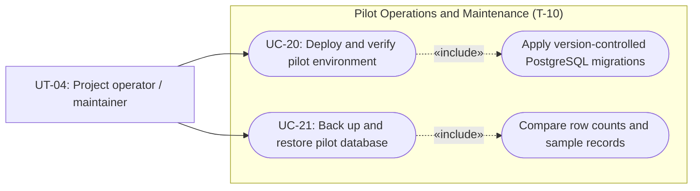

# Software Engineering — Requirements Specification

## Cover Page

| Field | Details |
|---|---|
| **Course** | BLG 411E Software Engineering |
| **Report name** | Requirements Specification |
| **Project title** | GymTracker: AI-assisted Fitness Planning and Tracking |
| **Group name / number** | CSHA |
| **Group members** | Ahmet Abalı — 150240052; Can Sei Keçeci — 150240007; Hamza Çevikbaş — 150240025; Selim Efe Aytemur — 150230070 |
| **Instructor** | Prof. Dr. Tolga Ovatman; Assoc. Prof. Dr. Ayşe Tosun |
| **Submission date** | 2026-11-08 |
| **Document version** | 1.0 |

---

## 1. Introduction

GymTracker is an Android-first application for beginners, recreational athletes, and fitness trainers aged 16 and above. It brings training plans, workout records, progress review, and private sharing between connected users into one workflow. Users can enter records directly or ask an AI assistant to prepare editable suggestions. AI output is only a proposal and is not saved until the user confirms it. GymTracker does not provide medical or clinical advice, and it shows a disclaimer saying so. The pilot also includes offline workout drafts, calendar reminders, a database-backed API, deployment assets, and verification evidence.

This document specifies **what** the pilot must do and how each requirement will be accepted. Requirements link to the Project Plan's task (`T-##`), deliverable (`D-##`), and work-breakdown (`WBS-#.#`) identifiers. Tasks T-01 to T-12 form the baseline. The optional tasks T-13 to T-17 are deferred, as are web and iOS clients, nutrition diaries, GPS cardio tracking, and wearable imports.

The rest of the document is organised as follows:

- **Section 2** gives the functional requirements (§2.1), the non-functional requirements (§2.2), and the platform constraints and project-delivery requirements (§2.3).
- **Section 3** gives the user types (§3.1), the personas, scenarios, and user stories (§3.2), the use case diagrams (§3.3), and the detailed use cases with a coverage matrix (§3.4).

### 1.1 Definitions and Abbreviations

| Term | Definition |
|---|---|
| AI proposal | Any goal, program, workout draft, or explanation generated by the AI provider. It has no effect until the user confirms it. |
| Draft | A workout record that has been saved on the device but not yet accepted by the server. |
| Queued operation | A create, update, or delete request stored on the device for later transmission to the server. Each one carries a unique operation ID. |
| Last-write-wins | When an edit to a record is accepted, the server's stored version is replaced. Order is decided by when the server **accepts** each write, not by when the edit was made on the device. |
| Eligible resistance set | A completed set of a catalogue exercise in the *resistance* category with external load ≥ 0 kg. |
| Training volume | Σ (repetitions × external load in kg) over eligible resistance sets. |
| Personal record (PR) | For one exercise, the maximum external load and, separately, the maximum repetitions in a single set. |
| Display timezone | The IANA timezone (e.g., `Europe/Istanbul`) used to display a user's dates and times. |
| Primary flows | Sign-in, onboarding, program creation, scheduling, workout recording, history, dashboard, AI draft review, and sharing. |
| Transient failure | A synchronization failure caused by lost connectivity, a timeout, or a server response in the 5xx range. |
| FCM | Firebase Cloud Messaging, the push-notification service. |
| App Check | A Firebase service that attests that requests come from the genuine application. |
| dp | Density-independent pixel (Android layout unit). |
| OpenAPI | A machine-readable specification format for REST APIs. |
| CI | Continuous integration (automated build and test pipeline). |
| KVKK / GDPR | Turkish Personal Data Protection Law No. 6698 / EU General Data Protection Regulation. |
| WCAG | Web Content Accessibility Guidelines. |
| MoSCoW | Must / Should / Could / Won't prioritisation. |

---

## 2. System Requirements

### 2.1 Functional Requirements

**Priority.** Priorities use MoSCoW. All baseline requirements are **Must** because the Project Plan's deliverable acceptance criteria (D-01 to D-07) require each of them for the pilot release. The optional tasks T-13 to T-17 (badges and quotes, group chat, joint workouts, global plan sharing, Kubernetes deployment) are **Won't (this release)**, so they are not specified here. Each requirement describes one behaviour that can be verified on its own. Technology choices are listed separately as constraints in §2.3.

#### Access and onboarding (T-01)

| Requirement ID | Related task ID(s) | Related deliverable ID(s) | Functional requirement | Priority | Verification / acceptance condition |
|---|---|---|---|---|---|
| FR-01 | T-01 | D-01, D-08 | The system shall let a prospective user create an account with an email address and password. | Must | A new email account is created and the user enters onboarding. A malformed email address, or one that is already registered, is rejected with an explanatory message. |
| FR-02 | T-01 | D-01 | The system shall let a user sign in with a registered email account or a Google account. | Must | An email user and a Google user each reach the dashboard, or onboarding on their first sign-in. Wrong credentials are rejected and no session is opened. |
| FR-03 | T-01 | D-08 | The system shall reject any request for private data that does not carry a valid, unexpired identity token. | Must | Unauthenticated and expired-token requests to every protected endpoint return an authorization error and no data. |
| FR-04 | T-01 | D-01 | On a user's first sign-in, the system shall guide them through onboarding that collects a display name and display timezone, and optionally goals, experience level, and equipment, before the dashboard opens. | Must | A first-time user completes onboarding and reaches the dashboard. The values persist after restart, and onboarding is not shown again. |
| FR-05 | T-01 | D-01 | During onboarding, the system shall display a statement that GymTracker does not provide medical advice, and shall require the user to acknowledge it before the dashboard opens. | Must | Onboarding cannot be completed without acknowledgement. The acknowledgement time is stored with the account. |
| FR-06 | T-01 | D-01, D-08 | The system shall let a signed-in user view and edit their own profile, and shall refuse access to any other user's profile. | Must | Edited values persist after restart. A request for another user's profile is rejected. |
| FR-07 | T-01, T-06 | D-01, D-04 | When a user chooses to log out while unsynchronized drafts or queued operations exist, the system shall show how many items would be deleted and offer three options: *Sync first* (only when online), *Log out anyway*, and *Cancel*. | Must | With pending items, the warning shows the correct count and the options. With no pending items, logout proceeds without a warning. |
| FR-08 | T-01, T-06 | D-01, D-04 | When logout is confirmed, the system shall delete the current user's local drafts, queued operations, and cached data before ending the local session. | Must | After a confirmed logout, none of the user's local data remain. *Cancel* leaves the session and data unchanged. A different account that signs in on the same device sees none of the previous user's data. |
| FR-09 | T-01 | D-01, D-08 | When a signed-in user requests account deletion and re-confirms it, the system shall permanently delete the user's account, profile, goals, programs, schedules, workouts, friend connections, and shares from the live database. It shall also delete the identity-provider account, clear local data, and end the session. | Must | After deletion, the API returns none of the user's records, former friends can no longer open the user's shares, and signing in with the same email creates a new, empty account. |

#### Goals and preferences (T-02)

| Requirement ID | Related task ID(s) | Related deliverable ID(s) | Functional requirement | Priority | Verification / acceptance condition |
|---|---|---|---|---|---|
| FR-10 | T-02 | D-01 | The system shall let a user create, edit, and delete their own manual fitness goals. | Must | Goals persist after restart, a deleted goal is no longer shown, and goals are not visible to other accounts. |
| FR-11 | T-02 | D-01 | The system shall let a user record their experience level and available equipment. | Must | The values persist after restart and appear in the input of an AI program proposal (FR-39). |
| FR-12 | T-02 | D-01 | The system shall let a user set notification and privacy preferences. | Must | The values persist after restart. When reminder notifications are disabled, no reminder is dispatched to that user (FR-21). |

#### Exercise catalogue and programs (T-03)

| Requirement ID | Related task ID(s) | Related deliverable ID(s) | Functional requirement | Priority | Verification / acceptance condition |
|---|---|---|---|---|---|
| FR-13 | T-03 | D-02, D-08 | The system shall let a user browse the exercise catalogue and filter it by primary muscle group. | Must | The catalogue contains at least 20 reviewed exercises (see the rules below). Filtering by a muscle group returns exactly the seeded exercises with that primary muscle. |
| FR-14 | T-03 | D-02, D-08 | The system shall let a user list and open the predefined program templates. | Must | At least three templates are listed and each one opens with its exercises and sets. |
| FR-15 | T-03 | D-02, D-08 | The system shall let a user create a program from catalogue exercises or from a template, specifying sets, repetitions, and target load. | Must | A program can be created both ways. Non-positive repetitions or set counts and negative loads are rejected. |
| FR-16 | T-03 | D-02, D-08 | When a user edits a program, the system shall save the result as a new immutable version and keep earlier versions unchanged. | Must | After an edit, a workout logged against the earlier version still references that version and shows its original content. |
| FR-17 | T-03 | D-02 | The system shall let a user select a saved program when scheduling a session or starting a workout. | Must | A saved program can be selected in both flows, and the selection records the current program version. |

#### Calendar and reminders (T-04)

| Requirement ID | Related task ID(s) | Related deliverable ID(s) | Functional requirement | Priority | Verification / acceptance condition |
|---|---|---|---|---|---|
| FR-18 | T-04 | D-03 | The system shall display the user's planned sessions in weekly and monthly calendar views in the user's display timezone. | Must | Both views show the sessions, and timezone cases TZ-1 to TZ-4 (see the rules below) pass. |
| FR-19 | T-04 | D-03 | The system shall let a user create, move, and cancel their own planned sessions. | Must | Each operation is reflected in both calendar views after restart. Another user's session cannot be changed. |
| FR-20 | T-04 | D-03 | The system shall let a user set a reminder lead time for each planned session, defaulting to 30 minutes. | Must | A new session has a 30-minute lead time. A changed value is stored and used by FR-21. |
| FR-21 | T-04 | D-03 | The system shall dispatch a push reminder at the session start time minus its lead time. It shall not dispatch one if the session has been cancelled, if the session was moved (in which case it reminds at the new time instead), or if the user has disabled reminders. | Must | The reminder job log shows dispatch at the configured time, and a controlled-device test records delivery. Cancelled sessions, the original time of moved sessions, and users with reminders disabled produce no dispatch. |

#### Workout logging (T-05)

| Requirement ID | Related task ID(s) | Related deliverable ID(s) | Functional requirement | Priority | Verification / acceptance condition |
|---|---|---|---|---|---|
| FR-22 | T-05 | D-04 | The system shall let a user record a workout during or after a session, including exercises, sets, repetitions, and external load. | Must | A saved workout appears in history. Unsupported units, unknown exercises, and non-existent program versions are rejected. |
| FR-23 | T-05 | D-04 | The system shall let a user edit or delete their own workout records after confirming, and shall refuse changes to other users' records. | Must | Edits and deletions persist after confirmation. Attempts to change another user's record are rejected. |

#### Offline drafts and synchronization (T-06)

| Requirement ID | Related task ID(s) | Related deliverable ID(s) | Functional requirement | Priority | Verification / acceptance condition |
|---|---|---|---|---|---|
| FR-24 | T-06 | D-04, D-08 | When the server cannot be reached, the system shall save workout drafts and queued operations on the device, scoped to the current user, and show a *saved on device* status. | Must | A draft saved offline survives the app being force-stopped and restarted. A second account on the same device cannot see it. |
| FR-25 | T-06 | D-04, D-08 | When connectivity returns, the system shall send queued operations to the server in the order they were created. | Must | Three queued operations (create, edit, delete) are applied on the server in creation order. |
| FR-26 | T-06 | D-04 | When an operation fails with a transient failure, the system shall retry it up to five times with exponentially increasing delays. After the fifth failure, the operation shall stay queued, the system shall show a *sync failed* status with a manual retry option, and automatic retries shall resume at the next connectivity change or app start. | Must | Using a stubbed server failure, five attempts are logged with increasing delays and the operation then remains queued with a visible status. Manual retry succeeds once the stub recovers. |
| FR-27 | T-06 | D-04, D-08 | The system shall identify each queued operation with a unique operation ID so that replaying the same operation creates at most one server record. | Must | Replaying the same create operation twice results in a single server record. |
| FR-28 | T-06 | D-04, D-08 | When the server accepts a queued edit, it shall replace the stored version of that record without asking the user to resolve a conflict (last-write-wins, §1.1). | Must | Device A edits a record offline. Device B then edits it online. When A reconnects, A's version is stored. |

#### History and progress (T-07)

| Requirement ID | Related task ID(s) | Related deliverable ID(s) | Functional requirement | Priority | Verification / acceptance condition |
|---|---|---|---|---|---|
| FR-29 | T-07 | D-06 | The system shall let a user browse their workout history and open the details of a selected workout. | Must | The list and detail views show the user's saved records. An empty history shows guidance, and a retrieval failure shows an error state with retry. |
| FR-30 | T-07 | D-06 | The system shall calculate training volume per workout and per selected period, as defined in §1.1. | Must | Results match the hand-computed fixtures, including zero external load and mixed exercise categories. |
| FR-31 | T-07 | D-06 | The system shall calculate session frequency as the number of completed sessions in a user-selected period. | Must | Results match the fixtures for an empty period and a multi-week period. |
| FR-32 | T-07 | D-06 | The system shall determine, for each exercise, the maximum-load record and the maximum-repetition record. | Must | Both record types match the fixtures, and bodyweight exercises report only repetition records. |
| FR-33 | T-07 | D-06 | The system shall count completed sets per muscle group using each exercise's primary muscle. | Must | Counts match the fixtures, and a set is counted only toward its exercise's primary muscle. |
| FR-34 | T-07 | D-06 | The system shall display a progress dashboard with at least two charts of the server-computed metrics from FR-30 to FR-33. | Must | The dashboard shows two or more charts whose values equal the API results. |
| FR-35 | T-07 | D-06 | When a workout is edited or deleted, the system shall recalculate the affected derived metrics. | Must | After an edit or deletion, the next dashboard load shows values that match the updated fixtures. |

#### AI assistance (T-08)

| Requirement ID | Related task ID(s) | Related deliverable ID(s) | Functional requirement | Priority | Verification / acceptance condition |
|---|---|---|---|---|---|
| FR-36 | T-08 | D-05 | The system shall convert a user's natural-language workout description into an editable workout draft mapped to catalogue exercises and structured sets, and show it alongside the original text. | Must | Each sample description in the AI test set produces an editable draft that references only catalogue exercises. |
| FR-37 | T-08 | D-02, D-05 | The system shall not save any AI-generated workout, goal, or program until the user explicitly confirms it. | Must | Closing or rejecting a proposal leaves stored data unchanged. Only the *Confirm* action saves it. |
| FR-38 | T-08 | D-05 | The system shall generate an editable AI goal suggestion from the user's stated goals and preferences. | Must | A suggestion can be edited, accepted, or rejected, and accepting it stores the edited goal. |
| FR-39 | T-08 | D-02, D-05 | The system shall generate an editable AI program proposal from the user's goals, experience level, and available equipment. | Must | A proposal uses only catalogue exercises and available equipment, and it can be edited, accepted, or rejected. |
| FR-40 | T-08 | D-05 | The system shall display the medical-advice disclaimer with every AI program proposal before the proposal can be accepted. | Must | The *Accept* action is shown only together with the visible disclaimer. |
| FR-41 | T-08 | D-05, D-06 | The system shall generate an AI explanation of progress patterns using only the current user's computed metrics, and shall not store it as a workout record. | Must | The recorded request payload contains only the current user's metrics, and history is unchanged after the explanation is shown. |
| FR-42 | T-08 | D-05 | While an AI request is in progress, the system shall show a progress indicator and let the user cancel it. | Must | The indicator appears when the request starts. Cancelling stops the request and keeps the user's input. |
| FR-43 | T-08 | D-05 | The system shall abandon any AI request that has not completed within 30 seconds and report a recoverable error. | Must | A stub delayed by 35 s produces a timeout error after 30 s (± 1 s). |
| FR-44 | T-08 | D-05 | When an AI request fails, whether through timeout, malformed or invalid output, quota exhaustion, or provider unavailability, the system shall preserve the user's input and offer the equivalent manual workflow. | Must | Each failure stub shows an explanation and a manual-entry option with the original text or values intact. |

#### Friends and private sharing (T-09)

| Requirement ID | Related task ID(s) | Related deliverable ID(s) | Functional requirement | Priority | Verification / acceptance condition |
|---|---|---|---|---|---|
| FR-45 | T-09 | D-07 | The system shall let a user send a friend request to another registered user, and let the recipient accept or reject it. | Must | Request → accept and request → reject both complete between two test accounts. Only accepted requests create a connection. |
| FR-46 | T-09 | D-07 | The system shall let either connected user remove the friend connection, and removal shall end all shares between the two users. | Must | After removal, neither user can open shares from the other. |
| FR-47 | T-09 | D-07 | The system shall let a user share a completed-workout summary with a selected connected friend. | Must | The selected friend can open the summary. Unconnected users cannot be chosen as recipients. |
| FR-48 | T-09 | D-07 | The system shall let the owner revoke a share at any time. | Must | After revocation, the former recipient's request for the summary is rejected. |
| FR-49 | T-09 | D-07 | The system shall show a shared summary only to its recipient, and only while both the friendship and the share are active. | Must | A third account and a former recipient are both rejected, and the owner's private records remain inaccessible to the recipient. |

**Functional rules and assumptions**

- **Identity.** Account identity is always derived from a verified identity token on the server. Client-side attestation (App Check) supplements but does not replace server-side authorization.
- **Units and time.** Timestamps are stored in UTC together with the user's display timezone. External load is normalized to kilograms. Bodyweight exercises contribute repetitions only and never contribute volume.
- **Program versions.** Editing a program creates a new version and does not change historical workouts.
- **Reviewed catalogue.** A catalogue entry counts as *reviewed* when two team members have checked its name, primary muscle, category (resistance or bodyweight), and required equipment.
- **Timezone acceptance cases (FR-18, FR-19):**
  - **TZ-1:** A session created for 18:00 in `Europe/Istanbul` is stored as 15:00 UTC and displayed at 18:00.
  - **TZ-2:** If the user changes the display timezone to `Europe/London`, the same session is displayed at 15:00 and its stored UTC value does not change. (Assuming London is UTC+0)
  - **TZ-3:** A session at 01:00 Istanbul time appears on the correct local calendar day, even though its UTC date is the previous day.
  - **TZ-4:** A session scheduled in `Europe/Berlin` on a daylight-saving transition date is displayed at the local time that was entered. If the scheduled date does not exist at local time due to the transition, the next closest available date is chosen. 
- **Synchronization.** Last-write-wins (FR-28) can overwrite a change accepted earlier from another device. This known limitation is described in the user guide, and no conflict-resolution interface is provided.
- **AI output.** Every AI-generated goal, program, workout, or explanation is an untrusted proposal. AI output cannot invoke persistence directly.
- **Roles.** A friend is a separate user account, not a privileged role. Trainers and ordinary users have the same permissions, and the product has no administrator account role.
- **Account deletion.** Backups taken before an account deletion (FR-09) may still contain that account's data until they are rotated. The rotation period is defined in the Software Design Report. If a backup is restored, deletions made after that backup are re-applied before the service is reopened.

### 2.2 Non-functional Requirements

Measurement results belong in the Software Test Report. Performance measurements use the following set-up: the development host running Docker Compose (its CPU, memory, and OS are recorded in the test report), one physical Android device, 100 seeded users, and 10,000 seeded workout sets.

| Requirement ID | Quality attribute | Non-functional requirement | Applies to | Verification / measurement |
|---|---|---|---|---|
| NFR-01 | Security — authorization | Every private endpoint shall derive identity from a verified token and enforce record ownership. Shared summaries shall additionally require an active friendship and an active share. | FR-03, FR-06–FR-35, FR-45–FR-49 | Positive and negative API tests for unauthenticated, expired-token, non-owner, non-friend, and revoked-share requests. |
| NFR-02 | Security — confidentiality | AI-provider credentials shall remain on the server. Private workout data shall be excluded from logs. All network traffic outside the developer's machine shall use TLS. Local caches shall be scoped to the user and cleared on confirmed logout. | Whole system | CI secret scan, sanitized-log inspection, TLS configuration check, and the account-switch and logout tests. |
| NFR-03 | Privacy and data protection | Personal data shall be processed only to provide the features in §2.1. AI requests shall contain only the data a request needs and no direct identifiers (name, email). The provider's option to exclude request data from model training shall be enabled where available. Users shall be able to erase their data (FR-09), in line with KVKK and GDPR. | Whole system, FR-09, FR-36–FR-41 | Inspection of recorded AI request payloads, the provider settings record from WBS-8.1, and the account-deletion test. |
| NFR-04 | Security — AI integrity | Structured AI output shall be validated against the expected schema, catalogue references, units, and allowed value ranges before it is shown. Prompts shall contain only the current user's data. | FR-36–FR-44 | Stub tests with malformed JSON, prompt injection, foreign IDs, negative loads, invented exercises, missing units, and the no-confirmation case. |
| NFR-05 | Performance | Non-AI API requests shall achieve a 95th-percentile latency of at most 1 second with 10 concurrent simulated users over five minutes. Cached primary screens shall load in at most 2 seconds on the test device. | FR-01–FR-35, FR-45–FR-49 | Record the endpoint mix, sample counts, and latency distribution under the stated set-up, excluding AI and sign-in latency. |
| NFR-06 | AI responsiveness | The progress indicator shall appear when an AI request starts. Requests shall be cancellable and shall time out after 30 seconds. | FR-42–FR-44 | Delayed, cancelled, and failed-provider tests using stubs. |
| NFR-07 | Usability and accessibility | Primary flows shall support 200% text scaling without clipped or overlapping content. Text contrast shall be at least 4.5:1 (3:1 for large text and UI components), per WCAG 2.1 AA. All interactive controls shall have accessibility labels and touch targets of at least 48 × 48 dp. Save, synchronization, and error states shall be visible. | Primary flows, UT-01, UT-02, UT-03 | Checklist review by a team member who did not build the screens, contrast measurement with a contrast checker, and Flutter widget tests. |
| NFR-08 | Reliability and synchronization | A draft acknowledged as saved shall survive app termination and restart. Synchronization shall be idempotent. A cancelled session shall not dispatch a reminder. | FR-21, FR-24–FR-28 | App-kill and restart, disconnect and reconnect, duplicate-operation, overwrite, and reminder-cancellation scenarios. |
| NFR-09 | Availability (degraded operation) | No uptime target is set for the pilot. While the backend is unreachable, manual workout recording (FR-22, FR-24) and viewing of cached history shall remain usable. | FR-22, FR-24, FR-29 | With the backend container stopped, record a workout and open cached history. Both succeed, and the workout syncs after restart. |
| NFR-10 | Calculation correctness | Derived metrics shall use the units in §1.1 and only eligible stored sets. Edits and deletions shall propagate to derived values. | FR-30–FR-35 | Comparison with hand-computed fixtures covering empty history, deleted sets, zero external load, mixed exercise categories, and both PR types. |
| NFR-11 | Recoverability | The pilot dataset shall be restorable from backup within 60 minutes. | CON-08 | Restore rehearsal in an isolated instance, with row-count and sample-record comparison and the elapsed time recorded. |
| NFR-12 | Maintainability | Changes shall pass lint and format checks and peer review before merging. Schema changes shall be applied only through version-controlled migrations. AI-provider access shall be isolated behind a single adapter interface. | D-08, D-09 | CI results and review evidence. No merge with a failing mandatory check. |
| NFR-13 | Cost control | AI request counts and input/output sizes shall be capped by configuration. The limits and the approved budget are recorded in the WBS-8.1 provider decision record. When the budget is reached, AI features shall be disabled with an explanatory message while manual functions remain available. | FR-36–FR-44 | Simulated quota-exhaustion test and inspection of the configured limits against the decision record. |
| NFR-14 | Compatibility | The Android client shall run on Android 8.0 (API level 26) or later on phone-sized screens in portrait orientation. | Android client | Primary end-to-end flows are executed on the physical test device and on an API 26 emulator. |
| NFR-15 | Localization | The user interface shall be in English for the pilot. Dates and times shall follow the user's display timezone. User-visible text shall be held in resource files rather than in code, so that later translation does not require code changes. | Android client | UI review and a code check confirming that no user-visible text is hard-coded. |

**Non-functional requirement notes and assumptions**

- **Supported environment.** The supported environment is a single Docker Compose host for the pilot plus Android devices that meet NFR-14. iOS, the web, and tablets are out of scope.
- **Stubs.** "Stub" means a controllable fake AI provider or server used to produce delays, failures, and malformed output on demand.
- **Unmet targets.** If a performance or accessibility target is not met, the measurement and an acceptance decision are recorded (PR-03), and the requirement is not reported as passed.

### 2.3 Platform Constraints and Project-delivery Requirements

The items below are **not system functionality**. The constraints (CON) record technology and operational decisions agreed in the Project Plan's technical baseline (§1.5). The project-delivery requirements (PR) cover verification and documentation work. They are kept here because the template requires every Project Plan task to be covered by at least one requirement.

#### 2.3.1 Platform and Operational Constraints

| Requirement ID | Related task ID(s) | Related deliverable ID(s) | Constraint | Verification / acceptance condition |
|---|---|---|---|---|
| CON-01 | T-01, T-10 | D-01, D-08 | Identity shall be provided by Firebase Authentication and Google Sign-In. The backend verifies Firebase ID tokens, and Firebase App Check supplements server-side authorization. | Email and Google sign-in work in the documented Android environments, and the backend rejects forged tokens. |
| CON-02 | T-04 | D-03 | Push reminders shall be delivered through Firebase Cloud Messaging. | A reminder is received on the controlled test device. |
| CON-03 | T-10 | D-08 | PostgreSQL shall be the only persistent database. Schema changes shall be applied through version-controlled migrations. | A clean PostgreSQL instance migrates to the current schema, and integration tests run against PostgreSQL. |
| CON-04 | T-10 | D-08 | The backend shall expose REST endpoints documented with OpenAPI, and the documented contracts shall match the implementation. | A contract check finds no difference between the OpenAPI document and the implemented endpoints. |
| CON-05 | T-10 | D-01, D-08 | The client shall be built with Flutter/Dart and the backend with C#/ASP.NET Core, as stated in the Project Plan's technical baseline. | Inspection of the repository and the build configuration. |
| CON-06 | T-08 | D-05 | A single AI provider shall be used through an adapter. The provider and exact model identifier are recorded in WBS-8.1. | The decision record exists, and swapping in the stub provider requires no domain-logic change. |
| CON-07 | T-10 | D-08, D-09 | The pilot shall run in Docker Compose. CI shall build and test the backend and Flutter code. The accepted release tag shall reproducibly produce the Android APK and a source archive from a clean checkout. | Compose starts the backend and PostgreSQL, CI passes, and a clean rebuild of the tag produces the documented artefacts. |
| CON-08 | T-10 | D-08 | A documented backup and restore procedure shall exist for the pilot PostgreSQL database. | The procedure is rehearsed and meets NFR-11. |

#### 2.3.2 Project-delivery Requirements

| Requirement ID | Related task ID(s) | Related deliverable ID(s) | Project-delivery requirement | Verification / acceptance condition |
|---|---|---|---|---|
| PR-01 | T-11 | D-01–D-09 | The team shall produce security, migration, API, client, and end-to-end verification evidence for the mandatory workflows, including negative authorization and failure-path cases. | The test evidence names the commit, environment, cases, outcomes, and limitations, and identifies any unresolved release-blocking defects. |
| PR-02 | T-11 | D-01–D-09 | The team shall measure the NFR-05 performance targets and the NFR-07 accessibility targets, and record release-scan results. | The measurements follow the set-up in §2.2 and are recorded in the Software Test Report. |
| PR-03 | T-11 | D-01–D-10 | A release shall require all of the following: mandatory deliverables meet their acceptance criteria; the primary end-to-end scenarios pass; there is no open severity-1 defect (private-data exposure, data loss, or application-wide failure); there is no open severity-2 defect (a mandatory workflow unusable without a workaround); and there is no unreviewed critical or high scan finding. | A completed release checklist. Any unmet NFR target has a recorded acceptance decision. |
| PR-04 | T-12 | D-10 | The team shall produce the requirements, analysis, design, and test reports, the user and administrator guides, and an AI-use record. | The required sections and traceability links are present, and a second team member reproduces the setup from the guide (UC-20, UC-21, §3.4.23). |
| PR-05 | T-12 | D-10 | The team shall demonstrate the pilot from a known seed dataset, with an acceptance record and a screen-recording fallback. | The demonstration shows the planning–logging–progress cycle, a confirmed natural-language draft, and a two-user sharing and revocation scenario (§3.4.23). |
| PR-06 | T-12 | D-10 | The team shall deliver a presentation covering the problem, requirements, design, results, limitations, and next stages. | The presentation package has been reviewed by the team, and the delivery outcome is recorded. |

---

## 3. Use Cases

### 3.1 User Types

| User type ID | User type / actor | Description and responsibilities | Goals / typical actions | Related requirement ID(s) |
|---|---|---|---|---|
| UT-01 | Registered user | A person (beginner, recreational athlete, or fitness trainer) who uses GymTracker to plan training, keep workout records, and review progress. Trainers use the same role and permissions as other users. | Manage their own account, goals, preferences, programs, schedule, workout logs, metrics, AI proposals, and friend shares; delete their own account. | FR-02–FR-49 |
| UT-02 | Prospective user | A person aged 16 or above who has installed the application and is setting up an account. | Register with email or sign in with Google, acknowledge the medical disclaimer, and complete onboarding. | FR-01, FR-02, FR-04, FR-05 |
| UT-03 | Connected friend | A registered user acting as the recipient of a friend request or, once a friendship is accepted, as the recipient of shared workout summaries. This is a role taken by a UT-01 account in a given interaction, not a separate account type.. | Accept or reject friend requests, remove connections, and view active workout summaries shared with them. | FR-45–FR-49 |
| UT-04 | Project operator / maintainer | A development team member who builds, deploys, backs up, restores, tests, and documents the pilot environment. This is an operational role, not an in-app administrator account. | Start the Docker Compose environment, run migrations, execute backups and restores, verify release gates, and produce project deliverables. | CON-01–CON-08, PR-01–PR-06, NFR-11, NFR-12 |
| UT-05 | Project stakeholder / reviewer | An instructor, teaching assistant, or peer evaluator who reviews project deliverables, setup reproducibility, demonstrations, and presentations. | Inspect project reports, verify setup guides, observe the pilot demonstration, and evaluate the final presentation. | PR-03–PR-06 |
| UT-06 | Identity provider | External authentication services (Firebase Authentication and Google Sign-In). | Authenticate users, issue identity tokens for backend verification, and delete identity records on account removal. | FR-01–FR-03, FR-09, CON-01 |
| UT-07 | AI provider | The external large-language-model service accessed through the backend's provider adapter. | Return structured JSON proposals for workout drafts, goals, and programs, or grounded explanations of computed metrics. | FR-36–FR-44, CON-06 |
| UT-08 | Push notification service | External notification service (Firebase Cloud Messaging). | Deliver scheduled workout reminders to the user's Android device. | FR-21, CON-02 |

**Access or role distinctions:**  
Users can read and modify only their own private records. A connected friend (UT-03) can read only the specific completed-workout summaries that the owner has explicitly shared and has not revoked, and only while the friendship remains active. Fitness trainers do not have privileged access to client accounts; they interact through the same friend and summary-sharing mechanisms as ordinary users. The application has no in-app administrator role. Operational access (UT-04) to containers, databases, and CI pipelines is controlled at the host and repository level.

---

### 3.2 User Scenarios

#### 3.2.1 Personas

| Persona ID | Name and profile | Background and context | Primary goals | Frustrations and pain points | Mapped user type(s) |
|---|---|---|---|---|---|
| P-01 | **Elif (19) — Beginner student trainee** | First-year university student who recently joined a campus gym. Has basic dumbbells at home and access to standard gym machines twice a week. | Learn structured routines, build a consistent twice-weekly habit, and receive timely reminders before class schedules crowd out workouts. | Intimidated by complex fitness apps; forgets what weights she used last week; worried about following unsafe advice without guidance. | UT-02, UT-01 |
| P-02 | **Mert (27) — Returning recreational lifter** | Software developer returning to strength training after a six-month break. Trains in a basement gym with weak cellular reception. | Log sets quickly during or right after training, convert rough notes into structured logs, and survive signal drops without losing work. | Losing typed sets when an app crashes or drops connection; tedious set-by-set form entry after a tiring session. | UT-01 |
| P-03 | **Zeynep (24) — Goal-oriented intermediate athlete** | Trains four days a week focusing on progressive overload. Tracks muscle-group balance and personal records across mesocycles. | Adapt her program as equipment availability changes, inspect volume and PR trends, and get clear explanations of plateaus without surrendering control of her plan. | Apps that silently overwrite historical workout logs when she edits a routine template, or opaque AI tools that alter plans without consent. | UT-01, UT-03 |
| P-04 | **Burak (32) — Independent fitness trainer** | Coaches recreational trainees part-time and trains alongside two regular gym partners. Uses standard user permissions within the pilot. | Build clean, reusable templates, review workout summaries that his training partners explicitly share with him, and keep his own logs private. | Public-by-default social feeds that expose all workouts; inability to revoke access once a coaching or training arrangement ends. | UT-01, UT-03 |
| P-05 | **Can (22) — Senior SE student & project maintainer** | Member of Group CSHA responsible for backend infrastructure, database migrations, CI checks, and release verification on the development host. | Bring up a clean PostgreSQL and backend environment via Docker Compose, rehearse database restores within 60 minutes, and collect reproducible test evidence. | Environment drift between teammates' machines, unverified backups, and last-minute demo failures caused by external API outages. | UT-04 |

#### 3.2.2 Scenario Narratives

**SC-01 — Set up an account, complete onboarding, and verify local data cleanup**  
**Persona:** P-01 — Elif (Beginner student trainee)  
**Related requirements:** FR-01–FR-09, NFR-01–NFR-03

Elif installs GymTracker on her Android phone before her first week at the campus gym. She opens the app and registers with her email address (or selects Google Sign-In). Once the identity provider authenticates her and the backend verifies her token, GymTracker presents the onboarding flow. Elif enters her display name, confirms her `Europe/Istanbul` timezone, selects beginner experience and basic gym equipment, and reads the mandatory medical disclaimer stating that GymTracker does not provide clinical advice. She acknowledges the disclaimer and reaches the dashboard. Later that day, she edits her profile bio and tests logging out while a temporary draft exists on her phone; GymTracker warns her that 1 unsynchronized item will be removed and offers to sync first, log out anyway, or cancel. She cancels to keep her draft, syncs it, and knows that she can also permanently delete her account and all personal data under KVKK/GDPR rules if she ever stops using the app.

**SC-02 — Plan a weekly routine and schedule timezone-aware reminders**  
**Persona:** P-01 — Elif (Beginner student trainee)  
**Related requirements:** FR-10–FR-21, NFR-05, NFR-07

At the start of the semester, Elif wants a manageable two-day full-body plan. She opens Goals and Preferences, records a goal to train twice a week, and sets her notification preference to allow reminders. She then browses the reviewed exercise catalogue filtered by primary muscle group (such as quadriceps and back) and inspects one of the three predefined beginner templates. Choosing to customize the template, she adjusts the target sets and repetitions and saves her program as Version 1. Next, she opens the weekly calendar view, schedules sessions for Tuesday and Friday at 18:00 local time, and keeps the default 30-minute reminder lead time. When Friday's lecture runs late, she moves the Friday session by an hour; the system updates the stored UTC timestamp, suppresses the old reminder slot, and dispatches a push notification via FCM 30 minutes before the new start time.

**SC-03 — Log workouts offline, synchronize safely, and inspect progress metrics**  
**Persona:** P-02 — Mert (Returning recreational lifter)  
**Related requirements:** FR-16, FR-22–FR-35, NFR-08–NFR-10

Mert heads into his basement gym where mobile data is unreachable. He opens GymTracker, selects his saved upper-body program, and records four exercises with their sets, repetitions, and external load in kilograms, plus one bodyweight pull-up exercise. When he taps save, the app cannot reach the server, so it stores the workout draft and a queued create operation with a unique operation ID in his user-scoped local database and displays a *saved on device* badge. Mert closes the app and restarts his phone; the queued workout remains intact. Once he returns upstairs and Wi-Fi reconnects, the app replays his queued operations in creation order. If a transient network hiccup occurs, the client retries up to five times with exponential backoff without duplicating the server record. Mert then opens the Progress Dashboard, which displays two charts of server-computed metrics: his weekly training volume (summing repetitions × load for resistance sets while tracking pull-ups by repetitions only) and his completed set counts per primary muscle group. When he edits an earlier set to fix a typo, the dashboard recalculates his volume and personal records automatically, while earlier workouts remain tied to the immutable program version he used that day.

**SC-04 — Convert natural-language workout notes into a reviewed record**  
**Persona:** P-02 — Mert (Returning recreational lifter)  
**Related requirements:** FR-36, FR-37, FR-42–FR-44, NFR-04, NFR-06, NFR-13

After a busy evening session, Mert prefers not to fill in set rows one by one. Instead, he opens the natural-language logging screen and types: *"Bench press 3x8 at 70 kg, incline dumbbell press 3x10 at 24 kg, and 3 sets of 12 push-ups."* He submits the text and sees an immediate progress indicator with a cancel button. Within a few seconds, the backend's AI adapter returns a schema-validated draft mapped to the reviewed catalogue exercises, displayed side-by-side with his original text. Mert notices he actually did 9 repetitions on his last bench press set, edits that row directly in the draft, and taps *Confirm*. Only then does GymTracker persist the workout. On another occasion, when the external AI provider times out after 30 seconds, GymTracker preserves Mert's typed note on screen, explains that the assistant is unavailable, and lets him switch directly to the manual entry form without losing his text.

**SC-05 — Review AI planning proposals and grounded progress explanations**  
**Persona:** P-03 — Zeynep (Goal-oriented intermediate athlete)  
**Related requirements:** FR-37–FR-44, NFR-03, NFR-04, NFR-06, NFR-13

Zeynep wants to adjust her training split after her gym adds new cable machines. She updates her available equipment and requests an AI program proposal. GymTracker sends only her goals, experience level, and equipment—without her name or email—to the AI provider and displays the returned program draft alongside the required medical disclaimer. Zeynep swaps one accessory exercise, acknowledges the disclaimer, and explicitly approves the proposal, saving it as a new program version. Two weeks later, curious about whether her back volume is lagging, she requests an AI progress explanation. The backend supplies only her deterministic server-computed metrics as evidence. The assistant returns a readable explanation highlighting her primary-muscle set distribution; the explanation is shown for review and is never stored as a historical workout record.

**SC-06 — Share a workout summary with a trainer or partner and revoke access**  
**Persona:** P-04 — Burak (Independent fitness trainer) and P-03 — Zeynep  
**Related requirements:** FR-45–FR-49, NFR-01

Burak and his training partner Zeynep want to review each other's heavy sessions without making their accounts public. Zeynep sends Burak a friend request inside GymTracker, which Burak accepts. After completing a lower-body workout, Zeynep selects that workout's summary and explicitly shares it with Burak. Burak opens his shared-with-me list and inspects the summary. When an unconnected third user attempts to query the same summary endpoint, the backend rejects the request. A month later, when their joint training block finishes, Zeynep revokes the share (or removes the connection); when Burak tries to open the summary again, access is immediately denied while Zeynep's own workout history remains untouched.

**SC-07 — Deploy, back up, verify, and demonstrate the pilot release**  
**Persona:** P-05 — Can (Project maintainer)  
**Related requirements:** CON-01–CON-08, PR-01–PR-06, NFR-11, NFR-12

Preparing for the milestone evaluation, Can checks out the accepted release tag on a clean machine, configures the environment variables, and starts the PostgreSQL and ASP.NET Core containers via Docker Compose. The database migrations apply cleanly, and the OpenAPI contract check passes in CI. Can then rehearses the database recovery procedure: he takes a backup of the seeded pilot dataset, restores it into an isolated PostgreSQL container in under 60 minutes, and verifies that row counts and sample records match. Next, the team runs the full verification suite—covering authorization negative tests, offline sync replay, AI failure stubs, accessibility checks, and the 10-user load test—and records the commit hash, environment details, and outcomes in the Software Test Report. Finally, a teammate reproduces the setup from the administrator guide, and the team delivers the live demonstration using the seeded dataset with a pre-recorded video of the same tagged build standing by as a fallback.

#### 3.2.3 User Stories Linked to the Project Plan

Every mandatory WBS activity from Project Plan Section 2 is mapped below. User-facing activities are expressed as standard user stories (`As a <role>, I want to <goal> so that <benefit>`). Purely technical, verification, or project-delivery activities are marked as internal engineering tasks with a clear explanation of why no end-user story applies and how they support the system requirements. Optional activities `WBS-13.1` through `WBS-17.2` are deferred.

| User story ID | Scenario ID(s) | Project Plan WBS activity ID | User story or internal activity explanation | Related requirement ID(s) |
|---|---|---|---|---|
| US-01 | SC-01, SC-02 | WBS-1.1 | As a registered user, I want a consistent navigation bar and screen layout so that I can move between planning, logging, progress, and sharing without confusion. | FR-04, FR-06, NFR-07 |
| US-02 | SC-01 | WBS-1.2 | As a prospective or registered user, I want sign-up, sign-in, onboarding (with the medical disclaimer), profile editing, logout warning, and account deletion screens so that I can set up and control my account and personal data. | FR-01, FR-02, FR-04–FR-09 |
| US-03 | SC-01 | WBS-1.3 | *Internal backend task (no direct UI goal):* Implement server-side identity token verification, owner-scoped profile endpoints, and cascading account deletion so that private records cannot be accessed or retained without authorization. | FR-03, FR-06, FR-09, NFR-01, NFR-03 |
| US-04 | SC-01 | WBS-1.4 | *Internal configuration task (no direct UI goal):* Configure Firebase Authentication, Google Sign-In SHA fingerprints, and App Check for the documented Android environments so that client authentication succeeds reliably. | FR-01–FR-03, CON-01 |
| US-05 | SC-02 | WBS-2.1 | As a registered user, I want to create, edit, and delete my fitness goals and set my experience level, available equipment, and notification/privacy preferences so that my plans and reminders match my situation. | FR-10–FR-12 |
| US-06 | SC-02 | WBS-3.1 | *Internal data-modelling task (no direct UI goal):* Define the database schema for ownership, normalized units, and immutable program versions, and seed at least 20 reviewed exercises and three templates so that catalogue and program features have a consistent data foundation. | FR-13–FR-16, CON-03 |
| US-07 | SC-02 | WBS-3.2 | As a registered user, I want to browse exercises by primary muscle group and inspect predefined program templates so that I can pick appropriate exercises for my routine. | FR-13, FR-14 |
| US-08 | SC-02, SC-03 | WBS-3.3 | *Internal backend task (no direct UI goal):* Implement owner-scoped program APIs that create a new immutable version on every edit so that historical workout logs never lose the program structure they were recorded with. | FR-15–FR-17, NFR-01 |
| US-09 | SC-02 | WBS-3.4 | As a registered user, I want to create, edit, and reuse training programs from templates or catalogue exercises so that I can follow a repeatable workout structure. | FR-15–FR-17 |
| US-10 | SC-02 | WBS-4.1 | As a registered user, I want weekly and monthly calendar views in my local timezone where I can schedule, move, or cancel sessions and set reminder lead times so that I can organize my training week. | FR-18–FR-20 |
| US-11 | SC-02 | WBS-4.2 | *Internal backend task (no direct UI goal):* Store session timestamps in UTC alongside the user's display timezone and validate create, move, and cancel operations against the timezone test cases so that schedules never shift unexpectedly across timezones or DST boundaries. | FR-18, FR-19 |
| US-12 | SC-02 | WBS-4.3 | *Internal background-service task (no direct UI goal):* Dispatch push reminders via FCM at the configured lead time and re-check session cancellation, rescheduling, and notification preferences before sending so that users only receive accurate reminders. | FR-20, FR-21, CON-02 |
| US-13 | SC-03 | WBS-5.1 | As a registered user, I want to log exercises, sets, repetitions, and load during or after a workout, and edit or delete my saved workouts with confirmation, so that my training log stays accurate. | FR-22, FR-23 |
| US-14 | SC-03 | WBS-5.2 | *Internal backend task (no direct UI goal):* Provide transactional, owner-scoped workout logging endpoints that validate units, catalogue exercise references, and program-version IDs so that invalid or unauthorized workout data cannot corrupt the database. | FR-22, FR-23, NFR-01 |
| US-15 | SC-01, SC-03 | WBS-6.1 | As a registered user training with poor reception, I want my workout drafts and pending edits saved locally across app restarts, and a clear warning with a *Sync first* option before logout deletes unsynchronized items, so that I do not lose my work by accident. | FR-07, FR-08, FR-24, NFR-08 |
| US-16 | SC-03 | WBS-6.2 | *Internal backend task (no direct UI goal):* Deduplicate synchronization requests by client-generated operation ID and apply accepted edits using last-write-wins semantics so that network retries never create duplicate workouts. | FR-27, FR-28, NFR-08 |
| US-17 | SC-03 | WBS-6.3 | As a registered user, I want my queued offline changes to synchronize in order when connectivity returns—retrying transient failures up to five times and offering manual retry if needed—so that my server history catches up automatically. | FR-25, FR-26, FR-28 |
| US-18 | SC-03 | WBS-7.1 | *Internal specification and test-fixture task (no direct UI goal):* Define deterministic metric formulas and hand-computed test fixtures covering empty history, deleted sets, zero load, bodyweight sets, and personal records so that progress calculations can be objectively verified. | FR-30–FR-33, NFR-10 |
| US-19 | SC-03 | WBS-7.2 | *Internal backend task (no direct UI goal):* Compute training volume, session frequency, exercise-specific load and repetition PRs, and primary-muscle set counts on the server, and recalculate them when records change, so that the client displays accurate analytics. | FR-30–FR-33, FR-35, NFR-10 |
| US-20 | SC-03 | WBS-7.3 | As a registered user, I want to browse my workout history, inspect session details, and view a progress dashboard with at least two metric charts so that I can see how my training is progressing. | FR-29, FR-34 |
| US-21 | SC-04, SC-05 | WBS-8.1 | *Internal architecture task (no direct UI goal):* Select one AI provider, document its model ID, cost limits, and privacy settings, and encapsulate it behind a server-side adapter with a 30-second timeout and budget cap so that domain logic remains independent of the vendor. | FR-43, NFR-02–NFR-04, NFR-12, NFR-13, CON-06 |
| US-22 | SC-04 | WBS-8.2 | As a registered user, I want my natural-language workout note converted into a schema-validated workout draft mapped to catalogue exercises so that I can log a session quickly without filling out every row by hand. | FR-36, NFR-04 |
| US-23 | SC-04 | WBS-8.3 | As a registered user, I want to see progress, cancel a slow AI request, review and edit the generated workout draft alongside my original text, or fall back to manual entry on failure, so that nothing is saved without my confirmation. | FR-36, FR-37, FR-42–FR-44, NFR-06 |
| US-24 | SC-05 | WBS-8.4 | As a registered user, I want editable AI goal and program proposals tailored to my goals, experience, and equipment, as well as grounded explanations of my computed progress metrics, so that I get helpful suggestions while staying in control. | FR-38–FR-41, NFR-03, NFR-04 |
| US-25 | SC-05 | WBS-8.5 | As a registered user, I want to see the medical disclaimer on AI program proposals, edit or reject any suggestion before it is saved, and use manual planning whenever the AI service is unavailable, so that I can plan safely and without interruption. | FR-37–FR-40, FR-42–FR-44 |
| US-26 | SC-06 | WBS-9.1 | *Internal backend task (no direct UI goal):* Enforce friend-request state transitions, active-friendship checks, explicit share permissions, and immediate revocation in the API so that private workout summaries are never exposed to unauthorized users. | FR-45–FR-49, NFR-01 |
| US-27 | SC-06 | WBS-9.2 | As a registered user, I want to send and manage friend requests, share selected completed-workout summaries with a friend, and revoke shares at any time so that I can coordinate with a training partner or trainer privately. | FR-45–FR-49 |
| US-28 | SC-07 | WBS-10.1 | *Internal DevOps task (no end-user UI):* Set up the repository structure, GitHub Actions CI pipeline, Docker Compose environment, and PostgreSQL migration/rollback checks so that all team members build and test against an identical baseline. | CON-03–CON-05, CON-07, NFR-12 |
| US-29 | SC-07 | WBS-10.2 | *Internal operations task (supports maintainer UT-04):* Document and rehearse the PostgreSQL backup and isolated restore procedure so that the pilot database can be recovered within 60 minutes. | CON-08, NFR-11 |
| US-30 | SC-07 | WBS-10.3 | *Internal release-engineering task (supports maintainer UT-04):* Build the Android release APK and source archive reproducibly from the accepted git tag on a clean checkout so that the evaluated build is verifiable. | CON-07 |
| US-31 | SC-07 | WBS-10.4 | *Internal verification task (no end-user UI):* Re-run backup/restore verification and dependency/container vulnerability scans on the feature-complete release candidate so that regressions are caught before release. | CON-07, CON-08, NFR-11, PR-01–PR-03 |
| US-32 | SC-07 | WBS-11.1 | *Internal testing task (no end-user UI):* Configure automated CI secret/vulnerability scans and reusable authorization test fixtures so that security rules are checked on every pull request. | NFR-01, NFR-02, PR-01 |
| US-33 | SC-03, SC-07 | WBS-11.2 | *Internal testing task (no end-user UI):* Execute integration tests for idempotent operation replay, app restart with queued drafts, offline edit overwrite, and reminder cancellation so that reliability rules are proven. | FR-21, FR-24–FR-28, NFR-08, PR-01 |
| US-34 | SC-04, SC-06, SC-07 | WBS-11.3 | *Internal security-testing task (no end-user UI):* Run adversarial AI stub tests (malformed JSON, prompt injection, foreign IDs, invented exercises) and cross-account sharing/revocation tests so that AI integrity and privacy boundaries hold. | FR-36–FR-49, NFR-01, NFR-03, NFR-04, PR-01 |
| US-35 | SC-02, SC-03, SC-06, SC-07 | WBS-11.4 | *Internal integration-testing task (no end-user UI):* Verify the end-to-end chain from scheduling and logging through metric recalculation, sharing, and revocation on the integrated stack so that cross-module defects are caught. | FR-18–FR-35, FR-45–FR-49, PR-01 |
| US-36 | SC-01, SC-07 | WBS-11.5 | *Internal quality-assurance task (no end-user UI):* Audit primary screens against the WCAG 2.1 AA contrast, 200% text scaling, and 48 dp touch-target rules, and have a second teammate reproduce the environment setup from the documentation. | NFR-07, NFR-14, NFR-15, PR-02, PR-04 |
| US-37 | SC-07 | WBS-11.6 | *Internal testing task (no end-user UI):* Execute the full API, PostgreSQL migration, and AI regression suites and record the commit hash, environment, and outcomes for the test report. | PR-01 |
| US-38 | SC-07 | WBS-11.7 | *Internal performance-testing task (no end-user UI):* Run the 10-user concurrent load test and screen-load measurements on the seeded dataset and verify release gates on the candidate build. | NFR-05, PR-02, PR-03 |
| US-39 | SC-07 | WBS-11.8 | *Internal rehearsal task (no end-user UI):* Rehearse the end-to-end acceptance scenarios and the two-user sharing demonstration on the seeded dataset so that the final demo runs smoothly. | PR-03, PR-05 |
| US-40 | SC-07 | WBS-11.9 | *Internal bug-fixing task (no end-user UI):* Resolve remaining low-severity UI defects found during acceptance rehearsals and re-run affected tests without introducing new scope. | PR-01, PR-03 |
| US-41 | SC-07 | WBS-11.10 | *Internal documentation task (no end-user UI):* Record post-test-report defect fixes, commit IDs, and regression outcomes in a verification addendum. | PR-01, PR-04 |
| US-42 | SC-07 | WBS-12.1 | *Internal project-delivery activity:* Prepare, peer-review, and submit the Requirements Specification Report with full traceability to the Project Plan. | PR-04 |
| US-43 | SC-07 | WBS-12.2 | *Internal project-delivery activity:* Prepare, peer-review, and submit the Requirements Analysis Report documenting domain models, workflows, metric rules, and privacy constraints. | PR-04 |
| US-44 | SC-07 | WBS-12.3 | *Internal project-delivery activity:* Prepare, peer-review, and submit the Software Design Report covering architecture, database schema, OpenAPI contracts, offline state, and security design. | PR-04 |
| US-45 | SC-07 | WBS-12.4 | *Internal project-delivery activity:* Prepare, peer-review, and submit the Software Test Report containing executed test cases, performance/accessibility measurements, defects, and limitations. | PR-01–PR-04 |
| US-46 | SC-07 | WBS-12.5 | *Internal project-delivery activity:* Write the user guide, administrator setup/restore guide, and AI-use record so that users and maintainers can operate and reproduce the pilot. | PR-04 |
| US-47 | SC-07 | WBS-12.6 | *Internal project-delivery activity:* Prepare and review the final presentation slides covering the problem, requirements, design, verification results, limitations, and future work. | PR-06 |
| US-48 | SC-07 | WBS-12.7 | *Internal project-delivery activity:* Prepare the deterministic demo seed dataset, acceptance checklist, and pre-recorded fallback video of the tagged release build. | PR-05 |
| US-49 | SC-07 | WBS-12.8 | *Internal project-delivery activity:* Deliver the live pilot demonstration to the course evaluators and record the acceptance outcome. | PR-05 |
| US-50 | SC-07 | WBS-12.9 | *Internal project-delivery activity:* Deliver the final project presentation to the course evaluators and record feedback. | PR-06 |

---

### 3.3 Use Case Diagrams

The diagrams below use Mermaid flowchart notation to represent UML use case diagrams. Primary actors appear on the left with directed associations to the use cases they initiate; secondary/supporting external systems appear on the right with undirected links (`---`) to show participation without initiation. Internal inclusion and extension relationships between use cases are labelled with `«include»` and `«extend»`.

#### 3.3.1 Whole-System Use Case Diagram

**Whole-system diagram notes:**  
The whole-system diagram shows all 21 system and operational use cases across the four primary human actors (`UT-01` to `UT-04`) and three external system actors (`UT-06` to `UT-08`). Prospective users (`UT-02`) register or sign in (`UC-01`) and complete onboarding (`UC-02`). Registered users (`UT-01`) perform all personal planning, logging, offline synchronization, analytics, AI-assisted workflows, and outgoing social actions. Connected friends (`UT-03`) respond to friend requests (`UC-17`) and view summaries explicitly shared with them (`UC-19`). Operational maintenance (`UC-20`, `UC-21`) is performed by the project maintainer (`UT-04`). Purely human project-delivery activities for Tasks T-11 and T-12 (running test suites, writing reports, and presenting) are documented in §3.4.23 rather than depicted as software use cases.

#### 3.3.2 Functionality-Specific Use Case Diagram — Access, Onboarding, and Account Lifecycle

**Functionality covered:** T-01, T-06 / FR-01–FR-09 / UC-01–UC-05, UC-12  
**Diagram notes:**  
Account lifecycle goals are separated into five distinct use cases (`UC-01` through `UC-05`). Completing onboarding (`UC-02`) mandatory includes acknowledging the non-medical disclaimer (`FR-05`). Both logging out (`UC-04`) and deleting an account (`UC-05`) include clearing user-scoped local drafts and queued operations (`FR-08`, `FR-09`). If the user attempts to log out while unsynchronized items exist and chooses *Sync first* (`FR-07`), synchronization (`UC-12`) extends `UC-04` before local cleanup proceeds.

#### 3.3.3 Functionality-Specific Use Case Diagram — Training Planning and Scheduling

**Functionality covered:** T-02, T-03, T-04 / FR-10–FR-21 / UC-06–UC-10  
**Diagram notes:**  
Creating or editing a program (`UC-08`) includes selecting exercises or templates (`UC-07`) and saving an immutable program version snapshot (`FR-16`). Scheduling or moving a workout session (`UC-09`) schedules or updates the corresponding reminder job (`UC-10`), which interacts with the external push notification service (`UT-08`) at the configured lead time unless the session has been cancelled or reminders are disabled (`FR-21`).

#### 3.3.4 Functionality-Specific Use Case Diagram — Workout Logging, Offline Sync, and Progress

**Functionality covered:** T-05, T-06, T-07 / FR-22–FR-35 / UC-11–UC-13  
**Diagram notes:**  
Recording, editing, or deleting a workout (`UC-11`) triggers server-side recalculation of derived progress metrics (`FR-30`–`FR-35`), which are presented in the history and dashboard view (`UC-13`). When the backend is unreachable during `UC-11`, offline draft storage and queued synchronization (`UC-12`) extends `UC-11` (`FR-24`–`FR-28`).

#### 3.3.5 Functionality-Specific Use Case Diagram — AI Assistance

**Functionality covered:** T-08 / FR-36–FR-44 / UC-14–UC-16  
**Diagram notes:**  
The three AI capabilities are separated into distinct use cases (`UC-14`, `UC-15`, `UC-16`). All three validate the provider's structured response (`NFR-04`). `UC-14` and `UC-15` require explicit user confirmation (`FR-37`) before persisting data via `UC-11` or `UC-08`, and `UC-15` additionally displays the medical disclaimer (`FR-40`). `UC-16` produces a read-only explanation grounded in computed metrics (`FR-41`) and never writes to workout history.

#### 3.3.6 Functionality-Specific Use Case Diagram — Friends and Private Sharing

**Functionality covered:** T-09 / FR-45–FR-49 / UC-17–UC-19  
**Diagram notes:**  
Friend management (`UC-17`), owner share control (`UC-18`), and recipient viewing (`UC-19`) are modelled as separate goals. Only actors who genuinely interact with the system are shown; unauthorized third users are rejected by the included authorization check (`VerifyShare`, `FR-49`, `NFR-01`) as documented in `UC-19` Exception E1 rather than drawn as a non-UML "denied" actor.

#### 3.3.7 Functionality-Specific Use Case Diagram — Platform Operations

**Functionality covered:** T-10 / CON-01–CON-08, NFR-11, NFR-12 / UC-20–UC-21  
**Diagram notes:**  
This diagram covers the operator's direct technical interactions with the deployed system and database (`UC-20`, `UC-21`). Deploying the pilot (`UC-20`) includes applying version-controlled PostgreSQL migrations (`CON-03`). Restoring a backup (`UC-21`) includes verifying row counts and sample records within the 60-minute recovery target (`NFR-11`).

---

### 3.4 Use Cases

#### 3.4.1 Use Case Coverage Matrix

| Project Plan task ID | Requirement / constraint ID(s) | Use case ID(s) | Scenario ID(s) |
|---|---|---|---|
| T-01 | FR-01–FR-09, CON-01 | UC-01, UC-02, UC-03, UC-04, UC-05 | SC-01 |
| T-02 | FR-10–FR-12 | UC-06 | SC-02 |
| T-03 | FR-13–FR-17 | UC-07, UC-08 | SC-02, SC-03 |
| T-04 | FR-18–FR-21, CON-02 | UC-09, UC-10 | SC-02 |
| T-05 | FR-22, FR-23 | UC-11 | SC-03 |
| T-06 | FR-07, FR-08, FR-24–FR-28 | UC-04, UC-12 | SC-01, SC-03 |
| T-07 | FR-29–FR-35 | UC-13 | SC-03 |
| T-08 | FR-36–FR-44, CON-06 | UC-14, UC-15, UC-16 | SC-04, SC-05 |
| T-09 | FR-45–FR-49 | UC-17, UC-18, UC-19 | SC-06 |
| T-10 | CON-01, CON-03–CON-05, CON-07, CON-08, NFR-11, NFR-12 | UC-20, UC-21 | SC-07 |
| T-11 | PR-01–PR-03 (project verification activities; see §3.4.23) | Operational / §3.4.23 (supported by UC-20, UC-21) | SC-07 |
| T-12 | PR-04–PR-06 (project documentation & demo activities; see §3.4.23) | Operational / §3.4.23 (demonstrates UC-01–UC-19) | SC-07 |

*Note:* Optional tasks T-13 through T-17 are outside the agreed pilot baseline and are excluded from this matrix.

---

#### 3.4.2 UC-01 — Register or sign in

| Field | Description |
|---|---|
| **Use case ID** | UC-01 |
| **Use case name** | Register an account or sign in |
| **Goal / Purpose** | Authenticate a user with email/password or Google identity and establish an authorized session. |
| **Actor(s)** | Primary: UT-02 Prospective user, UT-01 Registered user; Supporting: UT-06 Identity provider |
| **Related Project Plan task(s)** | T-01 |
| **Related functional requirement(s)** | FR-01, FR-02, FR-03, CON-01 |

**Pre-condition(s):**  
The Android application is installed and has network connectivity to the identity provider and backend.

**Main success flow:**

1. **Actor:** Opens the welcome screen and selects either email registration/sign-in or Google Sign-In.
2. **System:** Prompts for email and password or invokes the Google Sign-In sheet.
3. **Actor:** Submits valid credentials or selects a Google account.
4. **System:** Authenticates the credentials with `UT-06` (Identity provider) and receives a signed identity token.
5. **System:** Sends the identity token to the backend, which verifies its signature and expiration (`FR-03`).
6. **System:** Loads the user's account state and opens either onboarding (`UC-02`, for a first-time user) or the dashboard (for an existing user).

**Alternative flows:**

- **A1 — Existing user signs in on a new device (branches from step 6):**
  1. **System:** Detects that onboarding was already completed for this account.
  2. **System:** Restores the user's server-saved profile and opens the dashboard directly.

**Exception / error flows:**

- **E1 — Invalid credentials or duplicate email (occurs at step 4):** **System** displays a specific error message (invalid password, malformed email, or email already registered) and remains on the sign-in screen without opening a session.
- **E2 — Expired or unverifiable token (occurs at step 5):** **System** rejects the request with an authorization error and prompts the user to sign in again.

**Post-condition(s):**  
An authenticated session is active for the verified account, and all subsequent API calls carry a valid token.

---

#### 3.4.3 UC-02 — Complete onboarding

| Field | Description |
|---|---|
| **Use case ID** | UC-02 |
| **Use case name** | Complete first-time user onboarding |
| **Goal / Purpose** | Record initial profile settings and medical-disclaimer acknowledgement before granting access to training features. |
| **Actor(s)** | Primary: UT-02 Prospective user |
| **Related Project Plan task(s)** | T-01 |
| **Related functional requirement(s)** | FR-04, FR-05 |

**Pre-condition(s):**  
The user has completed `UC-01` for the first time and has not yet completed onboarding.

**Main success flow:**

1. **System:** Displays the onboarding form requesting display name, display timezone (pre-filled from device timezone), optional initial goals, experience level, and available equipment, along with the medical-advice disclaimer (`FR-05`).
2. **Actor:** Enters a display name, confirms or adjusts the display timezone and optional training details, and checks the medical-disclaimer acknowledgement box.
3. **Actor:** Taps *Complete setup*.
4. **System:** Validates the inputs, stores the profile values and disclaimer acknowledgement timestamp under the user's account, and opens the dashboard.

**Alternative flows:**

- **A1 — User skips optional training details (branches from step 2):**
  1. **Actor:** Enters only the required display name, timezone, and disclaimer acknowledgement, leaving goals and equipment blank.
  2. **System:** Saves the mandatory fields and continues at step 4.

**Exception / error flows:**

- **E1 — Disclaimer not acknowledged or display name missing (occurs at step 3):** **System** highlights the missing required field or checkbox and prevents progression to the dashboard until completed.

**Post-condition(s):**  
The user's display name, timezone, and disclaimer acknowledgement timestamp are persisted; subsequent sign-ins bypass onboarding.

---

#### 3.4.4 UC-03 — Edit user profile

| Field | Description |
|---|---|
| **Use case ID** | UC-03 |
| **Use case name** | View and edit user profile |
| **Goal / Purpose** | Allow an authenticated user to update their personal profile details and display timezone. |
| **Actor(s)** | Primary: UT-01 Registered user |
| **Related Project Plan task(s)** | T-01 |
| **Related functional requirement(s)** | FR-03, FR-06 |

**Pre-condition(s):**  
The user is signed in (`UC-01`) and has completed onboarding (`UC-02`).

**Main success flow:**

1. **Actor:** Opens the Profile screen.
2. **System:** Retrieves and displays the current user's profile fields (display name, bio/notes, display timezone).
3. **Actor:** Modifies one or more fields and taps *Save*.
4. **System:** Validates the inputs, verifies account ownership, updates the profile record, and confirms the save.

**Alternative flows:**

- **A1 — User cancels edits (branches from step 3):**
  1. **Actor:** Navigates back without saving.
  2. **System:** Discards unsaved changes and retains the previously stored profile.

**Exception / error flows:**

- **E1 — Invalid field value or network failure (occurs at step 4):** **System** displays an error message, preserves the edited values on screen for retry, and leaves the last saved server profile intact.

**Post-condition(s):**  
Updated profile values are persisted for the authenticated user and survive application restart.

---

#### 3.4.5 UC-04 — Log out of account

| Field | Description |
|---|---|
| **Use case ID** | UC-04 |
| **Use case name** | Log out and clear user-scoped local data |
| **Goal / Purpose** | End the local session safely while warning the user about any unsynchronized local work. |
| **Actor(s)** | Primary: UT-01 Registered user |
| **Related Project Plan task(s)** | T-01, T-06 |
| **Related functional requirement(s)** | FR-07, FR-08 |

**Pre-condition(s):**  
The user is signed in (`UC-01`).

**Main success flow:**

1. **Actor:** Selects *Log out* from the profile or settings menu.
2. **System:** Checks the local database for unsynchronized workout drafts or queued operations belonging to the current user.
3. **System:** Finds one or more pending items and displays a warning dialog stating the exact count of unsynchronized items that will be deleted, offering *Sync first* (if online), *Log out anyway*, and *Cancel* (`FR-07`).
4. **Actor:** Selects *Log out anyway*.
5. **System:** Deletes the current user's local drafts, queued operations, and cached records (`FR-08`), clears the session token, and returns to the welcome screen.

**Alternative flows:**

- **A1 — No unsynchronized local items exist (branches from step 2):**
  1. **System:** Skips the warning dialog and proceeds directly to step 5.
- **A2 — User chooses *Sync first* while online (branches from step 3):**
  1. **Actor:** Selects *Sync first*.
  2. **System:** Executes queued synchronization (`UC-12`). Once all items are acknowledged by the server, **System** proceeds to step 5.
- **A3 — User cancels logout (branches from step 3):**
  1. **Actor:** Selects *Cancel*.
  2. **System:** Closes the dialog and keeps the session and local data intact.

**Exception / error flows:**

- **E1 — *Sync first* fails or local cleanup fails (occurs at A2 or step 5):** **System** reports the failure, retains the local data and active session, and does not report logout as complete.

**Post-condition(s):**  
When logout completes, the session is closed and no local drafts, queued operations, or cached private data from that user remain on the device.

---

#### 3.4.6 UC-05 — Delete user account

| Field | Description |
|---|---|
| **Use case ID** | UC-05 |
| **Use case name** | Permanently delete user account and personal data |
| **Goal / Purpose** | Allow a user to erase their account and all associated personal data in accordance with KVKK/GDPR. |
| **Actor(s)** | Primary: UT-01 Registered user; Supporting: UT-06 Identity provider |
| **Related Project Plan task(s)** | T-01 |
| **Related functional requirement(s)** | FR-09, NFR-03 |

**Pre-condition(s):**  
The user is signed in (`UC-01`) and has network connectivity.

**Main success flow:**

1. **Actor:** Opens Account Settings and selects *Delete account*.
2. **System:** Explains that account deletion permanently erases all profile data, goals, programs, schedules, workouts, friendships, and shared summaries, and asks for explicit re-confirmation.
3. **Actor:** Re-confirms deletion.
4. **System:** Deletes all records owned by the user (and any shares/friendships referencing the user) from the PostgreSQL database in a transaction, requests account removal from `UT-06` (Identity provider), clears all local data for the user, and returns to the welcome screen.

**Alternative flows:**

- **A1 — User cancels deletion (branches from step 2):**
  1. **Actor:** Declines the confirmation dialog.
  2. **System:** Aborts the operation and leaves the account untouched.

**Exception / error flows:**

- **E1 — Server unreachable or transaction failure (occurs at step 4):** **System** rolls back the database transaction, informs the user that deletion could not be completed right now, and keeps the account active so the user can retry.

**Post-condition(s):**  
All live database records, active shares, local caches, and identity credentials for the account are removed.

---

#### 3.4.7 UC-06 — Manage goals and preferences

| Field | Description |
|---|---|
| **Use case ID** | UC-06 |
| **Use case name** | Manage fitness goals, equipment, and preferences |
| **Goal / Purpose** | Maintain the user's training goals, experience level, available equipment, and notification/privacy settings. |
| **Actor(s)** | Primary: UT-01 Registered user |
| **Related Project Plan task(s)** | T-02 |
| **Related functional requirement(s)** | FR-10, FR-11, FR-12 |

**Pre-condition(s):**  
The user is signed in (`UC-01`).

**Main success flow:**

1. **Actor:** Opens the Goals and Preferences screen.
2. **System:** Displays the user's current fitness goals, experience level, available equipment list, and notification/privacy toggles.
3. **Actor:** Creates, edits, or deletes a goal, updates experience level or equipment, or toggles notification/privacy preferences, then taps *Save*.
4. **System:** Validates the changes, persists them under the user's account, and confirms the update.

**Alternative flows:**

- **A1 — User deletes a goal (branches from step 3):**
  1. **Actor:** Selects an existing goal and confirms deletion.
  2. **System:** Removes the goal from the user's account and refreshes the list.

**Exception / error flows:**

- **E1 — Empty goal title or invalid input (occurs at step 4):** **System** highlights the invalid field and retains the previous saved values until corrected.

**Post-condition(s):**  
Updated goals, equipment, experience level, and preferences are stored and used by subsequent reminder (`UC-10`) and AI proposal (`UC-15`) workflows.

---

#### 3.4.8 UC-07 — Browse exercises and templates

| Field | Description |
|---|---|
| **Use case ID** | UC-07 |
| **Use case name** | Browse exercise catalogue and predefined program templates |
| **Goal / Purpose** | Inspect reviewed exercises by primary muscle group and view predefined starter templates. |
| **Actor(s)** | Primary: UT-01 Registered user |
| **Related Project Plan task(s)** | T-03 |
| **Related functional requirement(s)** | FR-13, FR-14 |

**Pre-condition(s):**  
The user is signed in (`UC-01`), and the database contains at least 20 reviewed exercises and three predefined templates.

**Main success flow:**

1. **Actor:** Opens the Exercise Catalogue or Templates tab.
2. **System:** Displays the list of reviewed exercises and predefined templates.
3. **Actor:** Selects a primary muscle group filter (e.g., *Chest*, *Back*, *Quadriceps*) or taps a template.
4. **System:** Filters the catalogue to show only exercises with that primary muscle group (showing category and required equipment), or displays the selected template's exercises, sets, and target repetitions.

**Alternative flows:**

- **A1 — User clears muscle-group filter (branches from step 3):**
  1. **Actor:** Resets the filter to *All*.
  2. **System:** Displays the full reviewed catalogue.

**Exception / error flows:**

- **E1 — Catalogue retrieval fails while uncached (occurs at step 2):** **System** displays an error message with a *Retry* button.

**Post-condition(s):**  
The user has viewed the filtered exercises or template structure and may select them for program creation (`UC-08`).

---

#### 3.4.9 UC-08 — Create or edit training program

| Field | Description |
|---|---|
| **Use case ID** | UC-08 |
| **Use case name** | Create or edit a reusable training program |
| **Goal / Purpose** | Build a custom training program or modify an existing one while preserving historical version integrity. |
| **Actor(s)** | Primary: UT-01 Registered user |
| **Related Project Plan task(s)** | T-03 |
| **Related functional requirement(s)** | FR-15, FR-16, FR-17 |

**Pre-condition(s):**  
The user is signed in (`UC-01`).

**Main success flow:**

1. **Actor:** Chooses *Create program* (from scratch or from a template via `UC-07`) or opens an existing owned program to edit.
2. **System:** Opens the program editor populated with the template/existing exercises or an empty exercise list.
3. **Actor:** Adds, reorders, or removes catalogue exercises and specifies target sets, repetitions, and optional target load (kg) for each exercise, then taps *Save program*.
4. **System:** Validates that set counts and repetitions are positive integers and loads are non-negative (`FR-15`).
5. **System:** Saves the program as a new immutable version snapshot (`FR-16`) under the user's account and displays the updated program with its version number.

**Alternative flows:**

- **A1 — User reuses a saved program to schedule or start a workout (branches after step 5):**
  1. **Actor:** Selects *Schedule session* or *Start workout* from the saved program screen (`FR-17`).
  2. **System:** Passes the current program version ID into `UC-09` or `UC-11`.

**Exception / error flows:**

- **E1 — Invalid set, repetition, or load values (occurs at step 4):** **System** highlights the invalid row(s) and keeps the editor open without creating a new version.

**Post-condition(s):**  
A new immutable program version is stored for the owner; any previously logged workouts remain linked to the earlier version they used.

---

#### 3.4.10 UC-09 — Schedule, move, or cancel session

| Field | Description |
|---|---|
| **Use case ID** | UC-09 |
| **Use case name** | Schedule, reschedule, or cancel a planned training session |
| **Goal / Purpose** | Plan training sessions on a weekly or monthly calendar in the user's display timezone and configure reminder lead times. |
| **Actor(s)** | Primary: UT-01 Registered user |
| **Related Project Plan task(s)** | T-04 |
| **Related functional requirement(s)** | FR-17, FR-18, FR-19, FR-20 |

**Pre-condition(s):**  
The user is signed in (`UC-01`).

**Main success flow:**

1. **Actor:** Opens the Calendar screen and selects either the weekly or monthly view.
2. **System:** Displays planned sessions converted from stored UTC into the user's display timezone (`FR-18`).
3. **Actor:** Taps a date/time slot to create a session, optionally links a saved program (`FR-17`), sets or accepts the default 30-minute reminder lead time (`FR-20`), and taps *Save*.
4. **System:** Validates the date/time, stores the session in UTC alongside the display timezone, schedules the reminder job (`UC-10`), and renders the session on the calendar.

**Alternative flows:**

- **A1 — User moves an existing session (branches from step 2):**
  1. **Actor:** Selects a planned session and chooses a new date or time.
  2. **System:** Updates the stored UTC timestamp, reschedules the pending reminder to the new time minus the lead time, and refreshes the calendar.
- **A2 — User cancels an existing session (branches from step 2):**
  1. **Actor:** Selects a planned session and chooses *Cancel session*.
  2. **System:** Marks the session as cancelled and suppresses its scheduled reminder (`FR-21`).

**Exception / error flows:**

- **E1 — Invalid date/time or unauthorized modification attempt (occurs at step 4):** **System** rejects the request with an explanatory error and leaves the calendar unchanged.

**Post-condition(s):**  
The session is stored in UTC with an accurate reminder schedule, or marked cancelled with its reminder suppressed.

---

#### 3.4.11 UC-10 — Dispatch workout reminder

| Field | Description |
|---|---|
| **Use case ID** | UC-10 |
| **Use case name** | Dispatch scheduled workout push reminder |
| **Goal / Purpose** | Notify the user ahead of a planned workout session if the session is still active and reminders are enabled. |
| **Actor(s)** | Primary (time-triggered): System scheduler for UT-01 Registered user; Supporting: UT-08 Push notification service |
| **Related Project Plan task(s)** | T-04 |
| **Related functional requirement(s)** | FR-12, FR-20, FR-21, CON-02 |

**Pre-condition(s):**  
A planned session exists with a scheduled reminder time (`session_start_utc − lead_time`).

**Main success flow:**

1. **System:** Reaches the scheduled reminder timestamp for a planned session.
2. **System:** Re-checks the database to confirm that the session is still active (not cancelled and not moved to a different time) and that the user's notification preference (`FR-12`) allows reminders (`FR-21`).
3. **System:** Dispatches the push notification payload to `UT-08` (FCM) for the user's registered device token and logs the dispatch outcome.

**Alternative flows:**

- **A1 — Session was cancelled, moved, or reminders were disabled (branches from step 2):**
  1. **System:** Detects that the session is cancelled/rescheduled or reminders are disabled.
  2. **System:** Suppresses the notification and records that no reminder was sent.

**Exception / error flows:**

- **E1 — FCM delivery failure or revoked device permission (occurs at step 3):** **System** logs the delivery error, retries transient transport failures within its job bound, and leaves the planned session's calendar state intact.

**Post-condition(s):**  
An active session with enabled notifications triggers one push dispatch at its configured lead time; cancelled or moved slots trigger none.

---

#### 3.4.12 UC-11 — Record, edit, or delete workout

| Field | Description |
|---|---|
| **Use case ID** | UC-11 |
| **Use case name** | Record, edit, or delete a workout log |
| **Goal / Purpose** | Persist completed workout sessions with exercises, sets, repetitions, and load, and keep derived metrics up to date. |
| **Actor(s)** | Primary: UT-01 Registered user |
| **Related Project Plan task(s)** | T-05, T-07 |
| **Related functional requirement(s)** | FR-22, FR-23, FR-35 |

**Pre-condition(s):**  
The user is signed in (`UC-01`).

**Main success flow:**

1. **Actor:** Selects *Log workout* (either live during training or post-workout, optionally pre-populated from a saved program version via `FR-17`).
2. **System:** Displays the workout entry form.
3. **Actor:** Adds catalogue exercises and enters sets, repetitions, and external load in kg (or repetitions only for bodyweight exercises), then taps *Save workout*.
4. **System:** Validates units, non-negative loads, positive repetitions, and exercise/program-version references (`FR-22`).
5. **System:** Persists the workout under the user's account, recalculates derived metrics (`FR-35`), and displays the saved workout summary.

**Alternative flows:**

- **A1 — User edits an existing workout (branches from step 1):**
  1. **Actor:** Opens an owned workout from history, modifies set values, taps *Save*, and confirms the edit (`FR-23`).
  2. **System:** Updates the workout record, recalculates volume, PRs, and muscle-group counts (`FR-35`), and refreshes the view.
- **A2 — User deletes an existing workout (branches from step 1):**
  1. **Actor:** Selects *Delete workout* on an owned record and confirms the deletion prompt (`FR-23`).
  2. **System:** Removes the workout and recalculates derived metrics (`FR-35`).

**Exception / error flows:**

- **E1 — Invalid units or negative values (occurs at step 4):** **System** highlights the invalid set fields and keeps the form open for correction.
- **E2 — Network/backend unreachable during save (occurs at step 5):** **System** invokes `UC-12` to save the workout as a local draft and queue the operation for synchronization.

**Post-condition(s):**  
The workout creation, edit, or deletion is persisted on the server (or queued locally via `UC-12`), and server-computed progress metrics reflect the change.

---

#### 3.4.13 UC-12 — Save offline draft and synchronize queue

| Field | Description |
|---|---|
| **Use case ID** | UC-12 |
| **Use case name** | Save workout draft offline and synchronize queued operations |
| **Goal / Purpose** | Preserve workout changes across restarts while offline and replay them idempotently when connectivity returns. |
| **Actor(s)** | Primary: UT-01 Registered user |
| **Related Project Plan task(s)** | T-06 |
| **Related functional requirement(s)** | FR-24, FR-25, FR-26, FR-27, FR-28, NFR-08, NFR-09 |

**Pre-condition(s):**  
The user is signed in (`UC-01`) and creates, edits, or deletes a workout while the backend is unreachable, or has pending items in the local queue.

**Main success flow:**

1. **Actor:** Saves a workout or edit while offline.
2. **System:** Writes the draft and a queued operation carrying a unique client-generated operation ID (`FR-27`) to the user-scoped local database and shows a *saved on device* indicator (`FR-24`).
3. **System:** Detects that network connectivity has returned.
4. **System:** Replays the user's queued operations to the backend in creation order (`FR-25`).
5. **System:** Deduplicates each request by operation ID (`FR-27`), applies edits using last-write-wins (`FR-28`), recalculates metrics, and returns acknowledgement.
6. **System:** Marks the local queue items complete and updates the UI status to *synchronized*.

**Alternative flows:**

- **A1 — Application is force-stopped or device restarts while offline (branches between steps 2 and 3):**
  1. **Actor:** Reopens the application.
  2. **System:** Reloads the user's local drafts and queue from device storage (`FR-24`) and resumes at step 3 when online.
- **A2 — Duplicate operation ID arrives at server (branches at step 5):**
  1. **System:** Recognizes the already-processed operation ID, skips creating a duplicate record, and returns the original success response (`FR-27`).

**Exception / error flows:**

- **E1 — Transient failure during replay (occurs at step 4):** **System** retries the operation up to five times with exponential backoff (`FR-26`). If all five attempts fail, **System** keeps the operation queued, displays a *sync failed* indicator with a *Retry now* button, and automatically resumes retries on the next connectivity change or app start.

**Post-condition(s):**  
Every queued operation is applied at most once on the server in creation order, or remains safely stored in the user-scoped local queue awaiting retry.

---

#### 3.4.14 UC-13 — View workout history and progress dashboard

| Field | Description |
|---|---|
| **Use case ID** | UC-13 |
| **Use case name** | Browse workout history and inspect progress dashboard |
| **Goal / Purpose** | Review past workout records and deterministic progress charts (volume, session frequency, PRs, and primary-muscle set counts). |
| **Actor(s)** | Primary: UT-01 Registered user |
| **Related Project Plan task(s)** | T-07 |
| **Related functional requirement(s)** | FR-29, FR-30, FR-31, FR-32, FR-33, FR-34, FR-35, NFR-10 |

**Pre-condition(s):**  
The user is signed in (`UC-01`).

**Main success flow:**

1. **Actor:** Opens the History or Progress Dashboard screen and selects a time period.
2. **System:** Fetches the user's workout list and server-computed metrics for the selected period (`FR-29`–`FR-33`).
3. **System:** Renders the workout history list, personal records (max load and max repetitions per exercise), and at least two dashboard charts (such as period training volume and completed sets per primary muscle group, `FR-34`).
4. **Actor:** Selects a specific workout from the history list.
5. **System:** Displays the full exercise and set breakdown, including the program version used when the workout was logged.

**Alternative flows:**

- **A1 — User has no logged workouts yet (branches from step 2):**
  1. **System:** Displays an empty-state screen with zeroed metrics and a prompt to log or schedule a first workout (`FR-29`).
- **A2 — Backend is unreachable but cached history exists (branches from step 2):**
  1. **System:** Displays the locally cached history with an *offline / cached* indicator (`NFR-09`).

**Exception / error flows:**

- **E1 — Retrieval fails with no local cache available (occurs at step 2):** **System** displays an error state with a *Retry* button and does not display fabricated numbers (`FR-29`).

**Post-condition(s):**  
The user views accurate history details and deterministic metrics matching the rules in §1.1 and §2.1.

---

#### 3.4.15 UC-14 — Convert natural-language workout into draft

| Field | Description |
|---|---|
| **Use case ID** | UC-14 |
| **Use case name** | Convert a natural-language workout description into an editable draft |
| **Goal / Purpose** | Parse free-text workout notes into structured exercises and sets that the user can review, edit, and confirm before saving. |
| **Actor(s)** | Primary: UT-01 Registered user; Supporting: UT-07 AI provider |
| **Related Project Plan task(s)** | T-08 |
| **Related functional requirement(s)** | FR-36, FR-37, FR-42, FR-43, FR-44, NFR-03, NFR-04, NFR-06, NFR-13, CON-06 |

**Pre-condition(s):**  
The user is signed in (`UC-01`).

**Main success flow:**

1. **Actor:** Opens the AI Workout Logging screen, enters a free-text workout description, and taps *Generate draft*.
2. **System:** Displays a progress indicator with a *Cancel* button (`FR-42`) and sends the description (without user identifiers, `NFR-03`) through the provider adapter (`CON-06`) to `UT-07`.
3. **System:** Receives the structured response within 30 seconds (`FR-43`) and validates it against the JSON schema, reviewed catalogue exercise IDs, units, and non-negative value rules (`NFR-04`).
4. **System:** Displays the editable workout draft side-by-side with the user's original text (`FR-36`).
5. **Actor:** Reviews the draft, edits any exercise, set, repetition, or load value as needed, and taps *Confirm workout* (`FR-37`).
6. **System:** Saves the confirmed workout via `UC-11` and updates history and progress metrics.

**Alternative flows:**

- **A1 — User cancels the in-flight request or discards the draft (branches from step 2 or step 5):**
  1. **Actor:** Taps *Cancel* during generation or *Discard* on the review screen.
  2. **System:** Aborts the request or discards the draft, keeps the original text in the input box, and writes nothing to the database (`FR-37`, `FR-42`).

**Exception / error flows:**

- **E1 — Schema validation failure, unknown exercise, or missing unit (occurs at step 3):** **System** rejects the unvalidated output, explains which part could not be mapped, preserves the user's original text, and offers the manual logging form (`FR-44`, `NFR-04`).
- **E2 — 30-second timeout, provider outage, or budget exhaustion (occurs at step 2 or 3):** **System** stops waiting at 30 seconds (or immediately on quota/outage error), preserves the user's original text, explains the issue, and provides a one-tap switch to manual logging (`FR-43`, `FR-44`, `NFR-13`).

**Post-condition(s):**  
A workout record is persisted if and only if the user explicitly confirms the validated draft; on any cancellation or failure, workout history is unchanged and the user's text is preserved.

---

#### 3.4.16 UC-15 — Request AI goal or program proposal

| Field | Description |
|---|---|
| **Use case ID** | UC-15 |
| **Use case name** | Request and review an AI goal or training program proposal |
| **Goal / Purpose** | Generate an editable goal or program suggestion based on the user's profile and equipment while enforcing human confirmation and the medical disclaimer. |
| **Actor(s)** | Primary: UT-01 Registered user; Supporting: UT-07 AI provider |
| **Related Project Plan task(s)** | T-08 |
| **Related functional requirement(s)** | FR-37, FR-38, FR-39, FR-40, FR-42, FR-43, FR-44, NFR-03, NFR-04, NFR-06, NFR-13 |

**Pre-condition(s):**  
The user is signed in (`UC-01`) and has saved goals, experience level, or available equipment (`UC-06`).

**Main success flow:**

1. **Actor:** Opens the AI Planning screen and requests either a goal suggestion (`FR-38`) or a training program proposal (`FR-39`).
2. **System:** Shows a progress indicator with a *Cancel* button (`FR-42`) and sends only the user's goals, experience level, and available equipment to `UT-07` via the adapter (`NFR-03`).
3. **System:** Receives the response within 30 seconds and validates that it conforms to the schema and references only reviewed catalogue exercises and available equipment (`NFR-04`).
4. **System:** Presents the proposal in an editable form and, for a program proposal, displays the medical-advice disclaimer directly above the confirmation controls (`FR-40`).
5. **Actor:** Edits the proposed goal or program exercises/sets if desired and taps *Accept proposal* (`FR-37`).
6. **System:** Saves the accepted goal (`UC-06`) or creates a new immutable program version (`UC-08`).

**Alternative flows:**

- **A1 — User rejects the proposal (branches from step 5):**
  1. **Actor:** Taps *Reject*.
  2. **System:** Discards the proposal and leaves existing goals and programs unchanged (`FR-37`).

**Exception / error flows:**

- **E1 — Invalid provider output, timeout, or quota reached (occurs at step 2 or 3):** **System** displays an explanatory message, leaves stored goals and programs untouched, and opens the manual goal (`UC-06`) or program editor (`UC-08`) (`FR-43`, `FR-44`, `NFR-13`).

**Post-condition(s):**  
An AI-suggested goal or program is saved only after explicit user confirmation alongside the medical disclaimer.

---

#### 3.4.17 UC-16 — Request AI progress explanation

| Field | Description |
|---|---|
| **Use case ID** | UC-16 |
| **Use case name** | Request an AI explanation of computed progress patterns |
| **Goal / Purpose** | Provide a readable summary of the user's training trends grounded strictly in their server-computed metrics. |
| **Actor(s)** | Primary: UT-01 Registered user; Supporting: UT-07 AI provider |
| **Related Project Plan task(s)** | T-08 |
| **Related functional requirement(s)** | FR-41, FR-42, FR-43, FR-44, NFR-03, NFR-04, NFR-06, NFR-13 |

**Pre-condition(s):**  
The user is signed in (`UC-01`) and viewing the Progress Dashboard (`UC-13`).

**Main success flow:**

1. **Actor:** Taps *Explain my progress* on the Progress Dashboard.
2. **System:** Displays a progress indicator with a *Cancel* button (`FR-42`), gathers only the current user's deterministic metrics (volume, frequency, PRs, and primary-muscle set counts, `FR-41`), and sends them to `UT-07` without personal identifiers (`NFR-03`).
3. **System:** Validates the structured response within 30 seconds (`FR-43`, `NFR-04`) and displays the explanation card on the dashboard.
4. **Actor:** Reads and dismisses the explanation.

**Alternative flows:**

- **A1 — User cancels the request (branches from step 2):**
  1. **Actor:** Taps *Cancel*.
  2. **System:** Stops the request and keeps the standard dashboard charts visible.

**Exception / error flows:**

- **E1 — Provider failure, timeout, or quota exhaustion (occurs at step 2 or 3):** **System** shows a recoverable notice that AI insights are currently unavailable while keeping all deterministic charts and history usable (`FR-44`).

**Post-condition(s):**  
The user has viewed the grounded explanation, and no workout record or metric value in the database has been created or modified (`FR-41`).

---

#### 3.4.18 UC-17 — Manage friend connections

| Field | Description |
|---|---|
| **Use case ID** | UC-17 |
| **Use case name** | Send, accept, reject, or remove a friend connection |
| **Goal / Purpose** | Establish or terminate mutual friend connections required for private workout summary sharing. |
| **Actor(s)** | Primary: UT-01 Registered user, UT-03 Connected friend |
| **Related Project Plan task(s)** | T-09 |
| **Related functional requirement(s)** | FR-45, FR-46, NFR-01 |

**Pre-condition(s):**  
Both users have registered accounts and are signed in (`UC-01`).

**Main success flow:**

1. **Actor (UT-01):** Searches for another user's handle/email in the Friends screen and sends a friend request.
2. **System:** Records a pending friend request between the two accounts.
3. **Actor (UT-03):** Opens incoming friend requests and selects *Accept* (`FR-45`).
4. **System:** Marks the friendship as active for both accounts.

**Alternative flows:**

- **A1 — Recipient rejects the friend request (branches from step 3):**
  1. **Actor (UT-03):** Selects *Reject*.
  2. **System:** Removes the pending request; no friendship is created (`FR-45`).
- **A2 — Either user removes an active friend connection (branches after step 4):**
  1. **Actor (UT-01 or UT-03):** Selects *Remove friend* and confirms (`FR-46`).
  2. **System:** Deletes the active friendship and immediately invalidates all shared workout summaries between the two accounts (`FR-46`).

**Exception / error flows:**

- **E1 — Duplicate request or non-existent target user (occurs at step 1):** **System** informs the user that the request cannot be sent and makes no state change.

**Post-condition(s):**  
The friendship state is accurately recorded, and removing a friendship revokes all dependent share access between the two users.

---

#### 3.4.19 UC-18 — Share workout summary or revoke share

| Field | Description |
|---|---|
| **Use case ID** | UC-18 |
| **Use case name** | Share a completed-workout summary with a friend or revoke access |
| **Goal / Purpose** | Allow a workout owner to grant or withdraw read access to a specific workout summary for a chosen connected friend. |
| **Actor(s)** | Primary: UT-01 Registered user (Workout owner) |
| **Related Project Plan task(s)** | T-09 |
| **Related functional requirement(s)** | FR-47, FR-48, FR-49, NFR-01 |

**Pre-condition(s):**  
The owner is signed in (`UC-01`), has at least one completed workout (`UC-11`), and has an active friendship (`UC-17`).

**Main success flow:**

1. **Actor:** Opens a completed workout from history and selects *Share summary*.
2. **System:** Displays the owner's list of currently connected friends (`FR-47`).
3. **Actor:** Selects a friend and confirms the share.
4. **System:** Verifies that the owner owns the workout and that the friendship is active, stores the share permission, and shows the friend in the workout's active-shares list.

**Alternative flows:**

- **A1 — Owner revokes an active share (branches after step 4):**
  1. **Actor:** Opens the workout's active-shares list and selects *Revoke* next to the friend (`FR-48`).
  2. **System:** Marks the share revoked so that any subsequent read attempt by that friend is rejected (`FR-48`, `FR-49`).

**Exception / error flows:**

- **E1 — Friendship was removed before share confirmation (occurs at step 4):** **System** rejects the share creation and refreshes the friend list.

**Post-condition(s):**  
An explicit share record is active for the selected friend, or marked revoked so that the friend can no longer read the summary.

---

#### 3.4.20 UC-19 — View shared workout summary

| Field | Description |
|---|---|
| **Use case ID** | UC-19 |
| **Use case name** | View a workout summary shared by a connected friend |
| **Goal / Purpose** | Allow an authorized friend to read a shared workout summary while enforcing strict ownership and revocation checks. |
| **Actor(s)** | Primary: UT-03 Connected friend |
| **Related Project Plan task(s)** | T-09 |
| **Related functional requirement(s)** | FR-47, FR-48, FR-49, NFR-01 |

**Pre-condition(s):**  
The recipient is signed in (`UC-01`) and has an active friendship with the owner.

**Main success flow:**

1. **Actor:** Opens the *Shared with me* tab and selects a shared workout summary.
2. **System:** Verifies the recipient's identity token, confirms that an active friendship still exists between the owner and the recipient, and confirms that the specific workout share has not been revoked (`FR-49`, `NFR-01`).
3. **System:** Returns and displays only the shared workout summary (exercises, sets, volume, and date) without exposing the owner's other workouts, profile settings, or plans.

**Alternative flows:**

- **A1 — No summaries are currently shared with the user (branches from step 1):**
  1. **System:** Displays an empty state explaining that summaries shared by friends will appear here.

**Exception / error flows:**

- **E1 — Share was revoked, friendship was removed, or request comes from an unauthorized third user (occurs at step 2):** **System** denies access with an authorization error and returns no workout data (`FR-48`, `FR-49`, `NFR-01`).

**Post-condition(s):**  
The recipient views the summary if and only if both the friendship and the share permission are currently active.

---

#### 3.4.21 UC-20 — Deploy and verify pilot environment

| Field | Description |
|---|---|
| **Use case ID** | UC-20 |
| **Use case name** | Build, deploy, and smoke-test the reproducible pilot environment |
| **Goal / Purpose** | Start the PostgreSQL database and ASP.NET Core backend via Docker Compose, apply migrations, and build the Android client from a clean checkout. |
| **Actor(s)** | Primary: UT-04 Project operator / maintainer |
| **Related Project Plan task(s)** | T-10, T-11 |
| **Related functional requirement(s)** | CON-01, CON-03, CON-04, CON-05, CON-07, NFR-12, PR-01 |

**Pre-condition(s):**  
The operator has a clean checkout of the repository and the documented toolchain (Docker Compose, .NET SDK, Flutter SDK).

**Main success flow:**

1. **Actor:** Copies the environment template, supplies configuration values, and starts the pilot stack with Docker Compose (`CON-07`).
2. **System:** Starts the PostgreSQL container and the ASP.NET Core backend container.
3. **System:** Applies version-controlled database migrations to the clean PostgreSQL instance (`CON-03`) and exposes the health and OpenAPI endpoints (`CON-04`).
4. **Actor:** Queries the health endpoint, runs the OpenAPI contract check, and triggers the Android APK build from the accepted git tag (`CON-07`).
5. **System:** Completes the contract verification and outputs the reproducible Android APK and source archive.

**Alternative flows:**

- **A1 — Automated execution in CI pipeline (branches from step 1):**
  1. **System (CI):** Checks out the commit in GitHub Actions, runs lint/format checks, migrates a test PostgreSQL service container, executes unit/integration tests and vulnerability scans, and builds the client and server (`CON-07`, `NFR-12`).

**Exception / error flows:**

- **E1 — Migration error, contract mismatch, or failing CI check (occurs at step 3 or 4):** **System** halts the build with a non-zero exit code and logs the failing step; the build is not marked ready for release.

**Post-condition(s):**  
The PostgreSQL database is migrated, the backend API is running and matches its OpenAPI specification, and the tagged Android APK is built.

---

#### 3.4.22 UC-21 — Back up and restore pilot database

| Field | Description |
|---|---|
| **Use case ID** | UC-21 |
| **Use case name** | Back up the pilot PostgreSQL database and verify isolated restore |
| **Goal / Purpose** | Ensure that the pilot dataset can be backed up and restored within the 60-minute recovery objective without data corruption. |
| **Actor(s)** | Primary: UT-04 Project operator / maintainer |
| **Related Project Plan task(s)** | T-10 |
| **Related functional requirement(s)** | CON-08, NFR-11, FR-09 |

**Pre-condition(s):**  
The pilot PostgreSQL database is running with the seeded or operational dataset (`UC-20`).

**Main success flow:**

1. **Actor:** Executes the documented PostgreSQL backup script against the pilot database (`CON-08`).
2. **System:** Produces a timestamped backup archive and records its checksum.
3. **Actor:** Starts an isolated PostgreSQL container and runs the documented restore script using the backup archive.
4. **System:** Restores the schema and data into the isolated instance, re-applies any post-backup account deletion records (`FR-09`), and reports the elapsed time.
5. **Actor:** Runs the verification query comparing table row counts and sample records between the source and restored databases.
6. **System:** Confirms that row counts and sample records match and that total elapsed time is at most 60 minutes (`NFR-11`).

**Alternative flows:**

- **A1 — Restore is executed for actual recovery after a host failure (branches from step 3):**
  1. **Actor:** Restores the latest verified backup archive onto the replacement pilot database instance and reconnects the backend container.

**Exception / error flows:**

- **E1 — Checksum mismatch, restore error, or elapsed time exceeds 60 minutes (occurs at step 4 or 6):** **System** flags the restore verification as failed; **Actor** preserves the backup file, logs the defect, and investigates before relying on the procedure (`PR-03`).

**Post-condition(s):**  
The isolated database matches the source dataset (with any subsequent account deletions enforced) and the measured restore duration is recorded for the Software Test Report.

---

#### 3.4.23 Project Verification and Delivery Activities (Tasks T-11 and T-12)

In standard UML, use cases represent interactions between an actor and the **software system under design**. The Project Plan also includes two project-level tasks—**T-11 (Verification and release readiness)** and **T-12 (Documentation, demonstration, and presentation)**—whose outputs are reports, test logs, and live presentations rather than software features. To maintain full traceability without misrepresenting team workflows as software use cases, these activities are mapped to the project-delivery requirements (`PR-01`–`PR-06`) and exercise the system use cases (`UC-01`–`UC-21`) as follows:

| Project Plan task | Project-delivery requirement(s) | Primary actor(s) | How the activity exercises the system use cases and verifies acceptance |
|---|---|---|---|
| **T-11: Verification and release readiness** (`WBS-11.1`–`WBS-11.10`) | PR-01, PR-02, PR-03 | UT-04 Project operator / maintainer | The team deploys the candidate via `UC-20`, rehearses recovery via `UC-21`, and executes automated and manual test suites across `UC-01`–`UC-19` (including negative authorization checks for `NFR-01`, offline sync/restart tests for `UC-12`/`NFR-08`, adversarial AI stub tests for `UC-14`–`UC-16`/`NFR-04`, the 10-user load test for `NFR-05`, and the WCAG 2.1 AA accessibility audit for `NFR-07`). Release acceptance (`PR-03`) requires zero open severity-1 or severity-2 defects and zero unreviewed critical/high scan findings. |
| **T-12: Documentation, demonstration, and presentation** (`WBS-12.1`–`WBS-12.9`) | PR-04, PR-05, PR-06 | UT-04 Project operator / maintainer; UT-05 Project stakeholder / reviewer | The team authors the four course reports, user/administrator guides, and AI-use record (`PR-04`), verified by having a second team member reproduce `UC-20` and `UC-21` solely from the guide. For the live demonstration (`PR-05`), the team loads the deterministic seed dataset (`UC-20`) and walks `UT-05` through the planning–logging–progress cycle (`UC-06`–`UC-13`), a confirmed natural-language workout draft (`UC-14`), and two-user sharing and revocation (`UC-17`–`UC-19`), backed by a screen recording of the same tagged build in case of external network or AI provider outages. |
